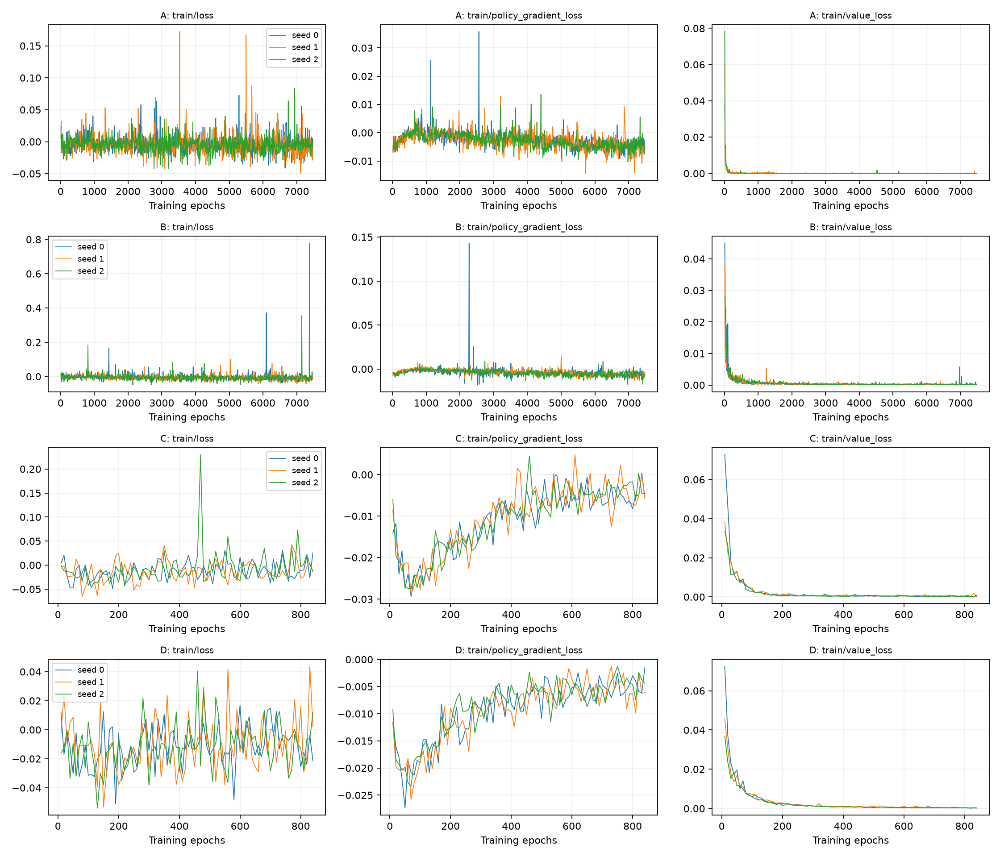

# DOPS-Serve：四组 PPO 训练实验

SB3 PPO，从头训练，每组 3 个 seed。各工况的模拟批次耗时除以该工况的全 NPU 耗时，再取等权平均，越低越好。

## 1. 四组训练方案

| 方案 | 观测 | 维度（固定 / 可变 decode） | 一次动作 | 步数 / 批次 |
| --- | --- | ---: | --- | ---: |
| A | 原始信息 + 算子类别 | 17 / 18 | 单算子二选一 | 9S |
| B | KV / 驻留 + 动作前缀 | 25 / 26 | 单算子二选一 | 9S |
| C | 原始信息 | 8 / 9 | 整段 9 位放置 | S |
| D | KV / 驻留 | 17 / 18 | 整段 9 位放置 | S |

- 原始信息：设备 timeline（3）＋阶段（2）＋decode 进度（1）；A 另含算子类别（9）。
- KV / 驻留：`ln(1+KV 长度)`（1）＋ NPU / PIM 权重驻留（14）；B 另含已有动作前缀（8）。
- 四组观测均含 prefill 长度和 batch；可变 decode 实验另含目标 decode 长度。每个批次有 S = 1 + ⌈decode 长度 / 4⌉ 个决策段。

## 2. 共同设置与实际训练预算

Qwen 1.8B，28 层，FP16，1 NPU + 2 PIM，冷缓存。层间共享放置，每 4 个 decode token 更新一次。prefill 取 64、256、1024，batch 取 1、4、16。

固定 decode=64 时，每批从 9 种工况中等概率采样。泛化评估使用 prefill 128、512 与 batch 2、8 的 4 种组合。下表为这轮的实际训练预算。

| 每个 seed | A / B | C / D |
| --- | ---: | ---: |
| 目标批次数 | 10,000 | 10,000 |
| 实际完整批次 | 10,012 | 10,119 |
| 环境步数 | 1,531,904 | 172,032 |
| Rollouts | 748 | 84 |
| 训练 epochs | 7,480 | 840 |
| Optimizer steps | 239,360 | 26,880 |

相同批次预算下，A/B 的优化步数是 C/D 的 **8.90 倍**。

可变 decode 取 64、128、512、1024，与上述 prefill 和 batch 组成 36 种等概率训练工况。A/B 每个 seed 训练 1,530,000 个目标环境步，C/D 为 170,000，每 20% 评估一次。泛化使用相同的 9 组 prefill 和 batch，decode 取 256、796，共 18 种。

Actor/Critic 各 2×64；rollout=2048，batch=64，每轮 10 epochs；lr=3e−4，γ=1，GAE λ=0.95，clip=0.2，ent_coef=0，未设 target_kl。

## 3. 四组结果与固定基线

以下为固定 decode=64 的 9 种训练工况，每组 3 个 seed 的均值 ± 样本标准差。Best 为周期评估最优，第 10,000 批为同预算检查点，Final 为最后一轮更新后。

| 方案 | Best | 第 10,000 批 | Final | Final − Best |
| --- | ---: | ---: | ---: | ---: |
| A | 0.5655 ± 0.0376 | 0.5865 ± 0.0491 | 0.5808 ± 0.0455 | +0.0153 |
| B | 0.5028 ± 0.0025 | 0.5100 ± 0.0122 | 0.5070 ± 0.0130 | +0.0042 |
| C | 0.5082 ± 0.0074 | 0.5092 ± 0.0078 | 0.5092 ± 0.0091 | +0.0010 |
| D | 0.5900 ± 0.0011 | 0.5901 ± 0.0011 | 0.5895 ± 0.0011 | -0.0005 |

| 固定基线 | 归一化批次耗时（9 种工况） |
| --- | ---: |
| 全 NPU | 1.0000 |
| 全 PIM | 1.4512 |
| Prefill NPU / Decode PIM | 0.6722 |
| 逐工况取最快固定策略 | 0.5648 |

按 9 种训练工况的 Final 选出 **B / seed 2**，归一化耗时 **0.4988**，4 种未见工况为 **0.5682**。

可变 decode 实验截至 11 月 15 日已完成初始评估。36 种训练工况上，A/B/C/D 的 Initial 分别为 1.0728、0.7717、0.9120、0.8539（3 个 seed 均值），Final 和 18 种未见工况结果待训练结束后评估。[逐工况 Initial](SB3_PPO/runs/mixed_decode_20261115/initial.csv) · [固定基线](SB3_PPO/runs/mixed_decode_accept_20261115_r2/fixed_baselines.json)

全部 seed 的训练结果

| 方案 / seed | Initial | Best | 第 10,000 批 | Final |
| --- | ---: | ---: | ---: | ---: |
| A / 0 | 1.0000 | 0.5633 | 0.5945 | 0.5921 |
| A / 1 | 1.4512 | 0.5291 | 0.5338 | 0.5307 |
| A / 2 | 1.6295 | 0.6042 | 0.6311 | 0.6196 |
| B / 0 | 1.0753 | 0.5049 | 0.5241 | 0.5221 |
| B / 1 | 0.9999 | 0.5036 | 0.5036 | 0.5003 |
| B / 2 | 1.0000 | 0.5000 | 0.5024 | 0.4988 |
| C / 0 | 1.3479 | 0.5051 | 0.5066 | 0.5048 |
| C / 1 | 1.3943 | 0.5029 | 0.5030 | 0.5032 |
| C / 2 | 1.3859 | 0.5167 | 0.5180 | 0.5197 |
| D / 0 | 1.4214 | 0.5913 | 0.5914 | 0.5906 |
| D / 1 | 1.3710 | 0.5896 | 0.5896 | 0.5896 |
| D / 2 | 1.4039 | 0.5892 | 0.5894 | 0.5884 |

## 4. 四组实验耗时曲线

固定 decode=64，每 500 批评估一次。横轴为累计训练批次，纵轴为 9 种训练工况的平均归一化耗时。

## 5. 训练 Loss

原始日志，无平滑；横轴为训练 epochs。A/B 与 C/D 分别使用各自的 epoch 范围，展示 Total loss、Policy-gradient loss 和 Value loss。

## 6. Critic 拟合与 KL

末次训练指标与训练期间峰值

| 方案 / seed | 末次 Value loss | Explained variance | 末次 approx KL | 峰值 approx KL |
| --- | ---: | ---: | ---: | ---: |
| A / 0 | 7.38e-06 | 0.999538 | 0.0046 | 0.0189 |
| A / 1 | 3.60e-05 | 0.995986 | 0.0035 | 0.0959 |
| A / 2 | 2.21e-05 | 0.999178 | 0.0060 | 0.0379 |
| B / 0 | 1.39e-04 | 0.991651 | 0.0067 | 0.1696 |
| B / 1 | 1.29e-04 | 0.995539 | 0.0048 | 0.0496 |
| B / 2 | 2.29e-04 | 0.981037 | 0.0085 | 0.1302 |
| C / 0 | 4.81e-04 | 0.985445 | 0.0097 | 0.0175 |
| C / 1 | 2.87e-04 | 0.987090 | 0.0123 | 0.0187 |
| C / 2 | 8.13e-04 | 0.983070 | 0.0068 | 0.0201 |
| D / 0 | 2.61e-04 | 0.992086 | 0.0100 | 0.0144 |
| D / 1 | 3.60e-04 | 0.986410 | 0.0123 | 0.0165 |
| D / 2 | 2.47e-04 | 0.993466 | 0.0074 | 0.0167 |

---

[运行与实现说明](SB3_PPO/README.md) · [完整实验分析](SB3_PPO/runs/mixed_workload_20261113/report.md) · [训练输出与模型](SB3_PPO/runs/mixed_workload_20261113)
