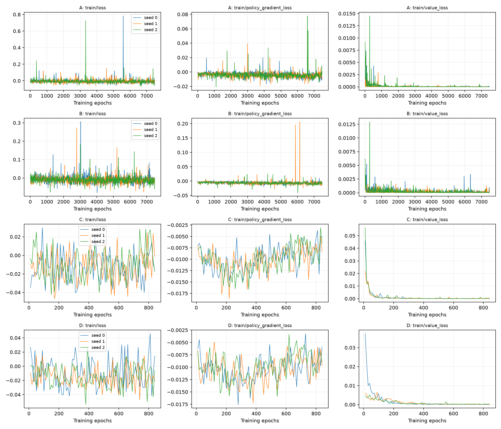

# DOPS-Serve：四组 PPO 训练实验

四组策略均用 SB3 PPO 从头训练，每组 3 个 seed。归一化耗时为各工况的模拟批次耗时与该工况全 NPU 耗时之比，再对工况取等权平均。全 NPU 的归一化耗时为 1。

## 1. 四组训练方案

| 方案 | 观测 | 维度（固定 / 可变 decode） | 一次动作 | 步数 / 批次 |
| --- | --- | ---: | --- | ---: |
| A | 原始信息 + 算子类别 | 17 / 18 | 单算子二选一 | 9S |
| B | KV / 驻留 + 动作前缀 | 25 / 26 | 单算子二选一 | 9S |
| C | 原始信息 | 8 / 9 | 整段 9 位放置 | S |
| D | KV / 驻留 | 17 / 18 | 整段 9 位放置 | S |

- 原始信息：设备 timeline（3）＋阶段（2）＋decode 进度（1）；A 另含算子类别（9）。
- KV / 驻留：`ln(1+KV 长度)`（1）＋ NPU / PIM 权重驻留（14）；B 另含已有动作前缀（8）。
- 四组观测均含 prefill 长度和 batch；可变 decode 实验另含目标 decode 长度。每个批次有 S = 1 + ⌈decode 长度 / 4⌉ 个决策段。

## 2. 共同设置与实际训练预算

Qwen 1.8B，28 层，FP16，1 NPU + 2 PIM，冷缓存。层间共享放置，每 4 个 decode token 更新一次。

prefill 是每个请求的输入长度，取 64、256、1024 token。每种输入长度都分别搭配推理 batch size 1、4、16，得到 3 × 3 = 9 组。每组再分别搭配 decode 长度 64、128、512、1024 token，得到 9 × 4 = 36 种训练工况。每个 episode 开始时从这 36 种组合中等概率抽取一种。

- **一个推理批次（episode）**覆盖一批同长请求从 prefill 到 decode 结束的全过程。例如 prefill=256、batch size=4、decode=512 表示同时处理 4 个请求，每个请求输入 256 token、输出 512 token。这一批共 129 个决策段，A/B 需要 1,161 个环境步，C/D 需要 129 个环境步。
- **一次 rollout** 连续采集 2,048 个环境步，供一轮 PPO 训练使用。一次 rollout 可以跨过多个推理批次，也可以在某一批中途结束。
- **一个 epoch** 把这 2,048 个样本打乱并遍历一遍。每 64 个样本组成一个**训练小批次（mini-batch）**，更新一次参数。每个 epoch 有 32 个小批次，同一份 rollout 数据训练 10 个 epoch，共更新 320 次。

| 每个 seed | A / B | C / D |
| --- | ---: | ---: |
| 目标环境步数 | 1,530,000 | 170,000 |
| 实际完整批次（seed 0 / 1 / 2） | 1,577 / 1,593 / 1,582 | 1,592 / 1,618 / 1,606 |
| 实际环境步数 | 1,531,904 | 172,032 |
| Rollouts | 748 | 84 |
| 训练 epochs | 7,480 | 840 |
| Optimizer steps | 239,360 | 26,880 |

每使用 20% 的目标环境步数，在全部 36 种训练工况上评估一次并保存检查点。泛化评估使用相同的 9 组 prefill 和 batch，decode 取 256、796，共 18 种工况。

Actor/Critic 各 2×64，lr=3e−4，γ=1，GAE λ=0.95，clip=0.2，ent_coef=0，未设 target_kl。

## 3. 四组结果与固定基线

下表给出 36 种训练工况的归一化耗时。每组报告 3 个 seed 的均值 ± 样本标准差。Best 取各 seed 历次周期评估的最低值，预算检查点取达到目标环境步数时的模型，Final 取最后一轮 PPO 更新后的模型。

| 方案 | Best | 预算检查点 | Final | Final − Best |
| --- | ---: | ---: | ---: | ---: |
| A | 0.4075 ± 0.0177 | 0.4332 ± 0.0090 | 0.4245 ± 0.0148 | +0.0170 |
| B | 0.4318 ± 0.0039 | 0.4855 ± 0.0826 | 0.4982 ± 0.0985 | +0.0665 |
| C | 0.4063 ± 0.0102 | 0.4063 ± 0.0102 | 0.4059 ± 0.0102 | -0.0004 |
| D | 0.4035 ± 0.0069 | 0.4059 ± 0.0035 | 0.4042 ± 0.0052 | +0.0007 |

| 固定基线 | 归一化批次耗时（36 种工况） |
| --- | ---: |
| 全 NPU | 1.0000 |
| 全 PIM | 0.8018 |
| Prefill NPU / Decode PIM | 0.4599 |
| 逐工况取最快固定策略 | 0.4131 |

在 18 种未见工况上，A、B、C、D 的 Final 归一化耗时分别为 0.3441、0.4321、0.3203、0.3168（3 个 seed 的均值）。按 36 种训练工况的 Final 归一化耗时选取的模型为 C / seed 2，在训练和未见工况上分别为 0.3994 和 0.3094，对应的平均绝对批次耗时为 790.603 ms 和 920.715 ms。

Bifocal 在相同的 54 种工况上测试了 16 组参数（seed 0）。下表与 PPO 使用相同的归一化口径，每个工况的批次耗时先除以该工况的全 NPU 批次耗时，再等权平均。两种共用参数的选择都只使用 36 种训练工况。

| Bifocal 选参方式 | 36 种训练工况 | 18 种未见工况 |
| --- | ---: | ---: |
| 按平均归一化耗时选共用参数（`h2_g0.5_p64_d512`、`h2_g0.5_p64_d1024` 并列） | 0.3744 | 0.3117 |
| 按平均绝对耗时选共用参数（`prefill16_a6_g0`） | 0.4274 | 0.3108 |
| 逐工况在 16 组参数中取最低值 | 0.3512 | 0.2798 |

两组并列参数在 54 种工况上的逐项耗时相同。最后一行的未见工况数值使用该工况自身的结果选参。[逐工况归一化耗时](SB3_PPO/runs/bifocal_mixed_decode_20261116/normalized_latency.csv) · [逐工况绝对耗时（按毫秒选参）](SB3_PPO/runs/bifocal_mixed_decode_20261116/latency_summary_ms.csv) · [16 组参数](SB3_PPO/runs/bifocal_mixed_decode_20261116/candidates.json) · [搜索与回放代码](SB3_PPO/dops_sb3/bifocal_search.py)

全部 seed 的训练结果

| 方案 / seed | Initial | Best | 预算检查点 | Final |
| --- | ---: | ---: | ---: | ---: |
| A / 0 | 1.0000 | 0.4084 | 0.4397 | 0.4414 |
| A / 1 | 0.8018 | 0.4247 | 0.4369 | 0.4144 |
| A / 2 | 1.4165 | 0.3894 | 0.4229 | 0.4175 |
| B / 0 | 0.4779 | 0.4327 | 0.4490 | 0.4740 |
| B / 1 | 1.2961 | 0.4352 | 0.5800 | 0.6066 |
| B / 2 | 0.5409 | 0.4275 | 0.4275 | 0.4141 |
| C / 0 | 0.8930 | 0.4181 | 0.4181 | 0.4177 |
| C / 1 | 0.8705 | 0.3995 | 0.3995 | 0.4007 |
| C / 2 | 0.9726 | 0.4014 | 0.4014 | 0.3994 |
| D / 0 | 0.8801 | 0.3962 | 0.4032 | 0.4002 |
| D / 1 | 0.9152 | 0.4046 | 0.4046 | 0.4023 |
| D / 2 | 0.7663 | 0.4098 | 0.4098 | 0.4101 |

## 4. 四组实验耗时曲线

每完成 20% 的目标环境步数评估一次。横轴为目标环境步数的完成比例，纵轴为 36 种训练工况的平均归一化耗时。同色细线分别表示该方案的 3 个 seed，粗线表示它们在各评估点的均值。

## 5. 训练 Loss

原始日志，无平滑；横轴为训练 epochs。A/B 与 C/D 分别使用各自的 epoch 范围，展示 Total loss、Policy-gradient loss 和 Value loss。

## 6. Critic 拟合与 KL

末次训练指标与训练期间峰值

| 方案 / seed | 末次 Value loss | Explained variance | 末次 approx KL | 峰值 approx KL |
| --- | ---: | ---: | ---: | ---: |
| A / 0 | 4.43e-06 | 0.998074 | 0.0064 | 0.0998 |
| A / 1 | 7.19e-07 | 0.999441 | 0.0165 | 0.0982 |
| A / 2 | 1.80e-05 | 0.997263 | 0.0154 | 0.0956 |
| B / 0 | 1.70e-05 | 0.993051 | 0.0050 | 0.2602 |
| B / 1 | 7.54e-06 | 0.994117 | 0.0151 | 0.2224 |
| B / 2 | 1.42e-04 | 0.957866 | 0.0022 | 0.1441 |
| C / 0 | 3.34e-05 | 0.996365 | 0.0098 | 0.0230 |
| C / 1 | 8.38e-05 | 0.994053 | 0.0068 | 0.0171 |
| C / 2 | 5.51e-04 | 0.981353 | 0.0104 | 0.0207 |
| D / 0 | 8.18e-05 | 0.991715 | 0.0098 | 0.0137 |
| D / 1 | 3.59e-04 | 0.974990 | 0.0153 | 0.0153 |
| D / 2 | 2.30e-04 | 0.991045 | 0.0124 | 0.0134 |

---

[运行与实现说明](SB3_PPO/README.md) · [完整实验结果](SB3_PPO/runs/mixed_decode_20261115/report.md) · [训练输出与模型](SB3_PPO/runs/mixed_decode_20261115) · [固定 decode=64 的前轮结果](SB3_PPO/runs/mixed_workload_20261113/report.md)
