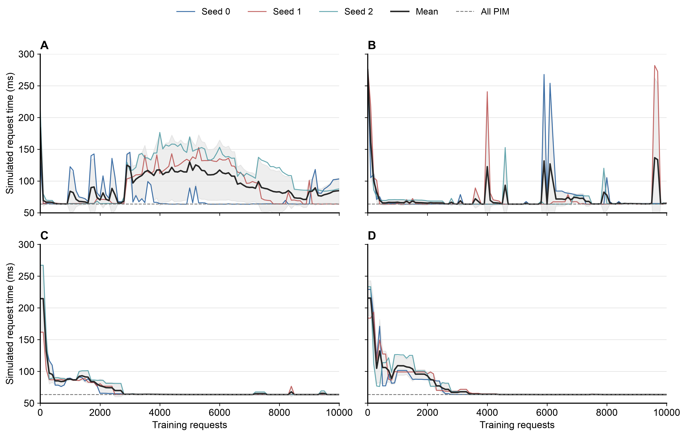
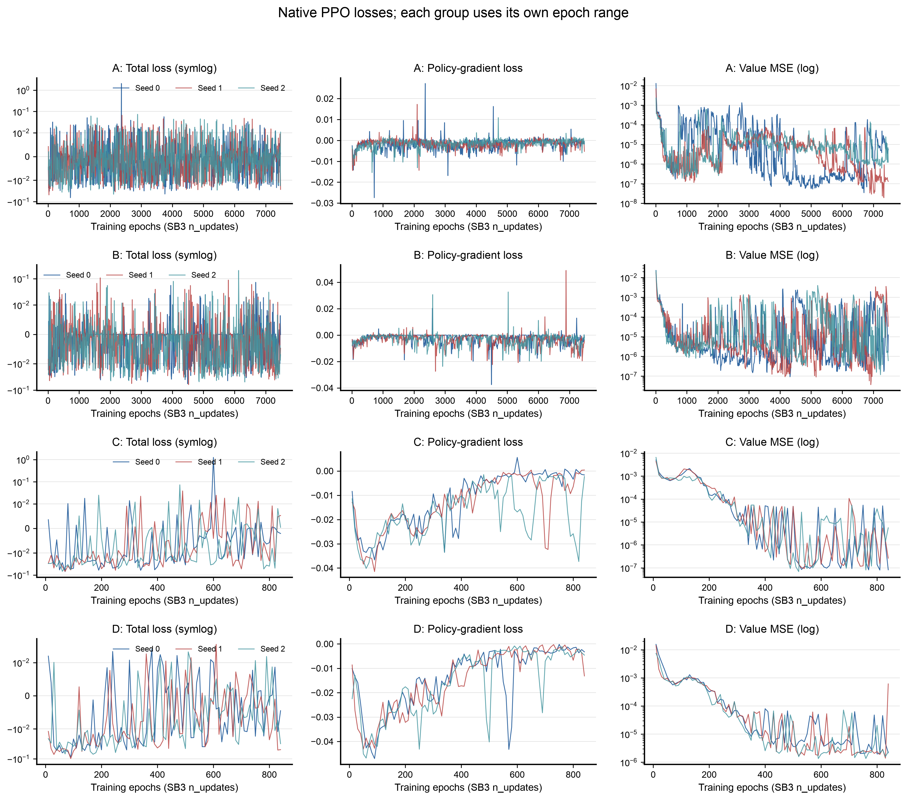

# DOPS-Serve：四组 PPO 训练实验

SB3 PPO，从头训练，每组 3 个 seed。以下请求耗时均为模拟结果，单位 ms，越低越好。

## 1. 四组训练方案

| 方案 | 观测 | 维度 | 一次动作 | 步数 / 请求 |
| --- | --- | ---: | --- | ---: |
| A | 原始信息 + 算子类别 | 15 | 单算子二选一 | 153 |
| B | KV / 驻留 + 动作前缀 | 23 | 单算子二选一 | 153 |
| C | 原始信息 | 6 | 整段 9 位放置 | 17 |
| D | KV / 驻留 | 15 | 整段 9 位放置 | 17 |

- 原始信息：设备 timeline（3）＋阶段（2）＋decode 进度（1）；A 另含算子类别（9）。
- KV / 驻留：`ln(1+KV 长度)`（1）＋ NPU / PIM 权重驻留（14）；B 另含已有动作前缀（8）。
- B/D 使用 KV / 驻留替换原始信息。

## 2. 共同设置与实际训练预算

Qwen 1.8B，28 层，FP16，batch=1，64 prefill + 64 decode；1 NPU + 2 PIM，冷缓存。层间共享放置，每 4 个 decode token 更新一次。

| 每个 seed | A / B | C / D |
| --- | ---: | ---: |
| 目标请求数 | 10,000 | 10,000 |
| 实际完整请求 | 10,012 | 10,119 |
| 环境步数 | 1,531,904 | 172,032 |
| Rollouts | 748 | 84 |
| 训练 epochs | 7,480 | 840 |
| Optimizer steps | 239,360 | 26,880 |

相同请求预算下，A/B 的优化步数是 C/D 的 **8.90 倍**。

Actor/Critic 各 2×64；rollout=2048，batch=64，每轮 10 epochs；lr=3e−4，γ=1，GAE λ=0.95，clip=0.2，ent_coef=0，未设 target_kl。

## 3. 四组结果与固定基线

每组 3 个 seed 的均值 ± 样本标准差。Best 为周期评估最优，第 10,000 请求为同预算检查点，Final 为最后一轮更新后。

| 方案 | Best | 第 10,000 请求 | Final | Best → Final 回退 |
| --- | ---: | ---: | ---: | ---: |
| A | 63.513 ± 0.160 | 84.709 ± 20.021 | 85.237 ± 19.870 | 21.723 |
| B | 63.470 ± 0.047 | 64.836 ± 0.747 | 64.953 ± 0.949 | 1.483 |
| C | 63.512 ± 0.000 | 63.523 ± 0.000 | 63.519 ± 0.006 | 0.007 |
| D | 63.448 ± 0.056 | 63.484 ± 0.059 | 63.484 ± 0.059 | 0.036 |

| 固定基线 | 模拟耗时（ms） |
| --- | ---: |
| 全 NPU | 279.856 |
| 全 PIM | 63.518 |
| Prefill NPU / Decode PIM | 149.054 |
| 随机放置（60 个计划） | 223.426 ± 16.876 |

四组都曾达到 63.4–63.7 ms，主要差别是后续更新能否保留结果。

全部 seed 的训练结果

| 方案 / seed | Initial | Best | 第 10,000 请求 | Final |
| --- | ---: | ---: | ---: | ---: |
| A / 0 | 131.805 | 63.416 | 103.167 | 103.798 |
| A / 1 | 205.106 | 63.426 | 63.426 | 64.276 |
| A / 2 | 214.148 | 63.698 | 87.535 | 87.636 |
| B / 0 | 280.734 | 63.498 | 64.495 | 64.495 |
| B / 1 | 278.979 | 63.416 | 65.693 | 66.044 |
| B / 2 | 266.060 | 63.496 | 64.320 | 64.320 |
| C / 0 | 214.813 | 63.512 | 63.523 | 63.512 |
| C / 1 | 161.777 | 63.512 | 63.523 | 63.523 |
| C / 2 | 267.176 | 63.512 | 63.523 | 63.523 |
| D / 0 | 229.137 | 63.416 | 63.416 | 63.416 |
| D / 1 | 183.891 | 63.512 | 63.512 | 63.512 |
| D / 2 | 233.343 | 63.416 | 63.523 | 63.523 |

## 4. 四组实验耗时曲线

每 100 个请求评估一次，横轴为累计训练请求数，纵轴为模拟耗时。

## 5. 训练 Loss

原始日志，无平滑；横轴为训练 epochs。A/B 与 C/D 分别使用各自的 epoch 范围，展示 Total loss、Policy-gradient loss 和 Value loss。

## 6. Critic 拟合与 KL

末次训练指标与训练期间峰值

| 方案 / seed | 末次 Value loss | Explained variance | 末次 approx KL | 峰值 approx KL |
| --- | ---: | ---: | ---: | ---: |
| A / 0 | 5.70e-6 | 0.999379 | 0.0035 | 1.4383 |
| A / 1 | 1.30e-7 | 0.999951 | 0.0994 | 0.3018 |
| A / 2 | 1.23e-6 | 0.999560 | 0.0034 | 0.2001 |
| B / 0 | 1.23e-5 | 0.995051 | 0.0017 | 0.3552 |
| B / 1 | 3.36e-5 | 0.982481 | 0.0042 | 0.1106 |
| B / 2 | 6.08e-7 | 0.999774 | 0.0033 | 0.1563 |
| C / 0 | 8.23e-8 | 0.999915 | 0.0038 | 0.0340 |
| C / 1 | 2.65e-7 | 0.999956 | 0.0007 | 0.0281 |
| C / 2 | 5.57e-6 | 0.998153 | 0.0003 | 0.0768 |
| D / 0 | 2.17e-6 | 0.999101 | 0.0040 | 0.0274 |
| D / 1 | 6.10e-4 | 0.776365 | 0.0415 | 0.0415 |
| D / 2 | 2.36e-6 | 0.999711 | 0.0054 | 0.0287 |

---

[运行与实现说明](SB3_PPO/README.md) · [完整实验分析](SB3_PPO/reports/2026-11-12_四组PPO实验结果分析.md) · [训练输出与模型](SB3_PPO/runs/obs_action_ablation)
