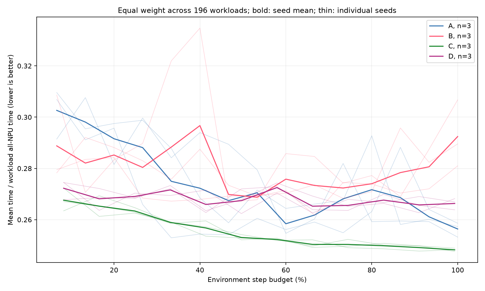
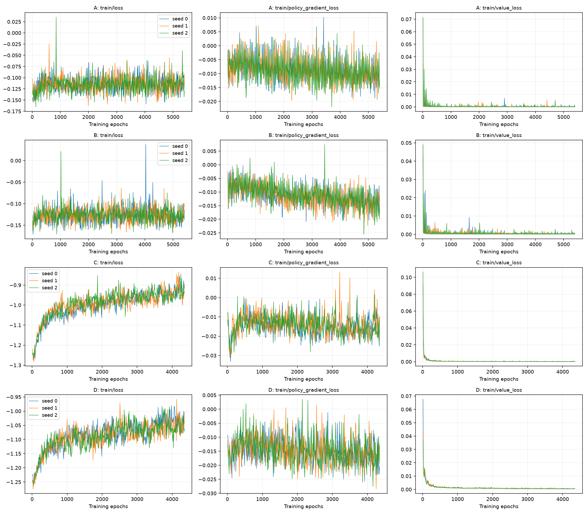
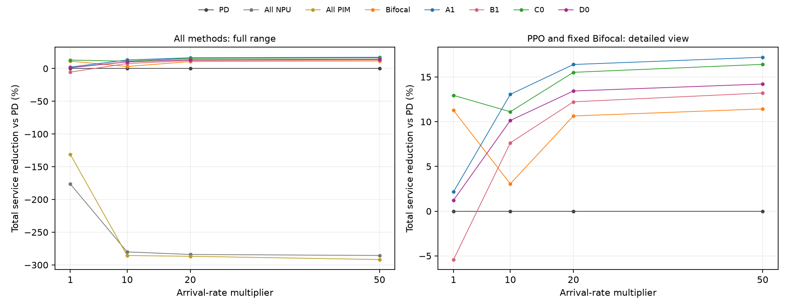

# DOPS-Serve：196 工况 PPO 训练与 BurstGPT 泛化

本页展示 A/B/C/D 四组方案的最终训练结果与 BurstGPT 泛化结果（2026-11-23）。每组独立训练 seed 0、1、2，共 12 个模型，均已完成训练及重载验收。全部结果来自解析模拟，并非 NPU/PIM 真机测量。

训练网格指标为各工况的模拟批次耗时 / 同工况全 NPU 耗时，再对 196 项等权平均，越低越好。BurstGPT 单独使用相对 PD 的总服务耗时降幅；两种指标不混用。

## 1. 四组训练方案

| 方案 | 观测 | 维度 | 一次动作 | 步数 / 批次 |
| --- | --- | ---: | --- | ---: |
| A | 原始信息 + 算子类别 | 18 | 单算子二选一 | 9S |
| B | KV / 驻留占比 + 动作前缀 | 26 | 单算子二选一 | 9S |
| C | 原始信息 | 9 | 整段 9 位放置 | S |
| D | KV / 驻留占比 | 18 | 整段 9 位放置 | S |

- 原始信息：设备 timeline（3）＋阶段（2）＋decode 进度（1）；A 另含算子类别（9）。
- KV / 驻留：`ln(1+KV 长度)`（1）＋ NPU / PIM 权重驻留占比（14）；B 另含动作前缀（8）。
- 四组共同包含输入长度、推理 batch 和已知目标输出长度；S 为一个 prefill 段加全部 decode 段。

## 2. 共同实验设置

Qwen 1.8B，28 层，FP16，1 NPU + 2 PIM，每个推理批次冷启动。prefill 和 decode 各取 64、256、512、1024、2048、4096、8192 token，推理 batch 为 1、4、8、16，共 196 工况。每个新批次独立、等概率、有放回抽取一种组合；开批时已知目标输出长度。

放置刷新间隔为 `min(256, ceil(decode_len / 16))`，七种输出长度依次对应 4、16、32、64、128、256、256 token。S 为一个 prefill 段加全部 decode 段：输出至 4096 时每批 17 段，输出 8192 时每批 33 段，A/B 分别需要 153 或 297 个环境步。每个真实 decode token 均推进模拟器。

64 环境 × 36 步，每轮 2,304 条 transition；mini-batch=64、10 epochs，每轮 360 次优化更新。Actor/Critic 各 2×64，lr=3e−4，γ=1，GAE λ=0.95，clip=0.2，ent_coef=0.2，vf_coef=0.5，max_grad_norm=0.5，未设 target_kl。

A/B 每段九项算子奖励在计算 GAE 前回填，C/D 每步按整段计奖。下文统一报告各模型训练结束后的 Final 结果；实际训练步数、样本数和完整配置见[详细实验报告](SB3_PPO/reports/2026-11-23_四组PPO训练结果/README.md)。

## 3. 最终结果与固定基线

196 工况，Final 归一化耗时取三 seed 均值 ± 样本标准差。相对 PD 降幅使用同一指标计算，正值表示改善。

| 方案 | Final 归一化耗时 | 相对 PD 降幅 |
| --- | ---: | ---: |
| A | 0.2539 ± 0.0041 | 8.88% |
| B | 0.2846 ± 0.0120 | -2.14% |
| C | 0.2481 ± 0.0006 | 10.97% |
| D | 0.2672 ± 0.0040 | 4.09% |

| 固定基线 | 196 工况归一化耗时 |
| --- | ---: |
| 全 NPU | 1.0000 |
| 全 PIM | 0.7089 |
| Prefill NPU / Decode PIM | 0.2786 |
| 逐工况取最快固定策略 | 0.2702 |

Final 归一化耗时由低至高为 **C、A、D、B**。12 个 Final 中指标最低的是 **C / seed 0：0.247388**。逐工况最快固定策略仅为上述三条固定策略集合的参考值。

BurstGPT 在测试前分别冻结 **A1、B1、C0、D0**，各自仅按 196 合成工况的 Final 分数选 seed。

### Bifocal：196 工况参数搜索

既有 16 组候选共 3,136 个组合已完成，447 个获选计划通过独立逐 token 回放。两组最好共用参数 `h2_g0.5_p64_d512` / `h2_g0.5_p64_d1024` 并列，逐工况耗时相同。

| Bifocal 选参方式 | 196 工况归一化耗时 | 平均批次耗时 / ms |
| --- | ---: | ---: |
| 按归一化耗时选一套共用参数 | 0.270870 | 6708.056 |
| 按绝对耗时选一套共用参数 | 0.276985 | 6338.175 |
| 逐工况从 16 候选中取最低值 | 0.239084 | 5653.476 |

主要口径为逐工况归一化后等权平均，与 PPO 一致。最好共用参数比 A 的 Final 均值慢 6.69%、比 B 快 4.82%；逐工况选参须分别挑参数。结果为候选集内解析模拟。新 BurstGPT 使用在此选定的共用参数 h2_g0.5_p64_d512，不用泛化结果重新调参。

[完整 Bifocal 报告、参数与计划](SB3_PPO/reports/2026-11-19_四组PPO训练结果/bifocal/README.md)

全部 seed 的最终结果

| 方案 / seed | Final 归一化耗时 |
| --- | ---: |
| A / 0 | 0.258532 |
| A / 1 | 0.250921 |
| A / 2 | 0.252201 |
| B / 0 | 0.296735 |
| B / 1 | 0.272733 |
| B / 2 | 0.284263 |
| C / 0 | 0.247388 |
| C / 1 | 0.248114 |
| C / 2 | 0.248655 |
| D / 0 | 0.263183 |
| D / 1 | 0.267313 |
| D / 2 | 0.271176 |

## 4. 四组实验耗时曲线

横轴为各模型训练预算的完成比例。每 82,944 环境步评估一次；同色细线为各 seed，粗线为组内均值。图中为周期评估，训练结束后的 Final 单列于结果表。

## 5. 训练 Loss

原始 SB3 日志，无平滑；横轴为训练 epochs。三个 seed 使用蓝、橙、绿细线，线宽 0.8，线性纵轴，不叠加均值线。Total loss 是最后一个 mini-batch 的值，其他指标沿用 SB3 原生记录；四组决策粒度不同，Loss 大小不作为组间调度性能排名。

## 6. Critic 拟合与 KL

末次训练指标与训练期间峰值

| 方案 / seed | 末次 Value loss | Explained variance | 末次 approx KL | 峰值 approx KL |
| --- | --- | --- | --- | --- |
| A / 0 | 1.96e-05 | 0.994124 | 0.0057 | 0.0253 |
| A / 1 | 2.03e-05 | 0.994477 | 0.0058 | 0.0269 |
| A / 2 | 3.40e-05 | 0.991061 | 0.0070 | 0.0222 |
| B / 0 | 6.90e-05 | 0.972385 | 0.0089 | 0.0195 |
| B / 1 | 7.52e-05 | 0.969996 | 0.0062 | 0.0215 |
| B / 2 | 9.05e-05 | 0.971269 | 0.0078 | 0.0204 |
| C / 0 | 1.40e-04 | 0.981915 | 0.0098 | 0.0198 |
| C / 1 | 1.46e-04 | 0.981947 | 0.0092 | 0.0233 |
| C / 2 | 1.82e-04 | 0.966806 | 0.0084 | 0.0188 |
| D / 0 | 5.54e-04 | 0.951370 | 0.0096 | 0.0176 |
| D / 1 | 4.87e-04 | 0.960716 | 0.0080 | 0.0240 |
| D / 2 | 7.07e-04 | 0.947420 | 0.0130 | 0.0218 |

十二个模型记录的 loss 均为有限值。Critic 拟合与 KL 用于训练诊断，放置性能以 Final 耗时及 BurstGPT 泛化结果衡量。

## 7. 新 BurstGPT 泛化（2026-11-23）

实验于 2026-11-23 12:16:05（北京时间）完成，9 个计算/报告作业均正常退出。A/B/C/D 在运行前分别按 196 合成工况的 Final 成绩冻结为 **A1、B1、C0、D0**；这里的数字表示独立训练的 seed，不是算子执行阶段。每个方案只测这一个预选模型。

从原 CSV 抽取 16×512=8,192 条新请求，保留输入/输出长度配对与到达关系；原库输入超过 8192 的 105 条（约 0.0075%）被排除，旧 2,048 条样本及结果不复用。固定 1 秒窗末组批，batch 1–16，超出按 FCFS 拆分；设备忙时按批次排队。按批内最长输入/最长输出形状执行，每批冷启动，已知输出长度。这里只模拟执行耗时，不计算法 CPU 开销，不做真实文本生成。

| 到达率 | 请求数 | 实际批次数 | 平均 batch | batch=16 批数 |
| --- | --- | --- | --- | --- |
| 1× | 8192 | 4169 | 1.96 | 8 |
| 10× | 8192 | 1001 | 8.18 | 225 |
| 20× | 8192 | 792 | 10.34 | 349 |
| 50× | 8192 | 652 | 12.56 | 443 |

主指标为 **1 − 方法总服务耗时 / PD 总服务耗时**；正值为改善。所有方法在同一到达率下执行完全相同的批次，主指标不含组批及排队时间。

| 方法 | 原速 1× | 10× | 20× | 50× |
| --- | --- | --- | --- | --- |
| PD | +0.00% | +0.00% | +0.00% | +0.00% |
| 全 NPU | -176.52% | -280.10% | -284.01% | -285.56% |
| 全 PIM | -131.33% | -285.61% | -286.80% | -291.77% |
| Bifocal（固定参数） | +11.27% | +3.05% | +10.64% | +11.43% |
| A1 | +2.17% | +13.06% | +16.40% | +17.21% |
| B1 | -5.41% | +7.64% | +12.23% | +13.21% |
| C0 | +12.95% | +11.12% | +15.52% | +16.41% |
| D0 | +1.23% | +10.14% | +13.44% | +14.21% |

原速下 **C0 最好，服务耗时比 PD 低 12.95%**；10×、20×、50× 下 **A1 最好，分别低 13.06%、16.40%、17.21%**。B1 在原速下比 PD 慢 **5.41%**，并非所有 PPO 模型在所有负载下都有收益。固定参数 Bifocal 四档分别改善 11.27%、3.05%、10.64%、11.43%。这是同一固定样本上、每方案一个预选 seed 的结果，不是三 seed 平均，也没有据此估计训练随机性的置信区间。

原速下各方法的吞吐接近 58.91 token/s，主要受请求到达节奏限制，不能把服务耗时降幅直接当作吞吐增益。50× 下，A1 的 E2E P95 为 **76.05 s**，PD 为 **92.37 s**（降低 17.66%）；吞吐分别为 **793.23** 与 **665.40 token/s**（提高 19.21%）。这些数值包含固定时间窗、排队和排空，并排除 PPO 决策与 Bifocal 搜索 CPU 时间。

原始时间戳只有整数秒，10×/20×/50× 为人为压缩到达间隔；该结果不覆盖未知 EOS、热缓存或连续动态补批。完整报告分别列出主实验与在线指标，并保留所有基线的负收益。

[完整 BurstGPT 报告](SB3_PPO/reports/2026-11-20_BurstGPT固定时间窗泛化/README.md) · [32 组完整指标](SB3_PPO/reports/2026-11-20_BurstGPT固定时间窗泛化/metrics.csv) · [验收记录](SB3_PPO/reports/2026-11-20_BurstGPT固定时间窗泛化/validation.json)

---

[完整四组结果与验证](SB3_PPO/reports/2026-11-23_四组PPO训练结果/README.md) · [逐工况最终结果](SB3_PPO/reports/2026-11-23_四组PPO训练结果/per_workload_results.json) · [实验设置](SB3_PPO/reports/2026-11-23_四组PPO训练结果/experiment_settings.json)
