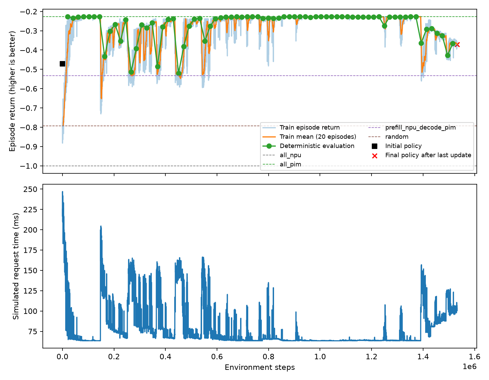
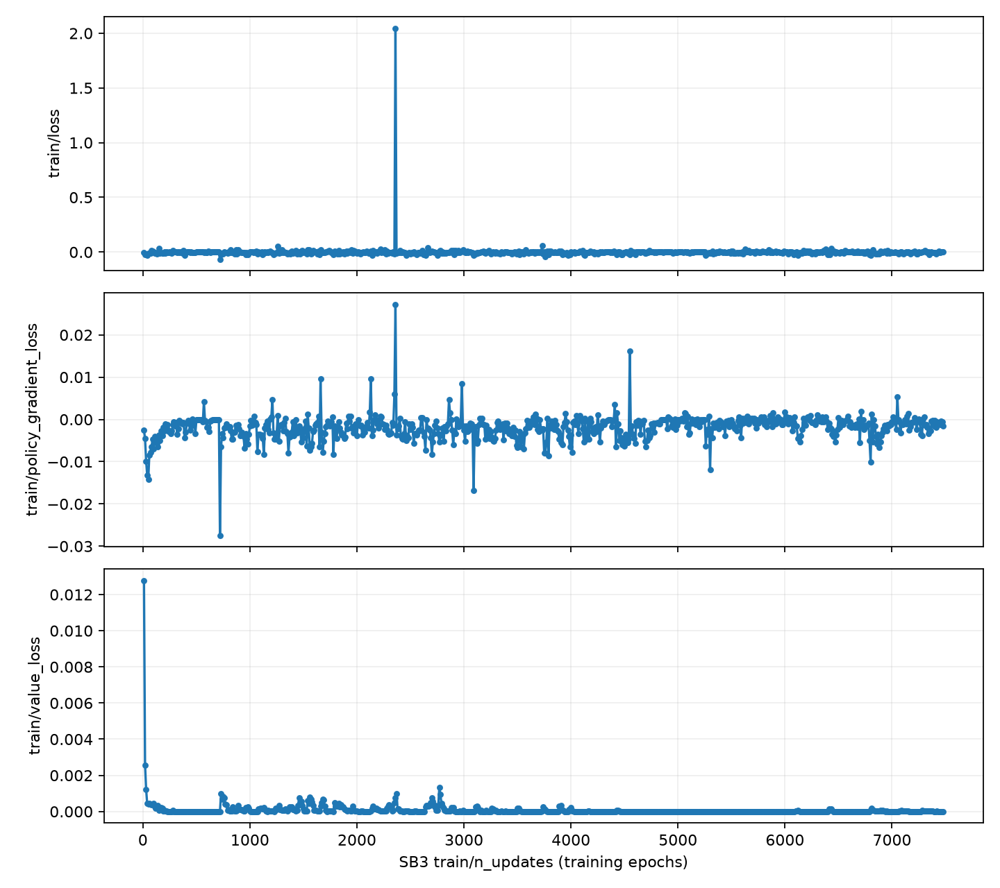

# SB3 PPO CPU 正式训练结果（2026-10-28）

CPU 作业正常完成，训练预算已跑满。策略在早期明显改善，最佳结果接近全 PIM 基线，但训练中多次回退，末期出现持续退化，不能判定为稳定收敛。以下耗时均为环境模拟的单请求耗时，不是实际 NPU/PIM 硬件测量值。

**作业完成情况**

| 项目 | 结果 |
| --- | --- |
| Slurm 作业 | 16252628，sb3-ppo-s0 |
| 状态 / 退出码 | COMPLETED / 0:0；batch、extern 也均正常完成 |
| 节点 | l01c02n3，CPU 训练 |
| 开始时间 | 2026-10-27 12:07:10，北京时间 |
| 结束时间 | 2026-10-28 09:02:51，北京时间 |
| 作业总耗时 | 20 小时 55 分 41 秒 |
| 训练计时 | 75,081.14 秒，约 20 小时 51 分 21 秒 |
| 目标 / 实际环境步数 | 1,530,000 / 1,531,904 |
| 完整 episode | 10,012，每个 153 步；另有 68 步未结束片段 |
| 平均训练吞吐 | 20.40 env steps/s |
| Rollout 数 | 748，每次 2,048 步；完成完整 rollout 后退出，因而略超过目标预算 |
| 定期评估 / checkpoint | 74 次 / 74 份，每 20,480 步一次 |

4 天是 Slurm 运行上限，训练完成预设步数后正常退出，并非超时或中断。

固定 Qwen 1.8B 架构，FP16、batch 1、prompt 64、decode 64；跨层复用决策，decode 每 4 token 刷新一次。使用原生 SB3 PPO，无 BC，seed 0。主要参数：learning_rate=3e-4、gamma=1、gae_lambda=0.95、batch_size=64、n_epochs=10、clip_range=0.2、ent_coef=0、vf_coef=0.5、max_grad_norm=0.5；Actor/Critic 各两层 64 单元。HPC 版本为 SB3 2.9.2、PyTorch 2.14.1+cpu、Gymnasium 1.4.0。

**策略结果**

Episode 总 Reward = −模拟请求耗时 / C，C=0.2798555601750934 秒，因此 Reward 越高（越接近 0）越好。初始、最佳、最终策略使用确定性动作；随机基线是 20 次随机策略的均值。

| 策略 | Reward | 模拟请求耗时（ms） | 相对全 NPU 加速比 |
| --- | ---: | ---: | ---: |
| 全 NPU | −1.000000 | 279.856 | 1.000× |
| 全 PIM | −0.226966 | 63.518 | 4.406× |
| Prefill NPU / Decode PIM | −0.532609 | 149.054 | 1.878× |
| 随机策略均值 | −0.792914 | 221.901 | — |
| 初始 PPO 策略 | −0.470974 | 131.805 | 2.123× |
| 最佳评估策略（737,280 步） | **−0.226603** | **63.416** | **4.413×** |
| 最终 PPO 策略（最后一次更新后） | −0.370898 | 103.798 | 2.696× |

- 最佳策略比初始策略减少 51.89% 耗时，但只比全 PIM 减少 0.16%（约 0.102 ms）。当前实验尚未显示相对简单基线有实质性的调度优势。
- 最终策略比初始策略减少 21.25% 耗时，但比最佳策略增加 63.68% 耗时，比全 PIM 增加 63.42% 耗时。
- 最佳策略的主算子选择为：prefill 的 K、V 投影放 NPU，decode 的 V 投影放 NPU，其余主算子放 PIM；16 个 decode 段的决策一致。Add、Norm 和非线性算子继续按环境的跟随规则执行。

**Reward 曲线解读**

第一轮定期评估（20,480 步）的 Reward 已达到 −0.227044，接近全 PIM。此后出现多次明显回退，随后又恢复。最佳定期评估出现在 737,280 步；中后段较长时间维持在全 PIM 附近，但约 139 万步后再次退化，直至训练结束也未恢复最佳水平。

前 100 个训练 episode 的平均 Reward 为 −0.646439，最后 100 个为 −0.366448；对应平均模拟耗时从 180.909 ms 降至 102.553 ms。这说明相对初期存在改善，但不能掩盖最终策略相对最佳策略的回退。训练 episode 使用随机采样动作，应与绿色确定性评估曲线分开理解。

最后一次定期评估位于 1,515,520 步，Reward 为 −0.366005；表中的最终值 −0.370898 是最后一次参数更新完成后重新评估的结果，两者并不相同。

**Loss 与更新情况**

| 原生 SB3 指标 | 首次记录 | 最终记录 |
| --- | ---: | ---: |
| train/value_loss | 0.0127764 | 0.000005701 |
| train/explained_variance | −9.0790 | 0.999379 |
| train/policy_gradient_loss | −0.00254652 | −0.00159775 |
| train/approx_kl | 0.00957722 | 0.00351582 |
| train/loss | −0.00446016 | 0.00149449 |

Value loss 下降、explained variance 上升，说明 Critic 对所记录训练目标的拟合改善；这不代表 Actor 策略持续变好。记录中存在尖峰：train/approx_kl 最大为 1.4383194，记录在 149,504 环境步的日志行；train/loss 最大为 2.046057，记录在 485,376 步的日志行。它们提示部分更新变化较大，但目前没有证据将末期退化归因于某一个参数或尖峰。

Loss 图取自 SB3 原生日志，横轴为 train/n_updates（累计训练 epoch），不是环境步数。748 次 rollout 更新、每次 10 个 epoch，对应累计 7,480 个 epoch。原生 train/loss 记录的是对应更新的最后一个 minibatch loss，不能将其当作整个 rollout 的平均 Loss。

**证据与验收**

已通过 data 节点取回完整训练输出，包括 TensorBoard 事件、Monitor CSV、progress.csv、评估 NPZ、74 个 checkpoint、初始/最佳/最终模型和训练日志。

本地执行现有验收入口 `.venv/bin/python -m dops_sb3.verify_run runs/ppo_seed0`，退出码 0，返回 `verified: true`。检查确认：Loss/KL 全部有限；初始与最终模型参数不同；TensorBoard 包含 value_loss 与评估 Reward；最终模型重载后在本地环境的确定性评估结果与 HPC summary.final 完全一致；图表、最佳模型与 checkpoint 均存在。

- [原始结果目录](../runs/ppo_seed0)
- [最终汇总 JSON](../runs/ppo_seed0/summary.json)
- [训练日志](../runs/train_16252628.out)
- [最佳模型](../runs/ppo_seed0/best/best_model.zip)
- [最终模型](../runs/ppo_seed0/last_model.zip)

结果覆盖一个 seed、一个固定请求形状及当前模拟器配置，不能据此推断多 seed 稳定性或其他模型/长度的泛化表现。后续排查应保留最佳与最终模型的对照，重点检查约 139 万步之后策略变化及对应更新记录；当前结果不支持仅靠增加训练步数来解决退化。
