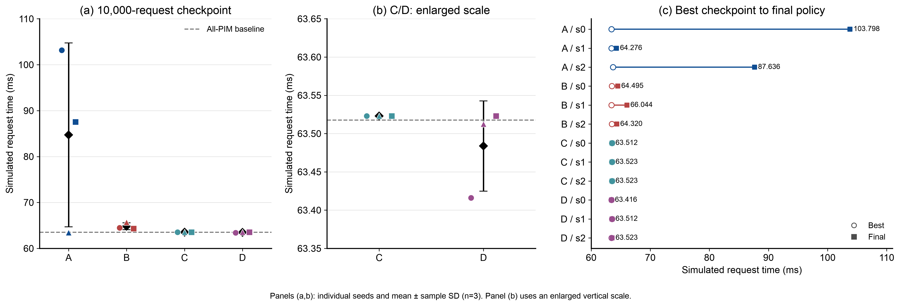
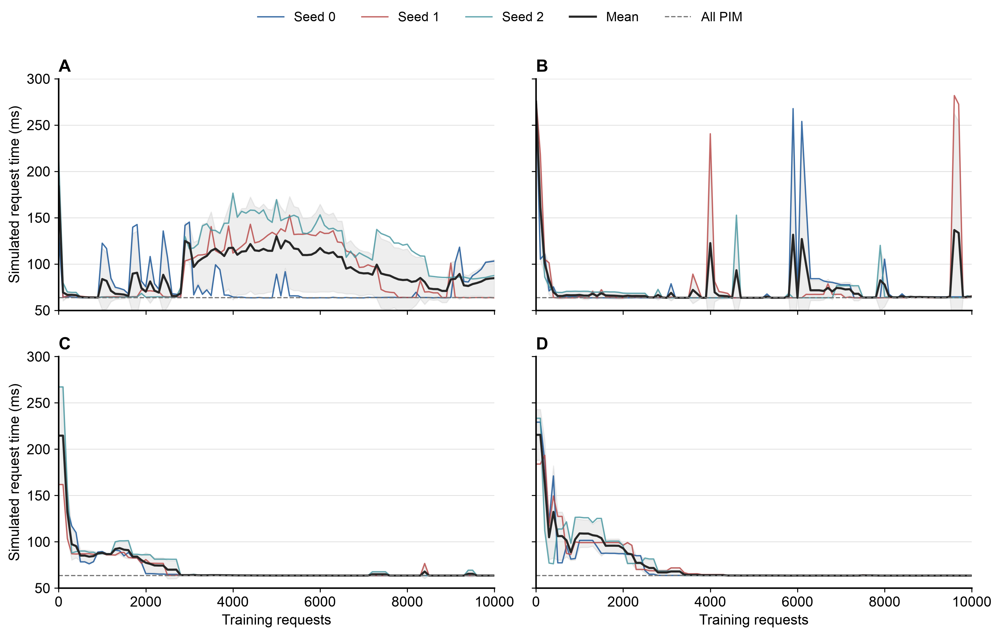
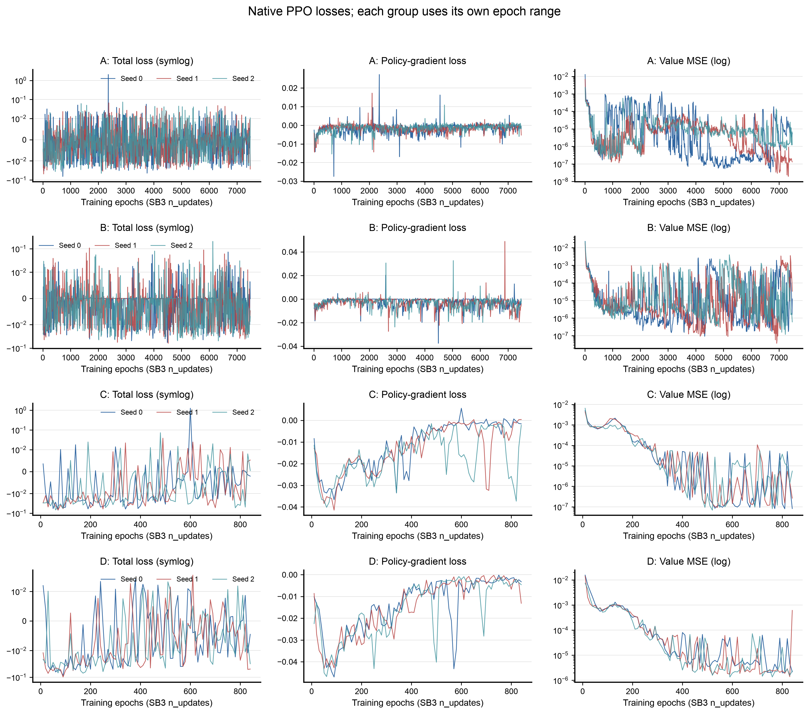
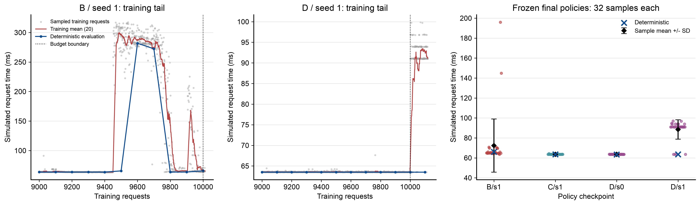

# 四组 PPO 实验结果分析

核对日期：2026-11-12。时间均为北京时间；性能数值均为模拟器中的完整请求耗时，不是物理设备实测。

## 完成情况与主要结果

12 次训练与 1 次汇总作业均已成功完成，Slurm 状态全部为 `COMPLETED / 0:0`。最后一次训练 A/seed2 于 **2026-11-12 08:39:12** 结束，汇总于 **08:39:29** 完成。12 次训练退出前的模型重载检查全部通过。本地已取回全部检查点、模型、TensorBoard、原始日志与对照结果，约 219 MB；本次又用固定放置完整回放全部 12 个 final 结果，均与 summary 一致。

四组都曾找到约 63.4–63.7 ms 的策略，主要差异发生在训练后期能否保留这种放置。A 的两个 seed 明显回退；B 的结束结果更集中，但过程中仍有大幅突变；C/D 的确定性结束结果接近全 PIM 基线。D 的确定性曲线很平稳，但 D/seed1 在最后一个 rollout 的随机采样表现明显变差。

以下均值 ± **样本标准差**来自每组 3 个 seed。

| 组别 | Best（ms） | 10,000 请求 Budget（ms） | Final（ms） |
| --- | --- | --- | --- |
| A | 63.513 ± 0.160 | 84.709 ± 20.021 | 85.237 ± 19.870 |
| B | 63.470 ± 0.047 | 64.836 ± 0.747 | 64.953 ± 0.949 |
| C | 63.512 ± 0.000 | 63.523 ± 0.000 | 63.519 ± 0.006 |
| D | 63.448 ± 0.056 | 63.484 ± 0.059 | 63.484 ± 0.059 |

## 1. 四组实际比较的内容

| 组别 | 观测 | 动作 | 每个请求 env steps |
| --- | --- | --- | ---: |
| A | 原始 15 维：3 个设备时间线、2 维阶段、decode 进度、9 维算子位置 | 每次一个算子，Discrete(2) | 153 |
| B | 增强 23 维：当前 KV 长度 1 + 权重驻留 14 + 已选动作前缀 8 | 每次一个算子，Discrete(2) | 153 |
| C | 原始信息的段边界版本 6 维：原始观测去掉 9 维算子位置 | 每次一段的 9 个二元选择，MultiBinary(9) | 17 |
| D | 增强 15 维：当前 KV 长度 1 + 权重驻留 14 | 每次一段的 9 个二元选择，MultiBinary(9) | 17 |

共同 workload 为 Qwen 1.8B、28 层、FP16、batch=1、64-token prefill + 64-token decode；层间共享放置，每 4 个 decode token 复用一次选择，共 17 段。模拟硬件为 1 NPU + 2 PIM，初始冷缓存。共同参数为 CPU、单环境、算法线程 1，actor/critic 各两层 64 单元，learning_rate=3e−4，gamma=1，gae_lambda=0.95，n_steps=2048，batch_size=64，n_epochs=10，clip_range=0.2，ent_coef=0，vf_coef=0.5，max_grad_norm=0.5，advantage normalization 开启；未设 target_kl。

HPC 软件为 SB3 2.9.2、Gymnasium 1.4.0、PyTorch 2.14.1+cpu。全部 12 份配置、预算及实际计数已核对。A0 的 final 放置与耗时还与历史 `runs/ppo_seed0` 完全一致。

输入/输出维数不同，参数量也随之变化：A/B/C/D 分别为 10,563 / 11,587 / 9,866 / 11,018；隐藏层宽度相同不代表总参数量完全相同。

| 项目 | A/B 每个 seed | C/D 每个 seed |
| --- | ---: | ---: |
| 目标请求数 | 10,000 | 10,000 |
| 实际 env steps | 1,531,904 | 172,032 |
| 完整请求数 + 未完成尾部步数 | 10,012 + 68 | 10,119 + 9 |
| 完整 rollouts | 748 | 84 |
| 训练 epochs | 7,480 | 840 |
| optimizer steps | 239,360 | 26,880 |

每 100 请求评估并保存。Budget 是恰好第 10,000 请求处的检查点；Final 是最后完整 rollout 更新后的模型；Best 是周期性确定性评估选出的模型，本次各 best 首次出现位置均在 10,000 请求以内。三者分别报告，避免把原生 rollout 超出预算后的模型与同预算模型混用。A/B 相比 C/D 进行了约 8.90 倍 optimizer steps，因此跨动作粒度的比较不是只改变 reward 聚合。

## 2. 全部 seed、基线与同预算比较

下面四列策略耗时单位均为 ms。

| 组别/seed | Initial | Best | Budget | Final | 首次 best 请求数 | 训练调用小时 |
| --- | --- | --- | --- | --- | --- | --- |
| A/0 | 131.805 | 63.416 | 103.167 | 103.798 | 4700 | 20.780 |
| A/1 | 205.106 | 63.426 | 63.426 | 64.276 | 9400 | 22.836 |
| A/2 | 214.148 | 63.698 | 87.535 | 87.636 | 600 | 23.007 |
| B/0 | 280.734 | 63.498 | 64.495 | 64.495 | 5100 | 21.177 |
| B/1 | 278.979 | 63.416 | 65.693 | 66.044 | 1100 | 21.159 |
| B/2 | 266.060 | 63.496 | 64.320 | 64.320 | 5100 | 20.452 |
| C/0 | 214.813 | 63.512 | 63.523 | 63.512 | 5500 | 20.719 |
| C/1 | 161.777 | 63.512 | 63.523 | 63.523 | 4500 | 21.115 |
| C/2 | 267.176 | 63.512 | 63.523 | 63.523 | 6900 | 21.217 |
| D/0 | 229.137 | 63.416 | 63.416 | 63.416 | 5700 | 21.303 |
| D/1 | 183.891 | 63.512 | 63.512 | 63.512 | 6200 | 21.115 |
| D/2 | 233.343 | 63.416 | 63.523 | 63.523 | 9800 | 21.756 |

| 固定基线 | 完整请求耗时（ms） |
| --- | ---: |
| 全 NPU | 279.856 |
| 全 PIM | 63.518 |
| Prefill NPU / Decode PIM | 149.054 |
| 随机放置，3 个 seed 合计 60 个不同采样计划 | 223.426 ± 16.876 |

全 PIM 已达 63.517819 ms；C 的 budget 为 63.522854 ms，平均只慢约 0.0050 ms；D 的 budget 平均为 63.483777 ms，只快约 0.0340 ms。全实验 best 为 63.415978 ms，相比全 PIM 提升约 **0.1603%**，尚无全局最优证明。当前工作负载中，学到“绝大多数算子选 PIM”已经获得主要收益，增强观测在 C/D 之间的额外收益空间很小。

Best 到 Final 的组均值回退分别为 A **21.723 ms**、B **1.483 ms**、C **0.0069 ms**、D **0.0356 ms**。A/B 同样能够到达低耗时区域，区别集中在后续更新与保留结果，而非完全没有学到过可用放置。

## 3. Reward/耗时曲线

每 100 个训练请求有一个确定性评估点，细线为 seed、黑线为组均值、阴影为 seed 间样本标准差。横轴统一截到 10,000 请求。

## 4. Loss、KL 与确定性/随机策略的差异

原始日志中，total loss 是训练调用最后一个 minibatch 的值，policy-gradient loss / value loss 是该次训练调用中 minibatch 值的均值；日志的 n_updates 在这里计数训练 epoch，不是 optimizer step。总损失允许为负，也不要求随请求数单调下降。图中 A/B 横轴到 7480、C/D 到 840，分别展开；total loss 使用 symlog、value loss 使用 log，仅用于显示，没有平滑或修改数据。

| 组别/seed | 末次 value loss | 末次 explained variance | 末次 approx KL | 训练期间峰值 KL |
| --- | --- | --- | --- | --- |
| A/0 | 5.701e-06 | 0.999379 | 0.003516 | 1.438319 |
| A/1 | 1.304e-07 | 0.999951 | 0.099442 | 0.301815 |
| A/2 | 1.228e-06 | 0.999560 | 0.003403 | 0.200097 |
| B/0 | 1.228e-05 | 0.995051 | 0.001700 | 0.355220 |
| B/1 | 3.355e-05 | 0.982481 | 0.004185 | 0.110594 |
| B/2 | 6.082e-07 | 0.999774 | 0.003276 | 0.156335 |
| C/0 | 8.225e-08 | 0.999915 | 0.003785 | 0.034019 |
| C/1 | 2.646e-07 | 0.999956 | 0.000684 | 0.028135 |
| C/2 | 5.572e-06 | 0.998153 | 0.000276 | 0.076784 |
| D/0 | 2.174e-06 | 0.999101 | 0.003963 | 0.027381 |
| D/1 | 6.100e-04 | 0.776365 | 0.041529 | 0.041529 |
| D/2 | 2.361e-06 | 0.999711 | 0.005405 | 0.028673 |

这些数值支持以下判断范围：

1. **Critic 拟合好并不能保证 Actor 放置好。** A0 最终 value loss 为 5.70e−6、explained variance 为 0.999379，实际却是 103.798 ms；A2 对应 1.23e−6、0.999560，实际为 87.636 ms。Critic 预测当前策略轨迹上的回报，能够准确预测一个较慢策略的回报。
2. **clip_range=0.2 没有把 KL 限制在 0.2 或其他固定阈值内。** A0 的日志峰值 approx KL 达 1.4383，A1/A2 为 0.3018/0.2001；B0 为 0.3552。配置没有 target_kl，原生实现不会基于 KL 提前停止该轮优化。
3. **确定性评估会隐藏部分随机策略退化。** D1 最后一次更新 value loss 升至 6.10e−4，explained variance 降至 0.7764，KL 达 0.04153，clip fraction 为 0.1476，而确定性放置仍是 63.5125 ms。训练过程中 policy 采样，评估时逐项选最大概率动作，两者不是同一统计量。MultiBinary 的 entropy/KL 基于 9 个动作的联合分布，也不能直接当成 A/B 单个二元动作的同尺度指标。

在本地对以下 4 个 Final 模型分别额外采样 32 个完整请求，固定采样随机种子 20261112。

| 固定 Final 模型 | 确定性（ms） | 随机采样均值 ± 样本标准差（ms） | 32 次范围（ms） |
| --- | --- | --- | --- |
| B/1 | 66.044 | 72.331 ± 26.600 | 63.498–195.885 |
| C/1 | 63.523 | 63.564 ± 0.147 | 63.512–64.335 |
| D/0 | 63.416 | 63.567 ± 0.048 | 63.512–63.730 |
| D/1 | 63.512 | 88.491 ± 9.739 | 63.512–96.838 |

D1 的具体风险出现在 FFN_W1：沿确定性轨迹，多数 decode 段选择 PIM 的概率约为 0.85–0.86，仍高于 0.5，所以确定性评估始终选 PIM；随机采样时存在约 14% 的单段概率去选 NPU。32 个样本中有 **28 个至少一次把 W1 放到 NPU**。复现第一个样本时，仅把其第 5 段（从 0 编号）的 W1 改回 PIM，固定其余所有动作，耗时从 **91.010 降至 63.564 ms**。

## 5. 放置变化解释了哪些执行代价

下表是 Final 在 17 个段中各算子选 NPU 的次数，其余段选 PIM。
| 组别/seed | Q | K | V | QK | SV | O | FFN_W1 | FFN_W3 | FFN_W2 |
| --- | --- | --- | --- | --- | --- | --- | --- | --- | --- |
| A/0 | 5 | 5 | 16 | 3 | 5 | 6 | 0 | 5 | 0 |
| A/1 | 0 | 0 | 17 | 0 | 10 | 0 | 0 | 0 | 0 |
| A/2 | 11 | 17 | 10 | 4 | 4 | 15 | 0 | 0 | 0 |
| B/0 | 0 | 0 | 16 | 0 | 0 | 0 | 0 | 0 | 0 |
| B/1 | 0 | 17 | 0 | 16 | 12 | 0 | 0 | 0 | 0 |
| B/2 | 0 | 1 | 1 | 2 | 0 | 0 | 0 | 0 | 0 |
| C/0 | 0 | 1 | 1 | 0 | 0 | 0 | 0 | 0 | 0 |
| C/1 | 0 | 1 | 2 | 0 | 0 | 0 | 0 | 0 | 0 |
| C/2 | 0 | 1 | 2 | 0 | 0 | 0 | 0 | 0 | 0 |
| D/0 | 0 | 1 | 17 | 0 | 0 | 0 | 0 | 0 | 0 |
| D/1 | 0 | 1 | 1 | 0 | 0 | 0 | 0 | 0 | 0 |
| D/2 | 0 | 1 | 2 | 0 | 0 | 0 | 0 | 0 | 0 |

把单个算子在全部 17 段的选择恢复为同一运行的 Best，并保持其他算子选择不变，完整执行回放得到：

| 原 Final | 单独恢复的算子列 | 干预后耗时（ms） | 比 Final 减少（ms） |
| --- | --- | ---: | ---: |
| A0：103.798 | FFN_W3 | 79.447 | 24.351 |
| A0：103.798 | Q | 95.687 | 8.111 |
| A0：103.798 | O | 97.323 | 6.475 |
| A2：87.636 | Q | 76.083 | 11.553 |
| A2：87.636 | O | 76.330 | 11.306 |
| A1：64.276 | SV | 63.426 | 0.850 |
| B0：64.495 | V | 63.518 | 0.977 |

B1 在 9600 请求的严重尖峰，三个 FFN 都在 17 段中选 NPU。固定其他动作，仅强制 W2 为 PIM，281.825 ms 降到 219.808 ms；强制三个 FFN 全部为 PIM，降到 91.934 ms。

## 6. 回到奖励集中与归一化的问题

四组使用完全相同的固定常数 **C = 0.2798555601750934 s**，即冷缓存全 NPU 完整请求耗时。每步 reward = −Δhorizon/C，gamma=1，因此完整请求回报满足：

`sum(reward) = −(最后 horizon − 初始 horizon)/C = −完整请求耗时/C`。

已在相同固定放置上同时回放 A 与 C；C 每段的 reward 等于 A 对应 9 步 reward 的和，数值一致。这次没有丢失或重复累计请求耗时。

奖励与段结束处理可直接对应到 [env.py](../dops_sb3/env.py#L95)，评估/检查点时机见 [train.py](../dops_sb3/train.py#L105)。

| 固定放置 | 完整请求耗时（ms） | 第 9 步占全部奖励绝对值 |
| --- | --- | --- |
| all_NPU | 279.856 | 98.782% |
| all_PIM | 63.518 | 98.036% |
| D0_best | 63.416 | 98.053% |

原始逐算子模式中，第 9 个选择使完整层间共享计划确定，因此它推进余下层，decode 段还推进复用计划的其余 token。约 98% 的代价在该步出现，前面的动作需要通过后续 return/GAE 获得反馈。

