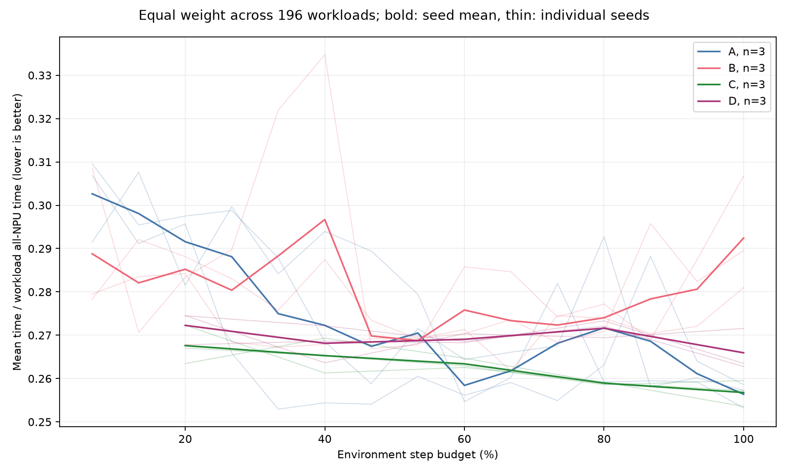
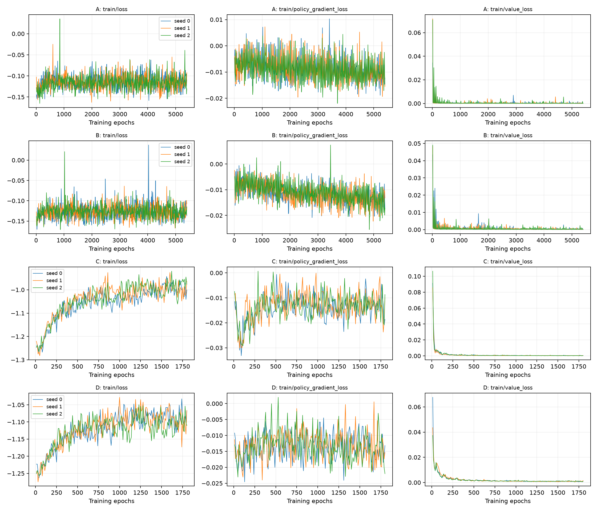
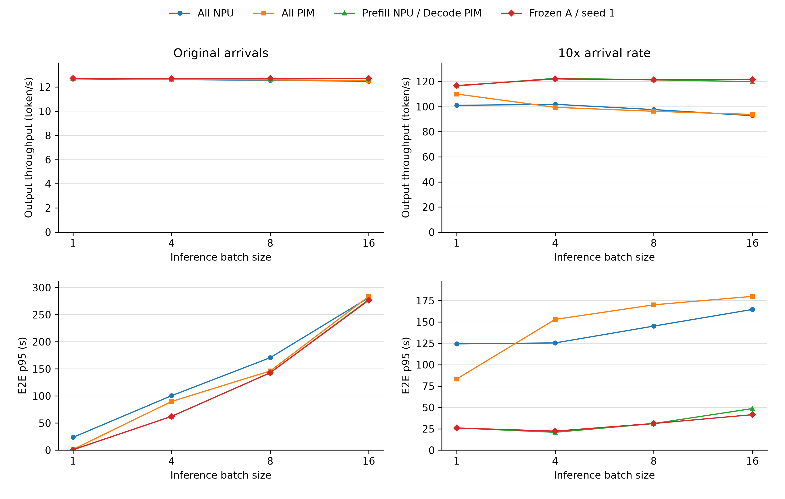

# DOPS-Serve：196 工况 PPO 训练实验

本轮 A/B/C/D 各 3 个 seed 已全部完成训练及模型重载验收，最后一个任务于 2026-11-19 12:04:57 结束。A/B 累计 540 轮，C/D 为 180 轮。归一化耗时为各工况的模拟批次耗时 / 同工况全 NPU 耗时，再对 196 项等权平均；越低越好。以下为解析模拟结果，交付候选已按训练网格 Final 指标冻结为 A / seed 1；BurstGPT 最终泛化已于 14:59:42 完成，见[独立报告](burstgpt/README.md)。

## 1. 四组训练方案

| 方案 | 观测 | 维度 | 一次动作 | 步数 / 批次 |
| --- | --- | ---: | --- | ---: |
| A | 原始信息 + 算子类别 | 18 | 单算子二选一 | 9S |
| B | KV / 驻留占比 + 动作前缀 | 26 | 单算子二选一 | 9S |
| C | 原始信息 | 9 | 整段 9 位放置 | S |
| D | KV / 驻留占比 | 18 | 整段 9 位放置 | S |

- 原始信息：设备 timeline（3）＋阶段（2）＋decode 进度（1）；A 另含算子类别（9）。
- KV / 驻留：`ln(1+KV 长度)`（1）＋ NPU / PIM 权重驻留占比（14）；B 另含动作前缀（8）。
- 四组共同包含输入长度、推理 batch 和已知目标输出长度；S 为一个 prefill 段加全部 decode 段。

## 2. 共同设置与实际训练预算

Qwen 1.8B，28 层，FP16，1 NPU + 2 PIM，每个推理批次冷启动。prefill 和 decode 各取 64、256、512、1024、2048、4096、8192 token，推理 batch 为 1、4、8、16，共 196 工况。每个新批次独立、等概率、有放回抽取一种组合；开批时已知目标输出长度。

放置刷新间隔为 `min(256, ceil(decode_len / 16))`，七种输出长度依次对应 4、16、32、64、128、256、256 token。S 为一个 prefill 段加全部 decode 段：输出至 4096 时每批 17 段，输出 8192 时每批 33 段，A/B 分别需要 153 或 297 个环境步。每个真实 decode token 均推进模拟器。

64 环境 × 36 步，每轮 2,304 条 transition；mini-batch=64、10 epochs，每轮 360 次优化更新。Actor/Critic 各 2×64，lr=3e−4，γ=1，GAE λ=0.95，clip=0.2，ent_coef=0.2，vf_coef=0.5，max_grad_norm=0.5，未设 target_kl。

| 每个 seed | A | B | C | D |
| --- | ---: | ---: | ---: | ---: |
| 实际环境步数 | 1,244,160 | 1,244,160 | 414,720 | 414,720 |
| Rollouts | 540 | 540 | 180 | 180 |
| 训练 epochs | 5,400 | 5,400 | 1,800 | 1,800 |
| Optimizer steps | 194,400 | 194,400 | 64,800 | 64,800 |
| 完整推理批次，seed 0 / 1 / 2 | 7,092 / 7,095 / 7,091 | 7,048 / 7,095 / 7,091 | 21,502 / 21,499 / 21,499 | 21,502 / 21,499 / 21,499 |
| 完整批次中的请求数，seed 0 / 1 / 2 | 52,071 / 52,120 / 51,834 | 51,722 / 52,120 / 51,834 | 155,967 / 155,927 / 155,793 | 155,967 / 155,927 / 155,793 |

A/B 本次从 360 轮 Final 保留权重与 Adam 状态，再增加 180 轮到累计 540 轮。64 个未完批次重启，工况采样种子为 829440 + seed，动作 RNG 按原生 `PPO.load` 初始化。每 82,944 步周期评估一次，累计 15 次；180、360 轮模型与报告分别归档保留。

C/D 每模型实际完成 414,720 步、180 轮，Final/Best/预算检查点重载均通过。A/B 每段九项算子奖励在计算 GAE 前回填，C/D 每步按整段计奖。

上表是每个模型、每个 seed 的步数。当前只启用 64 路，共 12 个模型；A/B 六模型合计 7,464,960 步，C/D 六模型合计 2,488,320 步，全轮有效模型实际共 **9,953,280 步，约 995 万步**。计入已退役的旧博雅 A，历史正式计划累计 11,197,440 步；用户已确认这次追加预算，历史归档前缀不重复计数。

## 3. 四组结果与固定基线

196 工况，三 seed 均值 ± 样本标准差。

| 方案 | Best | 预算检查点 | Final | Final − Best |
| --- | ---: | ---: | ---: | ---: |
| A | 0.2545 ± 0.0025 | 0.2564 ± 0.0028 | 0.2539 ± 0.0041 | -0.0006 |
| B | 0.2653 ± 0.0030 | 0.2924 ± 0.0131 | 0.2846 ± 0.0120 | +0.0193 |
| C | 0.2565 ± 0.0026 | 0.2568 ± 0.0030 | 0.2583 ± 0.0055 | +0.0018 |
| D | 0.2633 ± 0.0005 | 0.2659 ± 0.0049 | 0.2657 ± 0.0014 | +0.0024 |

Best 取周期评估最低值，A/B 共 15 次、C/D 共 5 次，均不包含 Final。预算检查点分别位于 A/B 的 1,244,160 步与 C/D 的 414,720 步，均在最后一次 PPO 更新前保存；Final 为更新后的模型，二者环境步数相同。

| 固定基线 | 196 工况归一化耗时 |
| --- | ---: |
| 全 NPU | 1.0000 |
| 全 PIM | 0.7089 |
| Prefill NPU / Decode PIM | 0.2786 |
| 逐工况取最快固定策略 | 0.2702 |

A 的 Final 均值比 B 低 **10.79%**。相对固定 Prefill NPU / Decode PIM，A 低 **8.88%**，B 高 **2.14%**。逐工况最快固定策略仅是上述三条固定策略集合的参考值。

按当前预算的 Final 均值排序为 A、C、D、B。C 为 **0.2583 ± 0.0055**，D 为 **0.2657 ± 0.0014**。A/B 使用 C/D 三倍的环境步数，当前结果不构成等预算比较。12 个 Final 中指标最低的是 **A / seed 1：0.250921**；交付模型仅依据 196 合成工况选取，未使用 BurstGPT 结果。

| 方案 | 180 轮 Final | 360 轮 Final | 540 轮 Final | 540 vs 360 耗时变化 |
| --- | ---: | ---: | ---: | ---: |
| A | 0.2744 ± 0.0186 | 0.2594 ± 0.0052 | 0.2539 ± 0.0041 | -2.14% |
| B | 0.2902 ± 0.0320 | 0.2768 ± 0.0056 | 0.2846 ± 0.0120 | +2.82% |

**这次追加对 A 有小幅收益，对 B 出现一致退化。** 相比 360 轮，A 均值耗时下降 **2.14%**，三个 seed 均改善；B 均值耗时上升 **2.82%**，三个 seed 均变差。A 在三个 seed 间的样本标准差从 0.0052 降到 0.0041，B 从 0.0056 增到 0.0120。

### Bifocal：196 工况参数搜索

既有 16 组候选共 3,136 个组合已完成，447 个获选计划通过独立逐 token 回放。两组最好共用参数 `h2_g0.5_p64_d512` / `h2_g0.5_p64_d1024` 并列，逐工况耗时相同。

| Bifocal 选参方式 | 196 工况归一化耗时 | 平均批次耗时 / ms |
| --- | ---: | ---: |
| 按归一化耗时选一套共用参数 | 0.270870 | 6708.056 |
| 按绝对耗时选一套共用参数 | 0.276985 | 6338.175 |
| 逐工况从 16 候选中取最低值 | 0.239084 | 5653.476 |

主要口径为逐工况归一化后等权平均，与 PPO 一致。最好共用参数比 A 的 Final 均值慢 6.69%、比 B 快 4.82%；逐工况选参须分别挑参数。结果为候选集内解析模拟，Bifocal 尚未测试 BurstGPT。

[完整 Bifocal 报告、参数与计划](bifocal/README.md)

全部 seed 的训练结果

| 方案 / seed | Initial | Best | 预算检查点 | Final |
| --- | ---: | ---: | ---: | ---: |
| A / 0 | 1.0000 | 0.2529 | 0.2586 | 0.2585 |
| A / 1 | 0.7089 | 0.2532 | 0.2532 | 0.2509 |
| A / 2 | 1.4153 | 0.2573 | 0.2573 | 0.2522 |
| B / 0 | 0.3192 | 0.2669 | 0.3067 | 0.2967 |
| B / 1 | 1.1746 | 0.2618 | 0.2810 | 0.2727 |
| B / 2 | 0.5035 | 0.2672 | 0.2896 | 0.2843 |
| C / 0 | 0.9310 | 0.2572 | 0.2572 | 0.2566 |
| C / 1 | 0.8113 | 0.2586 | 0.2595 | 0.2644 |
| C / 2 | 1.0360 | 0.2536 | 0.2536 | 0.2538 |
| D / 0 | 0.9041 | 0.2628 | 0.2628 | 0.2651 |
| D / 1 | 0.9084 | 0.2636 | 0.2716 | 0.2673 |
| D / 2 | 0.7955 | 0.2635 | 0.2635 | 0.2646 |

| 方案 / seed | 180 轮 Final | 360 轮 Final | 540 轮 Final | 540 vs 360 耗时变化 |
| --- | ---: | ---: | ---: | ---: |
| A / 0 | 0.2530 | 0.2609 | 0.2585 | -0.93% |
| A / 1 | 0.2851 | 0.2536 | 0.2509 | -1.07% |
| A / 2 | 0.2852 | 0.2637 | 0.2522 | -4.38% |
| B / 0 | 0.3267 | 0.2817 | 0.2967 | +5.32% |
| B / 1 | 0.2765 | 0.2706 | 0.2727 | +0.78% |
| B / 2 | 0.2674 | 0.2780 | 0.2843 | +2.26% |

## 4. 四组实验耗时曲线

横轴为各组自身环境步预算的完成比例：A/B 的 100% 为 1,244,160 步，C/D 为 414,720 步。各组每 82,944 步评估一次，A/B 共 15 点，C/D 共 5 点；同色细线为各 seed，粗线为组内均值。图中是周期评估，最后一次 PPO 更新后的 Final 单列于结果表。

## 5. 训练 Loss

原始 SB3 日志，无平滑；横轴为训练 epochs，A/B 累计 5,400，C/D 为 1,800。沿用 GitHub README 的原生图样式：三个 seed 为蓝、橙、绿细线，线宽 0.8，线性纵轴，不叠加均值线。Total loss 是最后一个 mini-batch 的值，其他指标沿用 SB3 原生记录；四组决策粒度不同，Loss 大小不作为组间调度性能排名。

## 6. Critic 拟合与 KL

末次训练指标与训练期间峰值

| 方案 / seed | 末次 Value loss | Explained variance | 末次 approx KL | 峰值 approx KL |
| --- | ---: | ---: | ---: | ---: |
| A / 0 | 1.96e-05 | 0.994124 | 0.0057 | 0.0253 |
| A / 1 | 2.03e-05 | 0.994477 | 0.0058 | 0.0269 |
| A / 2 | 3.40e-05 | 0.991061 | 0.0070 | 0.0222 |
| B / 0 | 6.90e-05 | 0.972385 | 0.0089 | 0.0195 |
| B / 1 | 7.52e-05 | 0.969996 | 0.0062 | 0.0215 |
| B / 2 | 9.05e-05 | 0.971269 | 0.0078 | 0.0204 |
| C / 0 | 3.96e-04 | 0.965648 | 0.0092 | 0.0152 |
| C / 1 | 3.88e-04 | 0.966843 | 0.0088 | 0.0134 |
| C / 2 | 3.59e-04 | 0.970583 | 0.0110 | 0.0145 |
| D / 0 | 8.47e-04 | 0.940786 | 0.0132 | 0.0170 |
| D / 1 | 1.53e-03 | 0.916951 | 0.0089 | 0.0168 |
| D / 2 | 9.62e-04 | 0.940485 | 0.0093 | 0.0161 |

十二个模型记录的 loss 均为有限值；B 的 Best 未刷新，后五次周期评估均值连续变差，Final 退化。具体原因尚未确定，当前不建议继续单纯增加 B 的训练轮次。分长度结果及逐工况对比见完整报告。

---

[聚合结果](metrics.json) · [历次轮次数据](history.json) · [本轮实验设置](experiment_settings.json) · [前轮 36 工况 README](../../../README_36workloads_20261116.md)

## 7. 按输出长度与交付模型

每个输出长度含 28 个工况。下表为三 seed Final 均值。

| Decode token | A | B | C | D |
| ---: | ---: | ---: | ---: | ---: |
| 64 | 0.554616 | 0.640936 | 0.545334 | 0.578529 |
| 256 | 0.328590 | 0.376477 | 0.334715 | 0.346537 |
| 512 | 0.266371 | 0.295853 | 0.271231 | 0.277646 |
| 1024 | 0.216461 | 0.238493 | 0.222806 | 0.225100 |
| 2048 | 0.173119 | 0.187418 | 0.180184 | 0.181013 |
| 4096 | 0.134890 | 0.144086 | 0.143567 | 0.142132 |
| 8192 | 0.103146 | 0.108774 | 0.109944 | 0.108602 |

交付候选为 **env64_A_seed1**，归一化耗时 **0.250921**。[冻结选择记录](selected_model.json)。本报告汇总 196 合成工况；BurstGPT 最终结果见[泛化报告](burstgpt/README.md)。

[聚合指标与诊断](metrics.json) · [196 工况逐模型 Final](per_workload_results.json) · [周期评估原始点](training_evaluation.csv) · [原始 Loss 数据](loss_statistics.csv) · [重载及工件验证](validation.json)

## 8. BurstGPT 最终泛化

2026-11-19 **14:59:42** 全部完成：12 个 PPO Final 加三条固定基线，共 120 项指标，每项 2,048 条相同请求。8 个连续窗口、原始节奏与 10 倍到达率，batch 1/4/8/16；FCFS 凑满开批、无超时、同批按最长形状执行。交付模型仍为回放前仅按训练网格冻结的 **A / seed 1**，以下为解析模拟结果。

相对 **Prefill NPU / Decode PIM**，冻结 A1 的结果如下。吞吐包含到达空闲和凑批等待，E2E 从请求到达计时；负的“降幅”表示延迟变差。

| 到达率 | Batch | A1 吞吐 / token·s⁻¹ | 吞吐变化 | A1 E2E p95 / s | 基线 E2E p95 / s | E2E p95 降幅 |
| --- | ---: | ---: | ---: | ---: | ---: | ---: |
| 原始 | 1 | 12.7175 | -0.0001% | 0.7787 | 0.7979 | +2.4066% |
| 原始 | 4 | 12.7172 | -0.0005% | 62.3992 | 62.3890 | -0.0164% |
| 原始 | 8 | 12.7158 | +0.0008% | 142.8004 | 142.8068 | +0.0045% |
| 原始 | 16 | 12.7099 | +0.0199% | 276.8224 | 277.7633 | +0.3387% |
| 10 倍 | 1 | 116.7174 | +0.2460% | 25.9085 | 26.0296 | +0.4653% |
| 10 倍 | 4 | 122.0732 | -0.3371% | 22.2489 | 20.9206 | -6.3496% |
| 10 倍 | 8 | 121.2934 | -0.0182% | 31.2208 | 31.1217 | -0.3183% |
| 10 倍 | 16 | 121.5430 | +1.4057% | 41.5129 | 48.6559 | +14.6807% |

原始节奏下吞吐几乎相同，主要受请求到达与凑批等待限制。10 倍到达率、batch 16 的 E2E p95 降低 **14.68%**，batch 4 则升高 **6.35%**，各负载并非一致改善。冻结样本输出长度为 1–1,916 token（中位数 7），本次不覆盖超长输出外推。

[完整泛化报告：三条基线、四组三 seed、等待拆分与核验](burstgpt/README.md) · [全部 120 项指标](burstgpt/metrics.csv)
