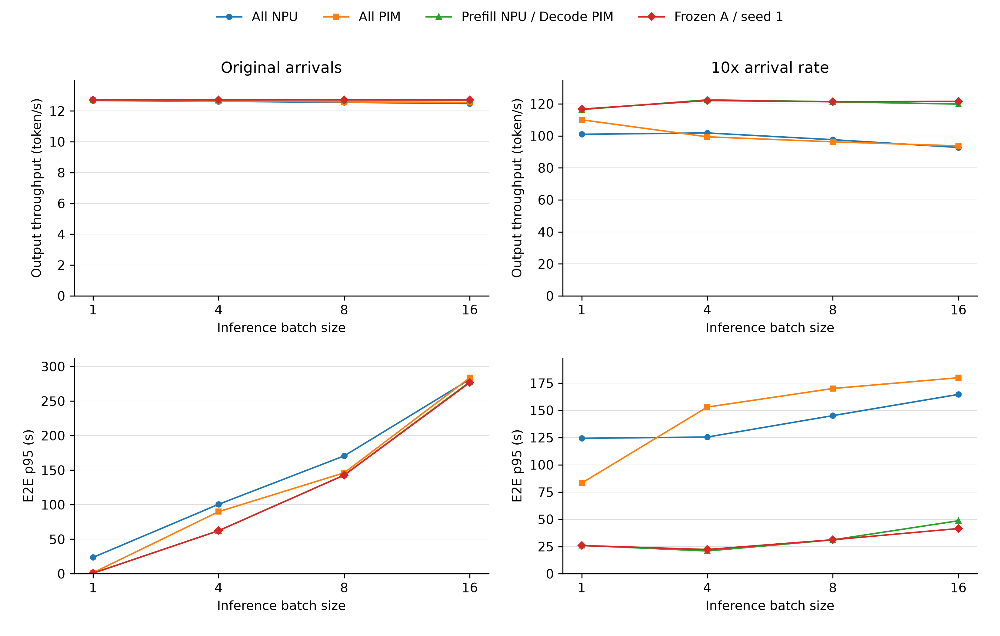

# BurstGPT 最终泛化结果

2026-11-19 **14:59:42** 全部完成。12 个冻结 PPO Final 和三条固定基线共 15 个策略，原始节奏与 10 倍到达率、batch 1/4/8/16 共 **120 项结果**；每项使用相同的 2,048 条请求。以下均为解析模拟结果。

交付模型仍为 **A / seed 1**，仅依据 196 合成工况的 Final 归一化耗时 **0.2509206792303672** 选定；在 BurstGPT 回放前冻结，未根据本报告重新选模。

## 1. 固定测试合同

- 数据：旧 DOPS 使用的 `BurstGPT_without_fails_1.csv`，固定 seed `20261116`，随机抽取 8 个互不重叠的连续窗口，每窗 256 条；保留原始请求的输入、输出长度配对及到达间隔。
- 原始节奏的到达间隔乘 1；10 倍到达率的间隔乘 0.1。每个窗口从时间 0 独立开始，队列和设备空闲；所有策略使用同一份冻结请求清单。
- FCFS，凑满目标 batch 且设备空闲即开批，无超时。窗口请求数能被四个 batch 整除，无尾批。
- 同批按最长输入、最长输出形状执行，保持固定批次资源到最长请求完成；每条请求在这条固定批次 token 时间曲线上、达到其真实输出长度时记录完成。不会缩小运行批次，后续到达者进入下一批。
- 开批时已知最长输出长度；放置刷新间隔为 `min(256, ceil(decode_len / 16))`。其余模型、硬件和冷启动合同沿用训练设置。
- A/B 每模型 540 轮、1,244,160 环境步；C/D 每模型 180 轮、414,720 步，属于不同训练预算。BurstGPT 只用于最终测试，未用于训练、选模或调参。

冻结请求的输入长度为 **8–4,395** token（中位数 271，p95 3,034.6），输出长度为 **1–1,916** token（中位数 7，p95 409），真实输出合计 **186,606 token**。本样本含训练网格之外的短长度，不覆盖超长输出的外推。每策略共 1,986 个不同的填充批次形状。

## 2. 冻结交付模型与三条固定基线

吞吐 = 全部请求的真实输出 token 数 / 八个窗口从首请求到排空的耗时之和，包含到达空闲、凑批及设备等待；它不是设备饱和处理能力。TTFT 与 E2E 均从每条请求到达开始计时；下表单位除吞吐外均为秒。

| 到达率 | Batch | 策略 | 吞吐 / token·s⁻¹ | TTFT p50 | TTFT p95 | E2E p50 | E2E p95 |
| --- | ---: | --- | ---: | ---: | ---: | ---: | ---: |
| 原始 | 1 | 全 NPU | 12.6783 | 0.1045 | 22.9992 | 0.4342 | 23.6998 |
| 原始 | 1 | 全 PIM | 12.7170 | 0.1417 | 1.4124 | 0.1555 | 1.4762 |
| 原始 | 1 | Prefill NPU / Decode PIM | 12.7175 | 0.1361 | 0.7902 | 0.2095 | 0.7979 |
| 原始 | 1 | 冻结 A / seed 1 | 12.7175 | 0.1438 | 0.7206 | 0.2034 | 0.7787 |
| 原始 | 4 | 全 NPU | 12.6196 | 2.0925 | 99.1266 | 2.1481 | 100.5608 |
| 原始 | 4 | 全 PIM | 12.6291 | 2.6037 | 89.6370 | 2.7070 | 89.8898 |
| 原始 | 4 | Prefill NPU / Decode PIM | 12.7172 | 1.1332 | 62.1557 | 1.1397 | 62.3890 |
| 原始 | 4 | 冻结 A / seed 1 | 12.7172 | 1.0924 | 62.1533 | 1.1386 | 62.3992 |
| 原始 | 8 | 全 NPU | 12.5570 | 4.1111 | 169.5026 | 5.1189 | 170.6499 |
| 原始 | 8 | 全 PIM | 12.5905 | 6.5489 | 145.2975 | 6.6731 | 146.1715 |
| 原始 | 8 | Prefill NPU / Decode PIM | 12.7157 | 2.8412 | 141.9329 | 3.1436 | 142.8068 |
| 原始 | 8 | 冻结 A / seed 1 | 12.7158 | 2.8101 | 141.9250 | 3.1074 | 142.8004 |
| 原始 | 16 | 全 NPU | 12.4774 | 9.0669 | 275.1518 | 10.6825 | 281.4884 |
| 原始 | 16 | 全 PIM | 12.5497 | 14.3778 | 280.9894 | 14.5672 | 283.7741 |
| 原始 | 16 | Prefill NPU / Decode PIM | 12.7073 | 6.1512 | 275.1801 | 6.4066 | 277.7633 |
| 原始 | 16 | 冻结 A / seed 1 | 12.7099 | 6.1009 | 275.1506 | 6.1706 | 276.8224 |
| 10 倍 | 1 | 全 NPU | 100.9834 | 5.0804 | 124.0680 | 5.1760 | 124.3285 |
| 10 倍 | 1 | 全 PIM | 110.0248 | 0.4389 | 83.1537 | 0.5661 | 83.2120 |
| 10 倍 | 1 | Prefill NPU / Decode PIM | 116.4310 | 5.8340 | 26.0147 | 5.8358 | 26.0296 |
| 10 倍 | 1 | 冻结 A / seed 1 | 116.7174 | 5.3833 | 25.8880 | 5.4053 | 25.9085 |
| 10 倍 | 4 | 全 NPU | 101.8071 | 2.4180 | 122.8714 | 3.4213 | 125.4397 |
| 10 倍 | 4 | 全 PIM | 99.3933 | 4.0669 | 152.9595 | 4.3367 | 152.9606 |
| 10 倍 | 4 | Prefill NPU / Decode PIM | 122.4861 | 1.3714 | 20.7501 | 1.4452 | 20.9206 |
| 10 倍 | 4 | 冻结 A / seed 1 | 122.0732 | 1.2894 | 21.6289 | 1.3781 | 22.2489 |
| 10 倍 | 8 | 全 NPU | 97.6002 | 4.3639 | 144.0573 | 5.5883 | 145.1264 |
| 10 倍 | 8 | 全 PIM | 96.2647 | 7.6754 | 169.2847 | 7.7816 | 170.0115 |
| 10 倍 | 8 | Prefill NPU / Decode PIM | 121.3156 | 1.3259 | 30.8388 | 1.5795 | 31.1217 |
| 10 倍 | 8 | 冻结 A / seed 1 | 121.2934 | 1.3093 | 30.9410 | 1.4894 | 31.2208 |
| 10 倍 | 16 | 全 NPU | 92.7677 | 7.8956 | 162.7737 | 8.9478 | 164.5928 |
| 10 倍 | 16 | 全 PIM | 93.7256 | 12.8824 | 178.9319 | 13.0751 | 179.8895 |
| 10 倍 | 16 | Prefill NPU / Decode PIM | 119.8581 | 2.8569 | 46.0040 | 3.0975 | 48.6559 |
| 10 倍 | 16 | 冻结 A / seed 1 | 121.5430 | 1.8282 | 40.9837 | 2.0091 | 41.5129 |

以下以 **Prefill NPU / Decode PIM** 为比较基线；吞吐变化为 `A1 / 基线 − 1`，E2E p95 降幅为 `1 − A1 / 基线`，负值表示变差。

| 到达率 | Batch | A1 吞吐 / token·s⁻¹ | 吞吐变化 | A1 E2E p95 / s | 基线 E2E p95 / s | E2E p95 降幅 |
| --- | ---: | ---: | ---: | ---: | ---: | ---: |
| 原始 | 1 | 12.7175 | -0.0001% | 0.7787 | 0.7979 | +2.4066% |
| 原始 | 4 | 12.7172 | -0.0005% | 62.3992 | 62.3890 | -0.0164% |
| 原始 | 8 | 12.7158 | +0.0008% | 142.8004 | 142.8068 | +0.0045% |
| 原始 | 16 | 12.7099 | +0.0199% | 276.8224 | 277.7633 | +0.3387% |
| 10 倍 | 1 | 116.7174 | +0.2460% | 25.9085 | 26.0296 | +0.4653% |
| 10 倍 | 4 | 122.0732 | -0.3371% | 22.2489 | 20.9206 | -6.3496% |
| 10 倍 | 8 | 121.2934 | -0.0182% | 31.2208 | 31.1217 | -0.3183% |
| 10 倍 | 16 | 121.5430 | +1.4057% | 41.5129 | 48.6559 | +14.6807% |

原始节奏下，A1 吞吐相对阶段固定基线的变化为 −0.0005% 至 +0.0199%，主要受到到达节奏和凑批等待约束。10 倍到达率、batch 16 时，A1 吞吐提高 **1.41%**，E2E p95 从 **48.6559 s** 降至 **41.5129 s（−14.68%）**；batch 4 时 E2E p95 从 **20.9206 s** 增至 **22.2489 s（+6.35%）**，batch 8 也略差。当前结果不支持“所有负载均改善”的结论。

## 3. 凑批与设备等待

以下为冻结 A1，单位为秒。凑批时间按每个批次的首请求到末请求到达计算；设备等待为凑满后等设备空闲；请求排队为每条请求从到达到开批。前两项在批次上取分位数，后一项在请求上取分位数，三者 p95 不能直接相加。

| 到达率 | Batch | 凑批 p50 | 凑批 p95 | 设备等待 p50 | 设备等待 p95 | 请求排队 p50 | 请求排队 p95 |
| --- | ---: | ---: | ---: | ---: | ---: | ---: | ---: |
| 原始 | 1 | 0.0000 | 0.0000 | 0.0000 | 0.6101 | 0.0000 | 0.6101 |
| 原始 | 4 | 3.0000 | 119.9000 | 0.0000 | 0.2605 | 1.0000 | 62.0000 |
| 原始 | 8 | 6.0000 | 299.2500 | 0.0000 | 0.1043 | 2.3123 | 141.6000 |
| 原始 | 16 | 13.5000 | 795.7500 | 0.0000 | 0.0000 | 5.1905 | 274.6500 |
| 10 倍 | 1 | 0.0000 | 0.0000 | 5.2741 | 25.7484 | 5.2741 | 25.7484 |
| 10 倍 | 4 | 0.3000 | 11.9900 | 0.0000 | 19.3744 | 1.1870 | 21.4650 |
| 10 倍 | 8 | 0.6000 | 29.9250 | 0.0000 | 23.6199 | 1.0765 | 30.4398 |
| 10 倍 | 16 | 1.3500 | 79.5750 | 0.0000 | 23.7218 | 1.5981 | 40.0830 |

原始节奏、batch 16 的凑批 p95 为 **795.75 s**、设备等待 p95 为 **0 s**；固定满批且无超时的规则使稀疏窗口产生较长等待。10 倍到达率、batch 1 时不需要凑批，但 A1 的设备等待 p95 为 **25.7484 s**，显示该设置下存在设备排队。

## 4. A/B/C/D 三 seed 泛化结果

每个设置分别计算三个模型的指标均值 ± 样本标准差。表中的 TTFT/E2E p95 是“三个模型各自 p95 的均值与标准差”，不把三个 seed 的请求混在一起计算分位数；这也不是置信区间。

| 到达率 | Batch | 组别 | 吞吐 / token·s⁻¹ | TTFT p95 / s | E2E p95 / s |
| --- | ---: | --- | ---: | ---: | ---: |
| 原始 | 1 | A | 12.7174 ± 0.0001 | 0.7777 ± 0.0683 | 0.8277 ± 0.0698 |
| 原始 | 1 | B | 12.7172 ± 0.0002 | 0.8995 ± 0.0839 | 0.9630 ± 0.1167 |
| 原始 | 1 | C | 12.7176 ± 0.0002 | 0.7297 ± 0.1026 | 0.7505 ± 0.0843 |
| 原始 | 1 | D | 12.7175 ± 0.0000 | 0.7892 ± 0.0055 | 0.7980 ± 0.0047 |
| 原始 | 4 | A | 12.7172 ± 0.0000 | 62.1533 ± 0.0018 | 62.3972 ± 0.0018 |
| 原始 | 4 | B | 12.7168 ± 0.0002 | 62.1847 ± 0.0409 | 62.4589 ± 0.0528 |
| 原始 | 4 | C | 12.7172 ± 0.0000 | 62.1579 ± 0.0044 | 62.3941 ± 0.0126 |
| 原始 | 4 | D | 12.7172 ± 0.0000 | 62.1554 ± 0.0004 | 62.4002 ± 0.0103 |
| 原始 | 8 | A | 12.7157 ± 0.0002 | 141.9218 ± 0.0056 | 142.7652 ± 0.0444 |
| 原始 | 8 | B | 12.7152 ± 0.0004 | 142.0476 ± 0.1075 | 142.9663 ± 0.0953 |
| 原始 | 8 | C | 12.7157 ± 0.0000 | 141.9377 ± 0.0104 | 142.8132 ± 0.0063 |
| 原始 | 8 | D | 12.7157 ± 0.0001 | 141.9275 ± 0.0075 | 142.8131 ± 0.0098 |
| 原始 | 16 | A | 12.7096 ± 0.0004 | 275.1469 ± 0.0065 | 276.9480 ± 0.1952 |
| 原始 | 16 | B | 12.7091 ± 0.0004 | 275.2218 ± 0.0409 | 277.2650 ± 0.2162 |
| 原始 | 16 | C | 12.7091 ± 0.0002 | 275.1563 ± 0.0254 | 277.1193 ± 0.0893 |
| 原始 | 16 | D | 12.7091 ± 0.0005 | 275.1684 ± 0.0142 | 277.2056 ± 0.1808 |
| 10 倍 | 1 | A | 116.0781 ± 1.2122 | 29.8048 ± 6.4823 | 29.8394 ± 6.4989 |
| 10 倍 | 1 | B | 113.3984 ± 2.0909 | 41.0601 ± 11.4174 | 41.1553 ± 11.4562 |
| 10 倍 | 1 | C | 117.7039 ± 2.1731 | 25.4485 ± 0.9791 | 25.5079 ± 0.9166 |
| 10 倍 | 1 | D | 116.3899 ± 0.0289 | 26.5066 ± 0.4470 | 26.5456 ± 0.4820 |
| 10 倍 | 4 | A | 122.1751 ± 0.1074 | 21.6057 ± 0.0386 | 21.9157 ± 0.3416 |
| 10 倍 | 4 | B | 120.0054 ± 1.0936 | 30.1021 ± 5.1394 | 30.3978 ± 5.2633 |
| 10 倍 | 4 | C | 122.3607 ± 0.1239 | 21.1586 ± 0.4788 | 21.2721 ± 0.4114 |
| 10 倍 | 4 | D | 122.2858 ± 0.1552 | 21.3384 ± 0.5078 | 21.4338 ± 0.4406 |
| 10 倍 | 8 | A | 121.2686 ± 0.2088 | 30.8337 ± 0.3545 | 31.2380 ± 0.4712 |
| 10 倍 | 8 | B | 120.2152 ± 0.8948 | 35.1754 ± 3.4325 | 35.7462 ± 3.3320 |
| 10 倍 | 8 | C | 121.2652 ± 0.1258 | 30.9378 ± 0.2588 | 31.3196 ± 0.4843 |
| 10 倍 | 8 | D | 121.3587 ± 0.1185 | 30.7570 ± 0.3182 | 31.1026 ± 0.2910 |
| 10 倍 | 16 | A | 121.4201 ± 0.1846 | 41.0306 ± 1.0287 | 41.7608 ± 0.6255 |
| 10 倍 | 16 | B | 121.0080 ± 0.5279 | 42.8511 ± 2.6941 | 43.5126 ± 2.8674 |
| 10 倍 | 16 | C | 121.1636 ± 0.2561 | 42.6034 ± 1.8529 | 43.1573 ± 1.7122 |
| 10 倍 | 16 | D | 121.1354 ± 0.2412 | 42.4002 ± 1.3135 | 42.8271 ± 1.1303 |

各负载下的排序不同：例如 10 倍到达率、batch 1/4 的组均值 E2E p95 以 C 最低，batch 8 以 D 最低，batch 16 以 A 最低。该观察保留测试结果，不用于更换冻结的交付模型。

12 个 PPO Final 的逐 seed 结果（全部 96 项）

| 到达率 | Batch | 组别 / seed | 吞吐 / token·s⁻¹ | TTFT p95 / s | E2E p95 / s |
| --- | ---: | --- | ---: | ---: | ---: |
| 原始 | 1 | A / 0 | 12.7173 | 0.8533 | 0.9077 |
| 原始 | 1 | A / 1 | 12.7175 | 0.7206 | 0.7787 |
| 原始 | 1 | A / 2 | 12.7175 | 0.7593 | 0.7967 |
| 原始 | 1 | B / 0 | 12.7169 | 0.9710 | 1.0488 |
| 原始 | 1 | B / 1 | 12.7174 | 0.8071 | 0.8301 |
| 原始 | 1 | B / 2 | 12.7172 | 0.9205 | 1.0101 |
| 原始 | 1 | C / 0 | 12.7175 | 0.7901 | 0.7992 |
| 原始 | 1 | C / 1 | 12.7175 | 0.7879 | 0.7991 |
| 原始 | 1 | C / 2 | 12.7179 | 0.6113 | 0.6531 |
| 原始 | 1 | D / 0 | 12.7175 | 0.7921 | 0.8033 |
| 原始 | 1 | D / 1 | 12.7175 | 0.7829 | 0.7946 |
| 原始 | 1 | D / 2 | 12.7175 | 0.7926 | 0.7959 |
| 原始 | 4 | A / 0 | 12.7172 | 62.1514 | 62.3963 |
| 原始 | 4 | A / 1 | 12.7172 | 62.1533 | 62.3992 |
| 原始 | 4 | A / 2 | 12.7172 | 62.1551 | 62.3959 |
| 原始 | 4 | B / 0 | 12.7166 | 62.2299 | 62.5170 |
| 原始 | 4 | B / 1 | 12.7170 | 62.1740 | 62.4137 |
| 原始 | 4 | B / 2 | 12.7169 | 62.1501 | 62.4461 |
| 原始 | 4 | C / 0 | 12.7173 | 62.1554 | 62.3868 |
| 原始 | 4 | C / 1 | 12.7172 | 62.1554 | 62.3868 |
| 原始 | 4 | C / 2 | 12.7172 | 62.1629 | 62.4087 |
| 原始 | 4 | D / 0 | 12.7172 | 62.1557 | 62.4033 |
| 原始 | 4 | D / 1 | 12.7172 | 62.1550 | 62.4086 |
| 原始 | 4 | D / 2 | 12.7172 | 62.1554 | 62.3887 |
| 原始 | 8 | A / 0 | 12.7155 | 141.9153 | 142.7154 |
| 原始 | 8 | A / 1 | 12.7158 | 141.9250 | 142.8004 |
| 原始 | 8 | A / 2 | 12.7158 | 141.9251 | 142.7799 |
| 原始 | 8 | B / 0 | 12.7149 | 142.1409 | 143.0255 |
| 原始 | 8 | B / 1 | 12.7156 | 142.0720 | 143.0171 |
| 原始 | 8 | B / 2 | 12.7151 | 141.9300 | 142.8563 |
| 原始 | 8 | C / 0 | 12.7157 | 141.9327 | 142.8065 |
| 原始 | 8 | C / 1 | 12.7157 | 141.9306 | 142.8143 |
| 原始 | 8 | C / 2 | 12.7156 | 141.9496 | 142.8190 |
| 原始 | 8 | D / 0 | 12.7158 | 141.9311 | 142.8122 |
| 原始 | 8 | D / 1 | 12.7157 | 141.9188 | 142.8233 |
| 原始 | 8 | D / 2 | 12.7157 | 141.9325 | 142.8037 |
| 原始 | 16 | A / 0 | 12.7092 | 275.1394 | 277.1728 |
| 原始 | 16 | A / 1 | 12.7099 | 275.1506 | 276.8224 |
| 原始 | 16 | A / 2 | 12.7099 | 275.1506 | 276.8486 |
| 原始 | 16 | B / 0 | 12.7087 | 275.2683 | 277.3646 |
| 原始 | 16 | B / 1 | 12.7095 | 275.1913 | 277.4134 |
| 原始 | 16 | B / 2 | 12.7090 | 275.2060 | 277.0169 |
| 原始 | 16 | C / 0 | 12.7089 | 275.1427 | 277.0626 |
| 原始 | 16 | C / 1 | 12.7091 | 275.1405 | 277.2222 |
| 原始 | 16 | C / 2 | 12.7094 | 275.1856 | 277.0731 |
| 原始 | 16 | D / 0 | 12.7086 | 275.1731 | 277.4119 |
| 原始 | 16 | D / 1 | 12.7096 | 275.1525 | 277.0748 |
| 原始 | 16 | D / 2 | 12.7091 | 275.1797 | 277.1302 |
| 10 倍 | 1 | A / 0 | 114.6800 | 37.2872 | 37.3408 |
| 10 倍 | 1 | A / 1 | 116.7174 | 25.8880 | 25.9085 |
| 10 倍 | 1 | A / 2 | 116.8368 | 26.2393 | 26.2690 |
| 10 倍 | 1 | B / 0 | 111.6175 | 49.7976 | 49.9918 |
| 10 倍 | 1 | B / 1 | 115.7007 | 28.1416 | 28.2117 |
| 10 倍 | 1 | B / 2 | 112.8772 | 45.2411 | 45.2624 |
| 10 倍 | 1 | C / 0 | 116.3998 | 26.1312 | 26.1478 |
| 10 倍 | 1 | C / 1 | 116.4994 | 25.8876 | 25.9180 |
| 10 倍 | 1 | C / 2 | 120.2126 | 24.3268 | 24.4578 |
| 10 倍 | 1 | D / 0 | 116.3595 | 26.1492 | 26.1657 |
| 10 倍 | 1 | D / 1 | 116.3931 | 27.0078 | 27.0878 |
| 10 倍 | 1 | D / 2 | 116.4171 | 26.3628 | 26.3834 |
| 10 倍 | 4 | A / 0 | 122.1649 | 21.6271 | 21.9320 |
| 10 倍 | 4 | A / 1 | 122.0732 | 21.6289 | 22.2489 |
| 10 倍 | 4 | A / 2 | 122.2872 | 21.5611 | 21.5662 |
| 10 倍 | 4 | B / 0 | 119.3961 | 33.7936 | 34.0630 |
| 10 倍 | 4 | B / 1 | 121.2679 | 24.2323 | 24.3667 |
| 10 倍 | 4 | B / 2 | 119.3523 | 32.2804 | 32.7637 |
| 10 倍 | 4 | C / 0 | 122.4934 | 20.6543 | 20.8239 |
| 10 倍 | 4 | C / 1 | 122.3406 | 21.2145 | 21.3600 |
| 10 倍 | 4 | C / 2 | 122.2481 | 21.6070 | 21.6325 |
| 10 倍 | 4 | D / 0 | 122.1925 | 21.6384 | 21.7126 |
| 10 倍 | 4 | D / 1 | 122.1999 | 21.6247 | 21.6629 |
| 10 倍 | 4 | D / 2 | 122.4649 | 20.7522 | 20.9258 |
| 10 倍 | 8 | A / 0 | 121.0485 | 31.1220 | 31.7176 |
| 10 倍 | 8 | A / 1 | 121.2934 | 30.9410 | 31.2208 |
| 10 倍 | 8 | A / 2 | 121.4639 | 30.4379 | 30.7757 |
| 10 倍 | 8 | B / 0 | 119.4049 | 37.8953 | 38.7097 |
| 10 倍 | 8 | B / 1 | 121.1755 | 31.3187 | 32.1395 |
| 10 倍 | 8 | B / 2 | 120.0654 | 36.3123 | 36.3893 |
| 10 倍 | 8 | C / 0 | 121.3396 | 30.8335 | 31.1138 |
| 10 倍 | 8 | C / 1 | 121.1200 | 31.2325 | 31.8728 |
| 10 倍 | 8 | C / 2 | 121.3360 | 30.7474 | 30.9722 |
| 10 倍 | 8 | D / 0 | 121.4866 | 30.4212 | 30.8380 |
| 10 倍 | 8 | D / 1 | 121.2527 | 31.0540 | 31.4142 |
| 10 倍 | 8 | D / 2 | 121.3369 | 30.7958 | 31.0557 |
| 10 倍 | 16 | A / 0 | 121.2079 | 42.0820 | 42.4722 |
| 10 倍 | 16 | A / 1 | 121.5430 | 40.9837 | 41.5129 |
| 10 倍 | 16 | A / 2 | 121.5096 | 40.0261 | 41.2972 |
| 10 倍 | 16 | B / 0 | 120.4120 | 45.9566 | 46.8178 |
| 10 倍 | 16 | B / 1 | 121.4169 | 41.4578 | 42.0289 |
| 10 倍 | 16 | B / 2 | 121.1951 | 41.1389 | 41.6910 |
| 10 倍 | 16 | C / 0 | 120.9192 | 44.4592 | 44.9481 |
| 10 倍 | 16 | C / 1 | 121.1417 | 42.5977 | 42.9873 |
| 10 倍 | 16 | C / 2 | 121.4300 | 40.7533 | 41.5364 |
| 10 倍 | 16 | D / 0 | 120.8588 | 43.6221 | 43.9005 |
| 10 倍 | 16 | D / 1 | 121.2455 | 42.5673 | 42.9334 |
| 10 倍 | 16 | D / 2 | 121.3019 | 41.0111 | 41.6474 |

## 5. 泛化曲线

四条曲线分别为三条固定基线和冻结 A1；横轴为 batch 的四个测试值，线宽 1.2，默认蓝、橙、绿、红，线性坐标。原始节奏下部分吞吐曲线重叠，准确数值见表格与 CSV。

[可编辑 SVG](figures/primary_comparison.svg)

## 6. 工件核验与数据

最终作业正常完成，无日志错误。完整窗口、冻结模型、配置、各策略请求与批次记录及最终指标均已取回，与 HPC 文件逐字节比较一致；冻结窗口、模型和选择记录保持原样。

- 120 个策略 × 到达率 × batch 组合完整，每项恰有 2,048 条请求，数值有限且非负。
- 2,048 个冻结请求的长度配对与相对时间戳均与原始 CSV 对应行一致；逐条核对所有策略使用相同请求和缩放到达时间。
- 核对 FCFS 分批、满批开批、设备等待、请求排队和完成时间；相同固定批次形状在两档到达率下的服务耗时、首 token 与输出 token 前缀耗时一致。
- 从 **245,760 条请求记录、88,320 条批次记录** 重算全部分位数和真实输出 token 吞吐，与最终 CSV 一致。

以上属于解析模拟与工件一致性验证。Bifocal 的 196 工况候选搜索单独报告，本次 15 个策略不含 Bifocal。

[全部 120 项指标](metrics.csv) · [四组均值与样本标准差](group_statistics.csv) · [冻结 A1 对比数据](primary_comparison.csv) · [冻结 2,048 请求窗口](windows.json) · [汇总 JSON](summary.json) · [核验记录](validation.json)

[返回四组训练报告](../README.md) · [返回项目 README](../../../../README.md)
