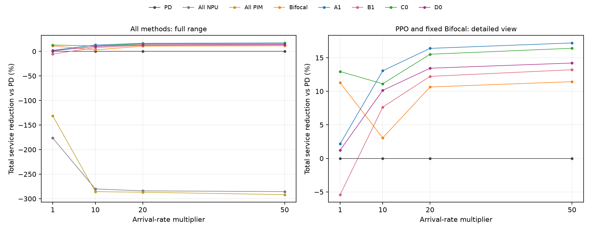

# BurstGPT 固定时间窗泛化结果

2026-11-23 12:16:05（北京时间）全部计算及汇总完成，9 个计算/报告作业均以 0 退出。

以下为解析模拟结果。主指标为相对 PD 的总服务耗时降幅，不包含组批、排队或算法 CPU 时间。

## 1. 数据与模型

从完整 CSV 的 1,404,294 条记录中排除输入超过 8192 的 105 条；固定种子 20261120，使用 16×512 条新请求。
固定 1 秒窗；窗末组批，batch 上限 16，溢出按到达顺序拆分。原速及 10×、20×、50× 各自重新组批。
同一到达率下所有方法共享完全相同的请求和批次清单。每批冷启动、已知最长输出、按最长输入和输出形状执行。

| 方案 | 所选 seed | 实际训练环境步 | 196 工况 Final 分数 |
| --- | ---: | ---: | ---: |
| A | 1 | 1,244,160 | 0.250921 |
| B | 1 | 1,244,160 | 0.272733 |
| C | 0 | 1,002,240 | 0.247388 |
| D | 0 | 1,002,240 | 0.263183 |

每种方案在测试前按合成工况选择一个 Final；这些不是三 seed 均值。Bifocal 使用此前固定的共用参数，保留搜索生成的原计划。

| 到达率 | 请求数 | 实际批次数 | 平均 batch | batch=16 批数 |
| --- | --- | --- | --- | --- |
| 1× | 8192 | 4169 | 1.96 | 8 |
| 10× | 8192 | 1001 | 8.18 | 225 |
| 20× | 8192 | 792 | 10.34 | 349 |
| 50× | 8192 | 652 | 12.56 | 443 |

样本输入为 8–4,830 token（P50 258，P95 2,646）；输出为 1–3,834 token（P50 9，P95 306.45）。批内最长输入与最长输出可能来自不同请求；短请求在自身输出长度对应的前缀记完成，实际 batch 不缩小、不补入后续请求。每批冷启动，已知目标输出长度；decode 每 min(256, ceil(D/16)) token 刷新放置，但每个 token 均推进模拟。

## 2. 主实验：放置泛化

原速下 **C0 最好，服务耗时比 PD 低 12.95%**；10×、20×、50× 下 **A1 最好，分别低 13.06%、16.40%、17.21%**。B1 在原速下比 PD 慢 **5.41%**，并非所有 PPO 模型在所有负载下都有收益。固定参数 Bifocal 四档分别改善 11.27%、3.05%、10.64%、11.43%。这是同一固定样本上、每方案一个预选 seed 的结果，不是三 seed 平均，也没有据此估计训练随机性的置信区间。

| 方法 | 原速 1× | 10× | 20× | 50× |
| --- | --- | --- | --- | --- |
| PD | +0.00% | +0.00% | +0.00% | +0.00% |
| 全 NPU | -176.52% | -280.10% | -284.01% | -285.56% |
| 全 PIM | -131.33% | -285.61% | -286.80% | -291.77% |
| Bifocal（固定参数） | +11.27% | +3.05% | +10.64% | +11.43% |
| A1 | +2.17% | +13.06% | +16.40% | +17.21% |
| B1 | -5.41% | +7.64% | +12.23% | +13.21% |
| C0 | +12.95% | +11.12% | +15.52% | +16.41% |
| D0 | +1.23% | +10.14% | +13.44% | +14.21% |

降幅 = 1 − 各批服务耗时之和 / PD 对应各批服务耗时之和；正值为改善。重复形状按实际批次出现次数计入。

| 到达率 | 方法 | 总服务 / s | 相对 PD 降幅 | prefill / s | decode / s | 单批 P50 / s | 单批 P95 / s | 逐批胜率 |
| ---: | --- | ---: | ---: | ---: | ---: | ---: | ---: | ---: |
| 1× | all_npu | 2529.2233 | -176.52% | 425.7260 | 2103.4973 | 0.1540 | 2.3031 | 44.95% |
| 1× | all_pim | 2115.9000 | -131.33% | 1807.4700 | 308.4300 | 0.1417 | 2.1946 | 52.48% |
| 1× | pd | 914.6592 | +0.00% | 425.7260 | 488.9332 | 0.1418 | 0.5069 | 0.00% |
| 1× | bifocal | 811.5927 | +11.27% | 387.6525 | 423.9402 | 0.1186 | 0.5175 | 67.62% |
| 1× | A | 894.7856 | +2.17% | 423.1414 | 471.6442 | 0.1398 | 0.5230 | 56.54% |
| 1× | B | 964.1168 | -5.41% | 435.8659 | 528.2509 | 0.1470 | 0.5667 | 10.10% |
| 1× | C | 796.2452 | +12.95% | 380.9895 | 415.2558 | 0.1188 | 0.5067 | 74.05% |
| 1× | D | 903.4045 | +1.23% | 425.9982 | 477.4064 | 0.1429 | 0.5048 | 45.24% |
| 10× | all_npu | 3314.0883 | -280.10% | 258.8823 | 3055.2060 | 1.0045 | 15.9260 | 20.18% |
| 10× | all_pim | 3362.1181 | -285.61% | 2791.0144 | 571.1036 | 1.1332 | 12.7949 | 14.79% |
| 10× | pd | 871.8900 | +0.00% | 258.8823 | 613.0077 | 0.3489 | 3.2370 | 0.00% |
| 10× | bifocal | 845.2652 | +3.05% | 255.2252 | 590.0400 | 0.3354 | 3.3473 | 61.14% |
| 10× | A | 758.0378 | +13.06% | 258.9452 | 499.0926 | 0.3389 | 2.8371 | 71.13% |
| 10× | B | 805.2788 | +7.64% | 271.4755 | 533.8033 | 0.3516 | 2.9783 | 52.35% |
| 10× | C | 774.9662 | +11.12% | 254.9124 | 520.0538 | 0.3192 | 3.0857 | 84.02% |
| 10× | D | 783.4896 | +10.14% | 259.2902 | 524.1994 | 0.3397 | 2.9238 | 79.02% |
| 20× | all_npu | 3508.7407 | -284.01% | 256.0132 | 3252.7275 | 1.5160 | 24.8844 | 18.18% |
| 20× | all_pim | 3534.2642 | -286.80% | 2909.3357 | 624.9285 | 1.7688 | 14.7305 | 11.11% |
| 20× | pd | 913.7148 | +0.00% | 256.0132 | 657.7015 | 0.5626 | 5.1045 | 0.00% |
| 20× | bifocal | 816.4518 | +10.64% | 253.8035 | 562.6483 | 0.5013 | 4.5121 | 75.38% |
| 20× | A | 763.8880 | +16.40% | 256.3302 | 507.5578 | 0.4633 | 4.2387 | 76.01% |
| 20× | B | 802.0043 | +12.23% | 267.1535 | 534.8508 | 0.5108 | 4.2247 | 66.79% |
| 20× | C | 771.8747 | +15.52% | 253.6538 | 518.2209 | 0.4577 | 4.2009 | 90.15% |
| 20× | D | 790.9243 | +13.44% | 256.5928 | 534.3315 | 0.4745 | 4.2910 | 81.57% |
| 50× | all_npu | 3568.1820 | -285.56% | 251.0001 | 3317.1819 | 2.0567 | 28.0459 | 17.48% |
| 50× | all_pim | 3625.7030 | -291.77% | 2977.8924 | 647.8106 | 2.9385 | 16.3880 | 3.22% |
| 50× | pd | 925.4634 | +0.00% | 251.0001 | 674.4633 | 0.7883 | 5.7441 | 0.00% |
| 50× | bifocal | 819.6461 | +11.43% | 250.4291 | 569.2170 | 0.7045 | 4.7232 | 80.06% |
| 50× | A | 766.2226 | +17.21% | 251.2532 | 514.9694 | 0.6497 | 4.5837 | 81.90% |
| 50× | B | 803.1678 | +13.21% | 261.0278 | 542.1401 | 0.7262 | 4.6560 | 74.69% |
| 50× | C | 773.5686 | +16.41% | 250.6090 | 522.9597 | 0.6476 | 4.5601 | 86.96% |
| 50× | D | 793.9347 | +14.21% | 251.9446 | 541.9900 | 0.6776 | 4.5538 | 89.26% |

## 3. 补充：在线回放

原速下各方法的吞吐接近 58.91 token/s，主要受请求到达节奏限制，不能把服务耗时降幅直接当作吞吐增益。50× 下，A1 的 E2E P95 为 **76.05 s**，PD 为 **92.37 s**（降低 17.66%）；吞吐分别为 **793.23** 与 **665.40 token/s**（提高 19.21%）。这些数值包含固定时间窗、排队和排空，并排除 PPO 决策与 Bifocal 搜索 CPU 时间。

组批、排队、TTFT 与 E2E 均按请求统计；吞吐使用真实输出 token 数，分母包含各片段的到达空闲及排空时间。它不代表硬件峰值吞吐。

| 到达率 | 方法 | 组批 P95 / s | 设备排队 P95 / s | TTFT P95 / s | E2E P95 / s | token/s |
| ---: | --- | ---: | ---: | ---: | ---: | ---: |
| 1× | all_npu | 1.0000 | 26.6366 | 27.7324 | 28.2134 | 58.1611 |
| 1× | all_pim | 1.0000 | 64.8482 | 68.7460 | 68.7520 | 57.4309 |
| 1× | pd | 1.0000 | 0.0458 | 1.6399 | 1.8067 | 58.9065 |
| 1× | bifocal | 1.0000 | 0.0337 | 1.6119 | 1.8119 | 58.9094 |
| 1× | A | 1.0000 | 0.0000 | 1.4518 | 1.7400 | 58.9069 |
| 1× | B | 1.0000 | 0.0000 | 1.5205 | 1.7916 | 58.9049 |
| 1× | C | 1.0000 | 0.0000 | 1.5015 | 1.7423 | 58.9093 |
| 1× | D | 1.0000 | 0.0000 | 1.5247 | 1.7737 | 58.9065 |
| 10× | all_npu | 1.0000 | 426.7262 | 427.7860 | 430.9470 | 177.6293 |
| 10× | all_pim | 1.0000 | 320.3214 | 329.0754 | 329.5296 | 172.0993 |
| 10× | pd | 1.0000 | 64.6890 | 65.3896 | 66.6257 | 414.5929 |
| 10× | bifocal | 1.0000 | 62.9003 | 64.4967 | 65.4025 | 421.2361 |
| 10× | A | 1.0000 | 51.6989 | 52.8284 | 53.1765 | 442.1464 |
| 10× | B | 1.0000 | 55.3061 | 56.4717 | 56.8934 | 433.3010 |
| 10× | C | 1.0000 | 57.4698 | 58.4526 | 59.6733 | 436.1456 |
| 10× | D | 1.0000 | 53.8299 | 55.0212 | 55.3254 | 436.6075 |
| 20× | all_npu | 1.0000 | 442.0658 | 443.0257 | 453.8481 | 182.9309 |
| 20× | all_pim | 1.0000 | 342.7026 | 353.4330 | 353.8427 | 177.3571 |
| 20× | pd | 1.0000 | 80.5365 | 81.8095 | 82.1420 | 553.3446 |
| 20× | bifocal | 1.0000 | 71.2805 | 73.1439 | 73.6445 | 596.2997 |
| 20× | A | 1.0000 | 65.2973 | 67.0357 | 67.1532 | 622.5679 |
| 20× | B | 1.0000 | 66.9056 | 68.6743 | 68.8333 | 608.8946 |
| 20× | C | 1.0000 | 67.1514 | 69.0263 | 69.4743 | 616.5198 |
| 20× | D | 1.0000 | 65.8433 | 67.7469 | 68.2621 | 610.5168 |
| 50× | all_npu | 0.9600 | 489.4087 | 490.9581 | 491.1449 | 181.2317 |
| 50× | all_pim | 0.9600 | 353.7335 | 363.7815 | 363.8924 | 178.4176 |
| 50× | pd | 0.9600 | 90.6354 | 92.2029 | 92.3678 | 665.3987 |
| 50× | bifocal | 0.9600 | 79.9319 | 81.4585 | 81.6225 | 749.4165 |
| 50× | A | 0.9600 | 74.3627 | 75.8895 | 76.0535 | 793.2313 |
| 50× | B | 0.9600 | 76.7452 | 78.2891 | 78.4525 | 766.7778 |
| 50× | C | 0.9600 | 75.7799 | 77.3092 | 77.4734 | 785.3700 |
| 50× | D | 0.9600 | 75.1432 | 76.7108 | 76.8756 | 767.6441 |

原库时间戳只有整数秒。倍率是人为缩放，不代表恢复毫秒级事件；本实验不涵盖未知 EOS、热缓存持续服务或队列感知决策。

[全部指标与 P50/P95](metrics.csv) · [逐片段结果](window_metrics.csv) · [按实际 batch 与最长长度分项](breakdowns.csv)

[选模记录](selection.json) · [请求与批次分布](sample_statistics.json) · [固定 Bifocal 参数](bifocal_params.json)

## 4. 验收与复现数据

全部 37,128 条形状服务曲线、4,641 个 Bifocal 计划的已记录原生逐 token 回放结果与阶段时间和、52,912 条批次记录、262,144 条请求记录均已核对。另用独立 pandas/NumPy 计算复算 32 组主结果、512 组片段结果和全部分项结果。固定模型及配置与训练 Final 按字节比较一致；未根据测试结果更换 seed 或 Bifocal 参数。核验不重新运行模拟器。

[最终验收记录](validation.json) · [固定请求清单](windows.json) · [完整训练结果](../2026-11-23_四组PPO训练结果/README.md)

逐请求/逐批 CSV、服务曲线、Bifocal 原计划及冻结模型保存在本地与 HPC 的 `runs/burstgpt_window1s_20261120/`。GitHub 发布汇总、逐片段、分项 CSV、抽样清单、参数、选模记录及验证工件。
