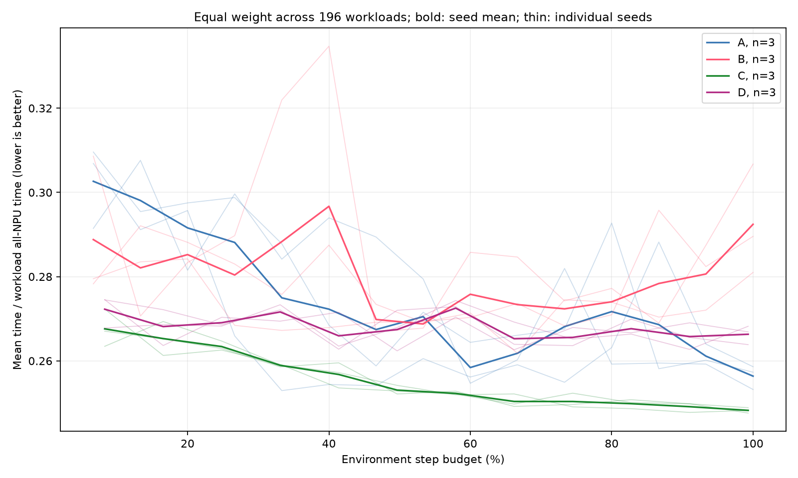
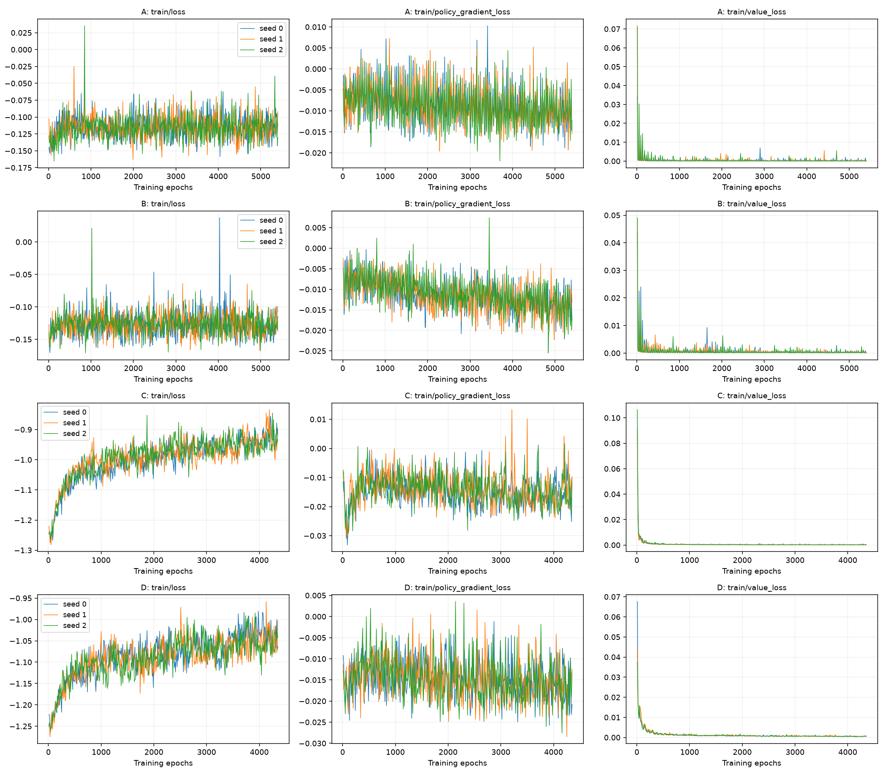

# 四组 PPO 训练结果（2026-11-23）

本页更新至 2026-11-23。12 个模型均已完成训练及重载验收：A/B 每 seed 540 轮、1,244,160 环境步，C/D 每 seed 435 轮、1,002,240 环境步。新 BurstGPT 实验另见[泛化报告](../2026-11-20_BurstGPT固定时间窗泛化/README.md)。全部结果来自解析模拟，并非 NPU/PIM 真机测量。

训练网格指标为各工况的模拟批次耗时 / 同工况全 NPU 耗时，再对 196 项等权平均，越低越好。BurstGPT 单独使用相对 PD 的总服务耗时降幅；两种指标不混用。

## 1. 四组训练方案

| 方案 | 观测 | 维度 | 一次动作 | 步数 / 批次 |
| --- | --- | ---: | --- | ---: |
| A | 原始信息 + 算子类别 | 18 | 单算子二选一 | 9S |
| B | KV / 驻留占比 + 动作前缀 | 26 | 单算子二选一 | 9S |
| C | 原始信息 | 9 | 整段 9 位放置 | S |
| D | KV / 驻留占比 | 18 | 整段 9 位放置 | S |

- 原始信息：设备 timeline（3）＋阶段（2）＋decode 进度（1）；A 另含算子类别（9）。
- KV / 驻留：`ln(1+KV 长度)`（1）＋ NPU / PIM 权重驻留占比（14）；B 另含动作前缀（8）。
- 四组共同包含输入长度、推理 batch 和已知目标输出长度；S 为一个 prefill 段加全部 decode 段。

## 2. 共同设置与实际训练预算

Qwen 1.8B，28 层，FP16，1 NPU + 2 PIM，每个推理批次冷启动。prefill 和 decode 各取 64、256、512、1024、2048、4096、8192 token，推理 batch 为 1、4、8、16，共 196 工况。每个新批次独立、等概率、有放回抽取一种组合；开批时已知目标输出长度。

放置刷新间隔为 `min(256, ceil(decode_len / 16))`，七种输出长度依次对应 4、16、32、64、128、256、256 token。S 为一个 prefill 段加全部 decode 段：输出至 4096 时每批 17 段，输出 8192 时每批 33 段，A/B 分别需要 153 或 297 个环境步。每个真实 decode token 均推进模拟器。

64 环境 × 36 步，每轮 2,304 条 transition；mini-batch=64、10 epochs，每轮 360 次优化更新。Actor/Critic 各 2×64，lr=3e−4，γ=1，GAE λ=0.95，clip=0.2，ent_coef=0.2，vf_coef=0.5，max_grad_norm=0.5，未设 target_kl。

| 每个 seed | A | B | C | D |
| --- | --- | --- | --- | --- |
| 实际环境步数 | 1,244,160 | 1,244,160 | 1,002,240 | 1,002,240 |
| Rollouts | 540 | 540 | 435 | 435 |
| 训练 epochs | 5,400 | 5,400 | 4,350 | 4,350 |
| Optimizer steps | 194,400 | 194,400 | 156,600 | 156,600 |
| 完整推理批次，seed 0 / 1 / 2 | 7,092 / 7,095 / 7,091 | 7,048 / 7,095 / 7,091 | 51,972 / 51,966 / 51,977 | 51,972 / 51,966 / 51,977 |
| 完整批次中的请求数，seed 0 / 1 / 2 | 52,071 / 52,120 / 51,834 | 51,722 / 52,120 / 51,834 | 377,970 / 377,879 / 377,687 | 377,970 / 377,879 / 377,687 |

A/B 本次从 360 轮 Final 保留权重与 Adam 状态，再增加 180 轮到累计 540 轮。64 个未完批次重启，工况采样种子为 829440 + seed，动作 RNG 按原生 `PPO.load` 初始化。每 82,944 步周期评估一次，累计 15 次；180、360 轮模型与报告分别归档保留。

C/D 从自身 180 轮 Final 保留权重及 Adam 状态，新增 255 轮到累计 435 轮。未完批次重启，工况采样种子为 414720 + seed。每 82,944 步周期评估，累计 12 次；最后一次为 995,328 步，Final 在 1,002,240 步的最后一次 PPO 更新后单独评估。A/B 每段九项算子奖励在计算 GAE 前回填，C/D 每步按整段计奖。

上表是每个模型、每个 seed 的步数；三个 seed 独立训练。只启用 64 路，共 12 个模型。有效模型累计 **13,478,400 环境步**；含已退役旧博雅 A 的历史正式累计为 14,722,560 步。此次采用用户后续要求的“每 seed 至少 100 万步”，已取代早先全轮 1,000 万步上限，归档前缀不重复计数。

## 3. 四组结果与固定基线

196 工况，三 seed 均值 ± 样本标准差。

| 方案 | Best | 预算检查点 | Final | Final − Best |
| --- | --- | --- | --- | --- |
| A | 0.2545 ± 0.0025 | 0.2564 ± 0.0028 | 0.2539 ± 0.0041 | -0.0006 |
| B | 0.2653 ± 0.0030 | 0.2924 ± 0.0131 | 0.2846 ± 0.0120 | +0.0193 |
| C | 0.2481 ± 0.0007 | — | 0.2481 ± 0.0006 | -0.000028 |
| D | 0.2626 ± 0.0002 | — | 0.2672 ± 0.0040 | +0.0046 |

Best 取周期评估最低值，A/B 共 15 次、C/D 共 12 次，均不包含 Final。A/B 的预算检查点在最后一次 PPO 更新前保存；Final 在更新后保存。C/D 的最终预算未落在 82,944 步评估间隔上，因此没有对应的更新前预算评估（—），已有更新后的 Final。

| 固定基线 | 196 工况归一化耗时 |
| --- | ---: |
| 全 NPU | 1.0000 |
| 全 PIM | 0.7089 |
| Prefill NPU / Decode PIM | 0.2786 |
| 逐工况取最快固定策略 | 0.2702 |

当前 Final 均值排序为 **C、A、D、B**。C 为 **0.2481 ± 0.0006**，相对 PD 低 **10.97%**；A、D 分别低 8.88%、4.09%，B 高 2.14%。A/B 比 C/D 多约 24.14% 环境步，因此仍不是严格等预算对照。逐工况最快固定策略仅为上述三条固定策略集合的参考值。

C 从 180 轮续训至 435 轮，Final 均值耗时下降 **3.95%**；D 上升 **0.59%**，不能据此声称 D 续训有效。12 个 Final 中指标最低的是 **C / seed 0：0.247388**。新泛化在测试前分别冻结 A1、B1、C0、D0，各自仅按 196 合成工况的 Final 选 seed。

| 方案 | 180 轮 Final | 360 轮 Final | 540 轮 Final | 540 vs 360 耗时变化 |
| --- | ---: | ---: | ---: | ---: |
| A | 0.2744 ± 0.0186 | 0.2594 ± 0.0052 | 0.2539 ± 0.0041 | -2.14% |
| B | 0.2902 ± 0.0320 | 0.2768 ± 0.0056 | 0.2846 ± 0.0120 | +2.82% |

**A/B 从 360 到 540 轮：A 有小幅收益，B 出现一致退化。** 相比 360 轮，A 均值耗时下降 **2.14%**，三个 seed 均改善；B 均值耗时上升 **2.82%**，三个 seed 均变差。A 在三个 seed 间的样本标准差从 0.0052 降到 0.0041，B 从 0.0056 增到 0.0120。

| 方案 | 180 轮 Final | 435 轮 Final | 435 vs 180 耗时变化 |
| --- | ---: | ---: | ---: |
| C | 0.2583 ± 0.0055 | 0.2481 ± 0.0006 | -3.95% |
| D | 0.2657 ± 0.0014 | 0.2672 ± 0.0040 | +0.59% |

### Bifocal：196 工况参数搜索

既有 16 组候选共 3,136 个组合已完成，447 个获选计划通过独立逐 token 回放。两组最好共用参数 `h2_g0.5_p64_d512` / `h2_g0.5_p64_d1024` 并列，逐工况耗时相同。

| Bifocal 选参方式 | 196 工况归一化耗时 | 平均批次耗时 / ms |
| --- | ---: | ---: |
| 按归一化耗时选一套共用参数 | 0.270870 | 6708.056 |
| 按绝对耗时选一套共用参数 | 0.276985 | 6338.175 |
| 逐工况从 16 候选中取最低值 | 0.239084 | 5653.476 |

主要口径为逐工况归一化后等权平均，与 PPO 一致。最好共用参数比 A 的 Final 均值慢 6.69%、比 B 快 4.82%；逐工况选参须分别挑参数。结果为候选集内解析模拟。新 BurstGPT 使用在此选定的共用参数 h2_g0.5_p64_d512，不用泛化结果重新调参。

[完整 Bifocal 报告、参数与计划](../2026-11-19_四组PPO训练结果/bifocal/README.md)

全部 seed 的训练结果

| 方案 / seed | Initial | Best | 预算检查点 | Final |
| --- | --- | --- | --- | --- |
| A / 0 | 1.0000 | 0.2529 | 0.2586 | 0.2585 |
| A / 1 | 0.7089 | 0.2532 | 0.2532 | 0.2509 |
| A / 2 | 1.4153 | 0.2573 | 0.2573 | 0.2522 |
| B / 0 | 0.3192 | 0.2669 | 0.3067 | 0.2967 |
| B / 1 | 1.1746 | 0.2618 | 0.2810 | 0.2727 |
| B / 2 | 0.5035 | 0.2672 | 0.2896 | 0.2843 |
| C / 0 | 0.9310 | 0.2478 | — | 0.2474 |
| C / 1 | 0.8113 | 0.2489 | — | 0.2481 |
| C / 2 | 1.0360 | 0.2476 | — | 0.2487 |
| D / 0 | 0.9041 | 0.2628 | — | 0.2632 |
| D / 1 | 0.9084 | 0.2624 | — | 0.2673 |
| D / 2 | 0.7955 | 0.2627 | — | 0.2712 |

| 方案 / seed | 180 轮 Final | 360 轮 Final | 540 轮 Final | 540 vs 360 耗时变化 |
| --- | ---: | ---: | ---: | ---: |
| A / 0 | 0.2530 | 0.2609 | 0.2585 | -0.93% |
| A / 1 | 0.2851 | 0.2536 | 0.2509 | -1.07% |
| A / 2 | 0.2852 | 0.2637 | 0.2522 | -4.38% |
| B / 0 | 0.3267 | 0.2817 | 0.2967 | +5.32% |
| B / 1 | 0.2765 | 0.2706 | 0.2727 | +0.78% |
| B / 2 | 0.2674 | 0.2780 | 0.2843 | +2.26% |

## 4. 四组实验耗时曲线

横轴为各组自身环境步预算的完成比例：A/B 的 100% 为 1,244,160 步，C/D 为 1,002,240 步。各组每 82,944 步评估一次，A/B 共 15 点，C/D 共 12 点；同色细线为各 seed，粗线为组内均值。图中是周期评估，最后一次 PPO 更新后的 Final 单列于结果表。

## 5. 训练 Loss

原始 SB3 日志，无平滑；横轴为训练 epochs，A/B 累计 5,400，C/D 为 4,350。沿用 GitHub README 的原生图样式：三个 seed 为蓝、橙、绿细线，线宽 0.8，线性纵轴，不叠加均值线。B0 的原始日志保留 536 条 Loss 记录（540 轮中有 4 条未记录），图中未补造数据；其余模型每轮均有记录。Total loss 是最后一个 mini-batch 的值，其他指标沿用 SB3 原生记录；四组决策粒度不同，Loss 大小不作为组间调度性能排名。

## 6. Critic 拟合与 KL

末次训练指标与训练期间峰值

| 方案 / seed | 末次 Value loss | Explained variance | 末次 approx KL | 峰值 approx KL |
| --- | --- | --- | --- | --- |
| A / 0 | 1.96e-05 | 0.994124 | 0.0057 | 0.0253 |
| A / 1 | 2.03e-05 | 0.994477 | 0.0058 | 0.0269 |
| A / 2 | 3.40e-05 | 0.991061 | 0.0070 | 0.0222 |
| B / 0 | 6.90e-05 | 0.972385 | 0.0089 | 0.0195 |
| B / 1 | 7.52e-05 | 0.969996 | 0.0062 | 0.0215 |
| B / 2 | 9.05e-05 | 0.971269 | 0.0078 | 0.0204 |
| C / 0 | 1.40e-04 | 0.981915 | 0.0098 | 0.0198 |
| C / 1 | 1.46e-04 | 0.981947 | 0.0092 | 0.0233 |
| C / 2 | 1.82e-04 | 0.966806 | 0.0084 | 0.0188 |
| D / 0 | 5.54e-04 | 0.951370 | 0.0096 | 0.0176 |
| D / 1 | 4.87e-04 | 0.960716 | 0.0080 | 0.0240 |
| D / 2 | 7.07e-04 | 0.947420 | 0.0130 | 0.0218 |

十二个模型记录的 loss 均为有限值；B 的 Best 未刷新，后五次周期评估均值连续变差，Final 退化。具体原因尚未确定，当前不建议继续单纯增加 B 的训练轮次。C 的训练网格 Final 改善，D 未随训练预算增加而改善；Loss 和 Critic 拟合本身不能证明放置性能改善。逐工况数据见完整报告。

## 7. 数据与验收

[汇总指标](metrics.json) · [逐工况结果](per_workload_results.json) · [周期评估 CSV](training_evaluation.csv) · [训练日志指标 CSV](loss_statistics.csv) · [历史比较](history.json) · [实验设置](experiment_settings.json) · [选定 seed](selected_models.json) · [验收记录](validation.json)
