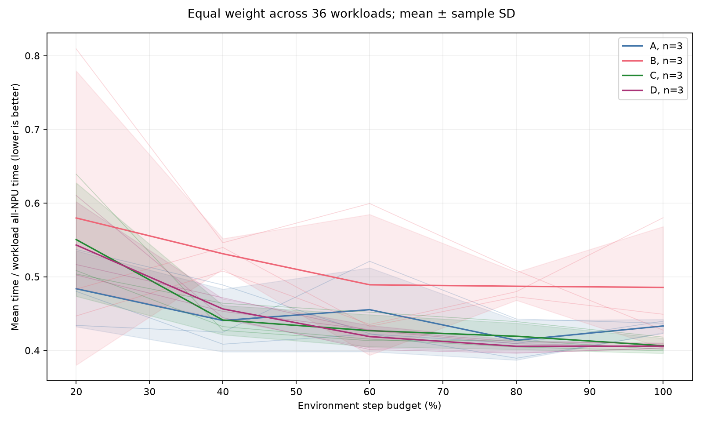
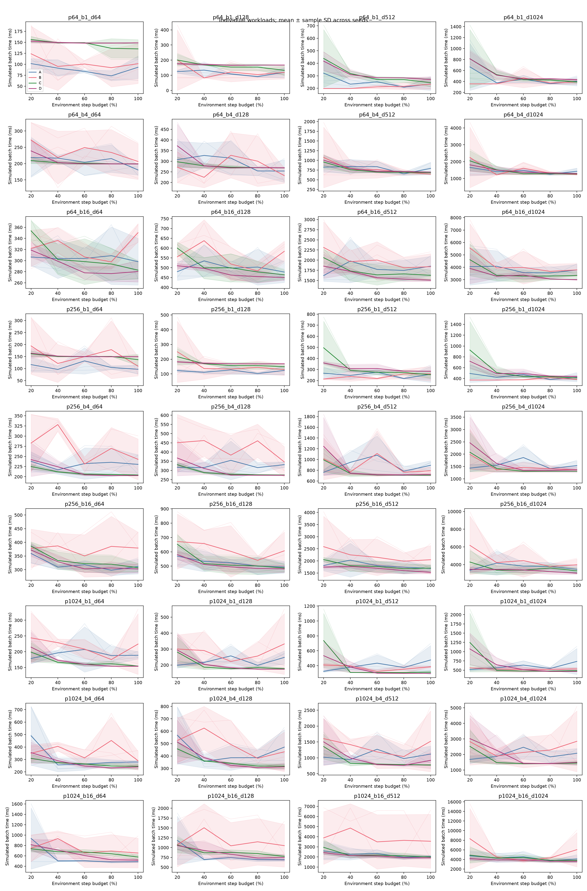
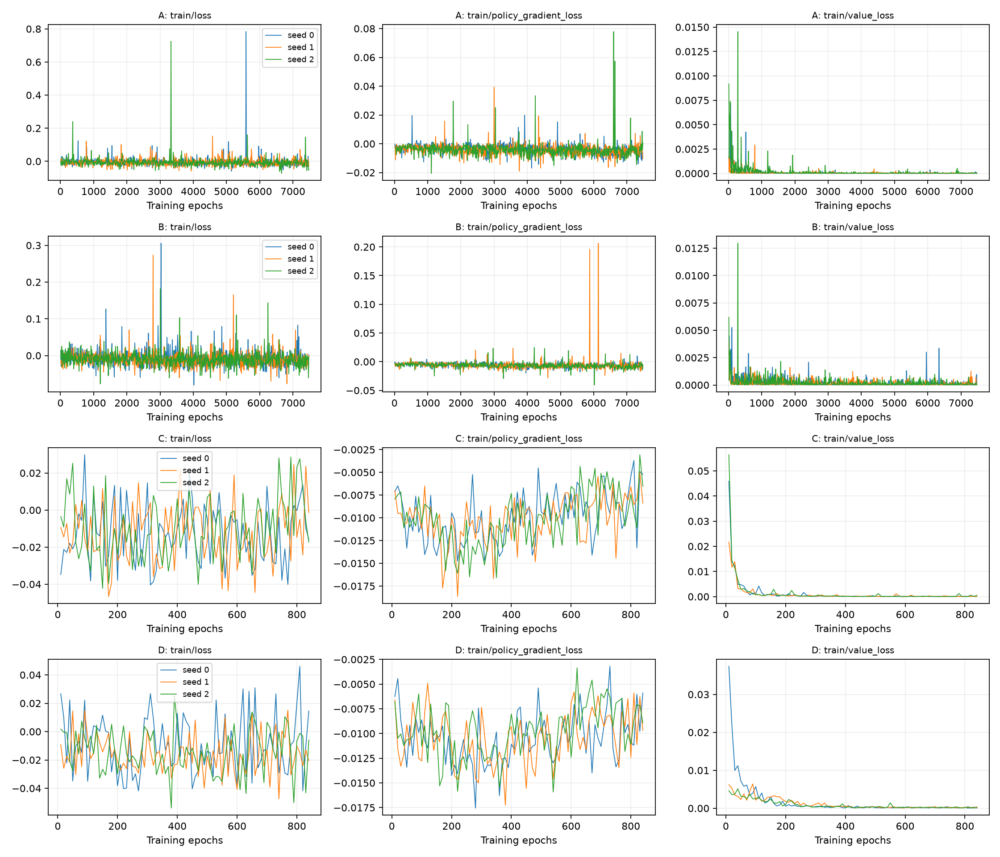

# 多工况 ABCD PPO 结果

已完成 12/12 次。
本轮不设置数值通过门槛。所有耗时均来自解析模拟器；未见工况不参与模型选择。

| 组别 | seed | Initial | Best | Budget | Final | 未见工况 Final |
| --- | ---: | ---: | ---: | ---: | ---: | ---: |
| A | 0 | 1.000000 | 0.408412 | 0.439652 | 0.441419 | 0.364734 |
| A | 1 | 0.801793 | 0.424703 | 0.436907 | 0.414395 | 0.348127 |
| A | 2 | 1.416535 | 0.389386 | 0.422908 | 0.417549 | 0.319440 |
| B | 0 | 0.477943 | 0.432666 | 0.449042 | 0.474019 | 0.388007 |
| B | 1 | 1.296059 | 0.435225 | 0.580028 | 0.606589 | 0.558309 |
| B | 2 | 0.540950 | 0.427482 | 0.427482 | 0.414122 | 0.350074 |
| C | 0 | 0.892972 | 0.418092 | 0.418092 | 0.417727 | 0.331569 |
| C | 1 | 0.870530 | 0.399495 | 0.399495 | 0.400739 | 0.319936 |
| C | 2 | 0.972571 | 0.401400 | 0.401400 | 0.399362 | 0.309407 |
| D | 0 | 0.880109 | 0.396220 | 0.403239 | 0.400224 | 0.318410 |
| D | 1 | 0.915232 | 0.404569 | 0.404569 | 0.402292 | 0.311201 |
| D | 2 | 0.766318 | 0.409822 | 0.409822 | 0.410070 | 0.320765 |

表中指标为各工况 T / 全 NPU T 的等权均值，越低越好。
逐工况耗时、三 seed 均值与样本标准差、完整评估曲线及放置分别见 comparison.csv、summary_statistics.csv、evaluation_statistics.csv 和 placements.csv。
预算检查点位于指定步数；Final 为完成尾部 rollout 更新后的模型。各组实际优化次数保留在 aggregate.csv。

交付候选：C / seed 2 的 Final，见 selected_model/model.zip。
选择只使用 36 种已见工况的综合指标，不代表通过预设稳定性或泛化门槛。
