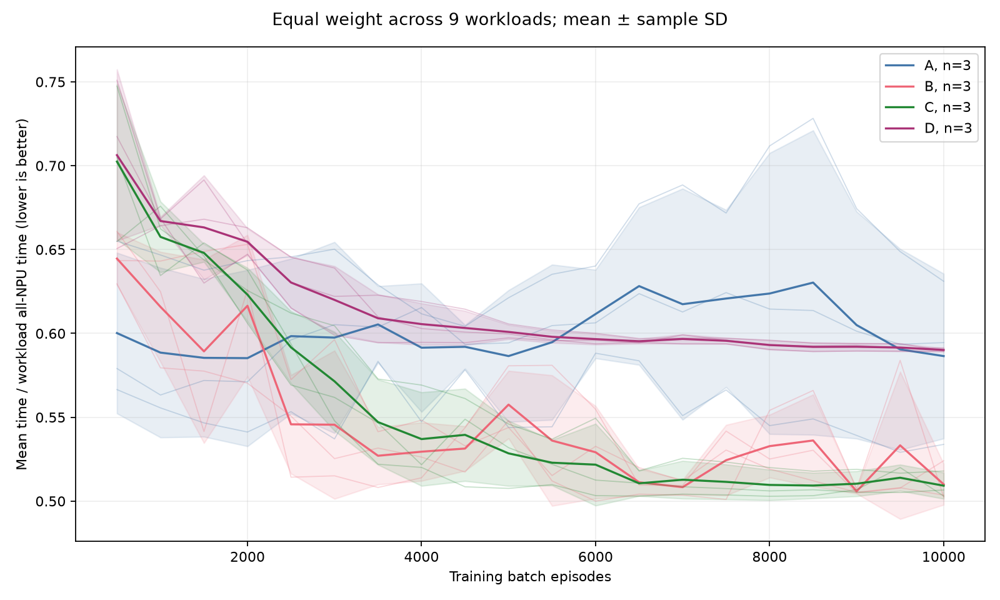
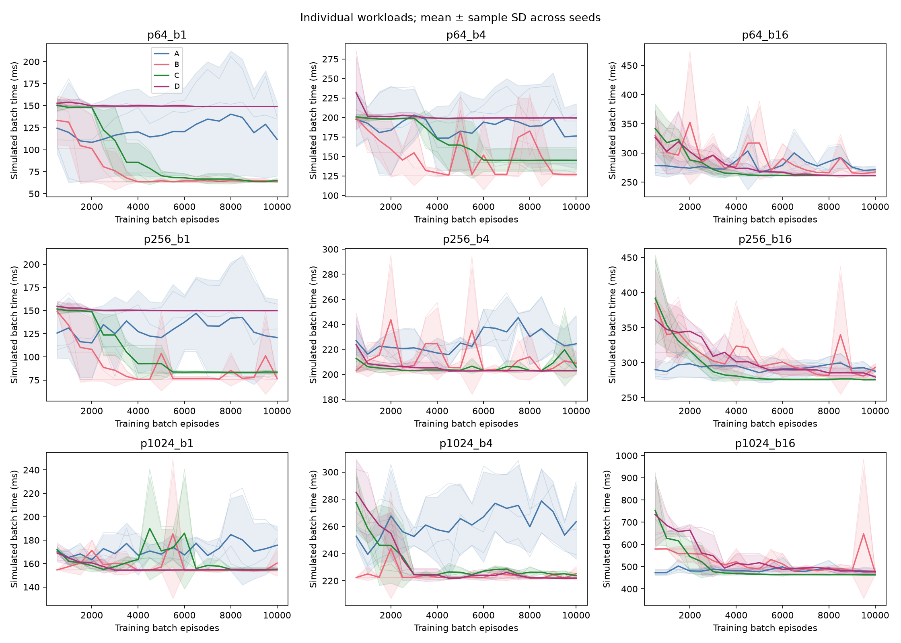
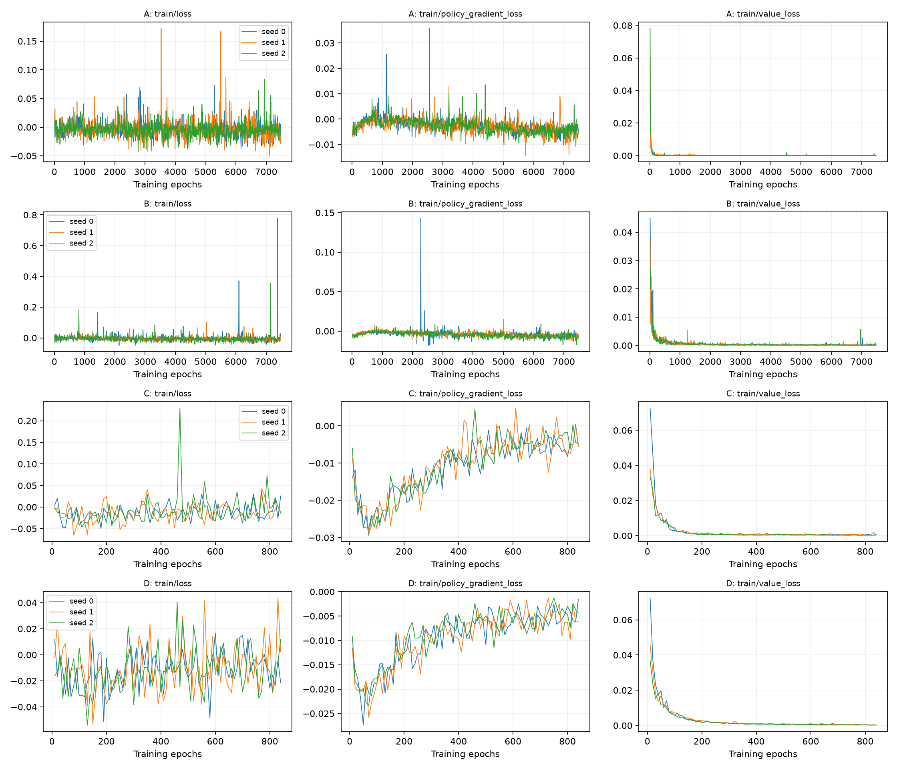

# 多工况 ABCD PPO 结果

已完成 12/12 次。
本轮不设置数值通过门槛。所有耗时均来自解析模拟器；未见工况不参与模型选择。

| 组别 | seed | Initial | Best | Budget | Final | 未见工况 Final |
| --- | ---: | ---: | ---: | ---: | ---: | ---: |
| A | 0 | 1.000000 | 0.563279 | 0.594528 | 0.592139 | 0.652811 |
| A | 1 | 1.451171 | 0.529105 | 0.533832 | 0.530664 | 0.609112 |
| A | 2 | 1.629518 | 0.604219 | 0.631087 | 0.619561 | 0.675185 |
| B | 0 | 1.075251 | 0.504859 | 0.524094 | 0.522058 | 0.589631 |
| B | 1 | 0.999888 | 0.503574 | 0.503574 | 0.500259 | 0.564415 |
| B | 2 | 1.000000 | 0.499986 | 0.502421 | 0.498797 | 0.568168 |
| C | 0 | 1.347863 | 0.505116 | 0.506648 | 0.504776 | 0.599118 |
| C | 1 | 1.394304 | 0.502882 | 0.503002 | 0.503175 | 0.590044 |
| C | 2 | 1.385867 | 0.516668 | 0.517971 | 0.519699 | 0.632790 |
| D | 0 | 1.421396 | 0.591308 | 0.591377 | 0.590559 | 0.618894 |
| D | 1 | 1.370968 | 0.589581 | 0.589581 | 0.589581 | 0.622734 |
| D | 2 | 1.403930 | 0.589177 | 0.589444 | 0.588439 | 0.617865 |

表中指标为各工况 T / 全 NPU T 的等权均值，越低越好。
逐工况耗时、三 seed 均值与样本标准差、完整评估曲线及放置分别见 comparison.csv、summary_statistics.csv、evaluation_statistics.csv 和 placements.csv。
预算检查点位于指定步数；Final 为完成尾部 rollout 更新后的模型。各组实际优化次数保留在 aggregate.csv。

交付候选：B / seed 2 的 Final，见 selected_model/model.zip。
选择只使用 9 种已见工况的综合指标，不代表通过预设稳定性或泛化门槛。
