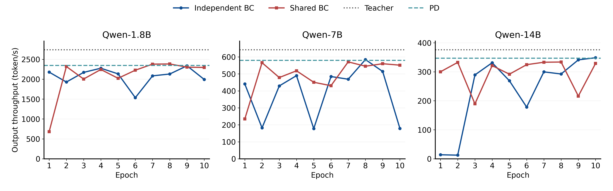

# BC 吞吐重算：全部排除决策开销

本报告只重算已有 E1—E10 结果，没有重新训练或重新执行模拟。原始含决策耗时的报告和 CSV 保留不变。

## 统一计算口径

- BC 吞吐 = 验证任务总输出 token / BC 安排的模拟执行总时间。
- 教师吞吐 = 同一批任务总输出 token / 各任务赢家教师的模拟执行总时间。
- PD 吞吐 = 同一批任务总输出 token / PD 安排的模拟执行总时间。
- 三者都排除决策、输入准备和计划编译开销；prefill/decode 计算、搬运、缓存与等待等模拟执行成本仍保留。
- 教师离线搜索的时间此前没有计入；这不等于其实际决策时间为零。PD 的决策时间此前计入，本次也移除，确保比较口径一致。
- 每个模型每轮均为同一组 8 个验证任务、17,280 输出 token。先求总量/总时间，不取逐任务吞吐的简单平均。
- BC、教师时间来自 training/<route>/epoch_*_cases.csv；PD 时间取 results/<case>.json 的 pd_simulated_s。重算的教师比例与旧 simulation_only_teacher_gap_pct 已逐行核对。
- 结果用于比较安排质量，是 DOPS fast 模拟吞吐，不代表实际端到端硬件吞吐。

## E10 与此前最佳

|路线|模型|E1→E10 token/s|教师 token/s|PD token/s|E10/教师|E10/PD|最佳 epoch|最佳 token/s|
|---|---|---:|---:|---:|---:|---:|---:|---:|
|独立|qwen_1.8b|2178.06 → 1993.10|2739.74|2346.59|72.75%|0.849×|E9|2336.92|
|独立|qwen_7b|440.56 → 178.70|642.10|579.78|27.83%|0.308×|E8|584.33|
|独立|qwen_14b|13.80 → 348.45|375.93|346.72|92.69%|1.005×|E10|348.45|
|共享|qwen_1.8b|680.02 → 2295.10|2739.74|2346.59|83.77%|0.978×|E8|2382.84|
|共享|qwen_7b|234.34 → 551.32|642.10|579.78|85.86%|0.951×|E7|570.80|
|共享|qwen_14b|299.99 → 328.82|375.93|346.72|87.47%|0.948×|E8|333.65|

[PNG](epoch_throughput.png) · [可编辑 SVG](epoch_throughput.svg) · [PDF](epoch_throughput.pdf) · [60 行逐轮汇总 CSV](epoch_aggregated.csv) · [480 行逐任务 CSV](epoch_cases.csv)

## E1—E10 全部结果

### 独立 qwen_1.8b

|Epoch|Train NLL|Val NLL|BC token/s|BC/教师|BC/PD|比 PD 高/低|
|---:|---:|---:|---:|---:|---:|---:|
|1|0.02741|0.02418|2178.06|79.50%|0.928×|-7.18%|
|2|0.02479|0.02410|1928.31|70.38%|0.822×|-17.82%|
|3|0.02255|0.02366|2171.09|79.24%|0.925×|-7.48%|
|4|0.01959|0.02090|2275.87|83.07%|0.970×|-3.01%|
|5|0.01851|0.02075|2133.55|77.87%|0.909×|-9.08%|
|6|0.02211|0.02327|1535.55|56.05%|0.654×|-34.56%|
|7|0.01653|0.01955|2083.84|76.06%|0.888×|-11.20%|
|8|0.01599|0.01853|2130.57|77.77%|0.908×|-9.21%|
|9|0.01561|0.01886|2336.92|85.30%|0.996×|-0.41%|
|10|0.01545|0.01923|1993.10|72.75%|0.849×|-15.06%|

### 独立 qwen_7b

|Epoch|Train NLL|Val NLL|BC token/s|BC/教师|BC/PD|比 PD 高/低|
|---:|---:|---:|---:|---:|---:|---:|
|1|0.01569|0.02331|440.56|68.61%|0.760×|-24.01%|
|2|0.01667|0.02685|181.88|28.33%|0.314×|-68.63%|
|3|0.01325|0.02221|429.09|66.83%|0.740×|-25.99%|
|4|0.01212|0.01975|489.75|76.27%|0.845×|-15.53%|
|5|0.01065|0.02010|177.48|27.64%|0.306×|-69.39%|
|6|0.01091|0.15892|484.42|75.44%|0.836×|-16.45%|
|7|0.00867|0.01997|468.63|72.98%|0.808×|-19.17%|
|8|0.00762|0.01930|584.33|91.00%|1.008×|+0.79%|
|9|0.00802|0.02037|514.19|80.08%|0.887×|-11.31%|
|10|0.00917|0.02132|178.70|27.83%|0.308×|-69.18%|

### 独立 qwen_14b

|Epoch|Train NLL|Val NLL|BC token/s|BC/教师|BC/PD|比 PD 高/低|
|---:|---:|---:|---:|---:|---:|---:|
|1|0.01543|0.02344|13.80|3.67%|0.040×|-96.02%|
|2|0.01491|0.02382|12.45|3.31%|0.036×|-96.41%|
|3|0.01436|0.02404|289.18|76.93%|0.834×|-16.59%|
|4|0.01371|0.02185|331.17|88.09%|0.955×|-4.49%|
|5|0.01335|0.02364|269.07|71.58%|0.776×|-22.39%|
|6|0.01402|0.02401|178.39|47.45%|0.515×|-48.55%|
|7|0.01181|0.02253|299.71|79.73%|0.864×|-13.56%|
|8|0.01042|0.02175|292.33|77.76%|0.843×|-15.69%|
|9|0.01019|0.02770|341.09|90.73%|0.984×|-1.62%|
|10|0.00895|0.02188|348.45|92.69%|1.005×|+0.50%|

### 共享 qwen_1.8b

|Epoch|Train NLL|Val NLL|BC token/s|BC/教师|BC/PD|比 PD 高/低|
|---:|---:|---:|---:|---:|---:|---:|
|1|0.02478|0.02333|680.02|24.82%|0.290×|-71.02%|
|2|0.02012|0.01878|2318.44|84.62%|0.988×|-1.20%|
|3|0.01817|0.02062|2004.30|73.16%|0.854×|-14.59%|
|4|0.01617|0.01813|2243.84|81.90%|0.956×|-4.38%|
|5|0.01509|0.01876|2023.03|73.84%|0.862×|-13.79%|
|6|0.01488|0.01955|2225.72|81.24%|0.948×|-5.15%|
|7|0.01428|0.01733|2378.80|86.83%|1.014×|+1.37%|
|8|0.01329|0.02264|2382.84|86.97%|1.015×|+1.55%|
|9|0.01385|0.02139|2302.78|84.05%|0.981×|-1.87%|
|10|0.01260|0.02067|2295.10|83.77%|0.978×|-2.19%|

### 共享 qwen_7b

|Epoch|Train NLL|Val NLL|BC token/s|BC/教师|BC/PD|比 PD 高/低|
|---:|---:|---:|---:|---:|---:|---:|
|1|0.01370|0.02273|234.34|36.50%|0.404×|-59.58%|
|2|0.00973|0.01797|565.87|88.13%|0.976×|-2.40%|
|3|0.00837|0.01970|478.40|74.50%|0.825×|-17.49%|
|4|0.00662|0.01708|518.24|80.71%|0.894×|-10.61%|
|5|0.00545|0.01740|450.73|70.20%|0.777×|-22.26%|
|6|0.00536|0.01755|430.42|67.03%|0.742×|-25.76%|
|7|0.00481|0.01616|570.80|88.89%|0.985×|-1.55%|
|8|0.00375|0.01838|545.17|84.90%|0.940×|-5.97%|
|9|0.00454|0.01884|559.91|87.20%|0.966×|-3.43%|
|10|0.00318|0.01812|551.32|85.86%|0.951×|-4.91%|

### 共享 qwen_14b

|Epoch|Train NLL|Val NLL|BC token/s|BC/教师|BC/PD|比 PD 高/低|
|---:|---:|---:|---:|---:|---:|---:|
|1|0.01442|0.02419|299.99|79.80%|0.865×|-13.48%|
|2|0.01193|0.02354|332.40|88.42%|0.959×|-4.13%|
|3|0.01108|0.02467|189.46|50.40%|0.546×|-45.36%|
|4|0.00826|0.02228|321.25|85.45%|0.927×|-7.35%|
|5|0.00736|0.02257|291.71|77.60%|0.841×|-15.87%|
|6|0.00688|0.02148|324.50|86.32%|0.936×|-6.41%|
|7|0.00631|0.01955|332.93|88.56%|0.960×|-3.98%|
|8|0.00497|0.02187|333.65|88.75%|0.962×|-3.77%|
|9|0.00517|0.02202|216.21|57.51%|0.624×|-37.64%|
|10|0.00404|0.02079|328.82|87.47%|0.948×|-5.16%|

