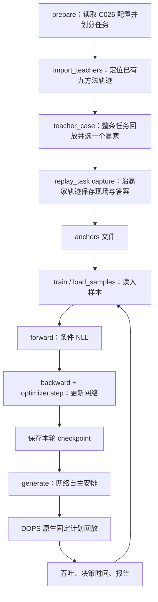

# 本轮 HPC BC 代码阅读路线

本轮只做 BC：用已经选好的教师答案训练设备分配网络，没有 PPO、reward 回传或 value head。本文对应从 HPC 实际目录同步的代码。

HPC 实验根目录：`/lustre/home/2501111916/workspace/DOPS-Serve/artifacts/bc_static_c026_20260913`。

- 实际运行代码：根目录下 `code/src/dops_serve/`。
- DOPS 后端：根目录下 `backend/DOPS/src/`。
- 教师、现场、检查点：根目录下 `teachers/`、`normalized/`、`anchors/`、`training/`。
- 不要把外层仓库的旧 `placement_training.py` 或 `PlacementActor` 类当成本轮入口。本轮网络是 `StaticPlacementActor`。

## 1. 先区分六个词

|词|本轮具体含义|
|---|---|
|任务 case|一种 Qwen 模型、batch、prompt 长度、decode 长度的组合；执行一次完整 prefill 和全部 decode|
|现场 state|某个决策时刻的状态，包括序列长度、KV、缓存、设备时间线、之前的安排等|
|节点 node|Qwen 计算图里的一个算子或分片，不是 BC 网络的一层|
|动作 action|给一个节点指定 NPU、PIM0 或 PIM1，编码为 0、1、2|
|计划 plan|整张图的节点设备映射，以及执行顺序|
|训练样本 sample|一个现场的输入特征，加上教师在该现场的一整份计划答案|

例如 Qwen-14B、batch=1、prompt=128、decode=128 是一个完整任务。它产生 1 份 prefill 计划，以及 t=0、1、2、4……126 的 65 份 decode 计划，所以是 66 个样本。这里 t 从 0 开始，是即将执行的 decode 步。

`batch_plans=16` 表示一次更新网络使用 16 份计划样本；它和任务配置中的 Qwen batch=1/4/8/16 是两种不同的 batch。

## 2. 从哪里启动

从 [slurm/run.sh](code/slurm/run.sh:4) 开始。它设置 `PYTHONPATH`，优先使用本次隔离目录的 `code/src` 和后端。训练的核心命令相当于：

```bash
python3 -m dops_serve.static_bc train --root "$BC_ROOT" \
  --backend "$BC_ROOT/backend/DOPS" --route qwen_14b --workers 8
```

`--route qwen_14b` 只训练 14B；`--route shared` 将三个模型样本交给同一个网络。Slurm 包装负责申请资源与选择容器，算法入口在 [static_bc.py:main](code/src/dops_serve/static_bc.py:601)。



上图最后的循环只在本批 10 个 epoch 内发生；第 10 轮结束后停止。

## 3. 先选教师，然后才训练

[prepare](code/src/dops_serve/static_bc.py:50) 直接读旧 C026 各任务的运行配置，固定 train/val/test。当前是 144 个训练任务、24 个验证任务，24 个 test 任务保持锁定。

[import_teachers](code/src/dops_serve/static_bc.py:83) 只记录已有轨迹的路径：Bifocal 来自 C026，另外八种方法来自 `fast_bc_restart_20260908/teacher_runs`。旧目录里的旧 Bifocal 不参与本轮。

[teacher_case](code/src/dops_serve/static_bc.py:257) 对每个任务做以下事情：

1. 读九种方法的完整 prefill + decode 轨迹。
2. 用共同节点顺序和小算子固定规则整理计划。
3. 各自从相同初始条件开始，用 DOPS 完整回放整个任务。
4. 比较 `输出 token 数 / 模拟总耗时`，选最高的一个完整赢家。
5. 再沿赢家轨迹走一遍，保存每个决策点的输入和答案。

关键代码是：

```python
winner = max(scores, key=lambda row: row["throughput"])
captured = replay_task(..., plans=normalized[winner["method"]], capture=True)
```

每个任务只学这个赢家。其他候选保留供分析，不参与 BC 梯度。教师不是从九种方法中给每个节点分别挑一个动作，也不是每个 decode 窗口重新选一名方法赢家。

## 4. 一个训练样本里装了什么

[replay_task](code/src/dops_serve/static_bc.py:211) 在 prefill 前和 decode 更新点调用 [static_policy_inputs](code/src/dops_serve/placement_dataset.py:273)。

样本的主要字段：

|字段|形状|含义|
|---|---|---|
|state|47 个数|当前任务、模型结构、缓存/KV、设备和链路状态|
|nodes|N × 35|每个节点的角色、位置、分片、计算规模、缓存和历史设备|
|actions|N 个整数|教师给每个节点选的设备：0/1/2|
|masks|N × 3|每个节点哪些设备是合法选择|
|learned|N 个标记|哪些节点需要通过 loss 学习|
|fixed_from|N 个整数|自主生成时，小算子的设备应该跟随哪个前序节点|

N 在当前 1.8B、7B 为 728，在 14B 为 1,040。它是网络需要处理的算子节点数，不是 BC 的网络层数。

47 维全局输入包含 batch、prompt、总 decode 长度、当前进度、模型结构，以及缓存、KV、设备和链路时间线。35 维节点输入的最后 6 维明确记录：该节点之前在 prefill 的设备，以及上一份 decode 计划中的设备，各用 3 位表示。

`anchors/<case>.jsonl.gz` 每行就是这样一个样本。它不是只有一串设备答案，还保留“这个答案是在什么现场产生的”。现场沿赢家计划连续推进，随后冻结成训练数据。

## 5. 网络怎样读这些输入

从 [StaticPlacementActor.__init__](code/src/dops_serve/placement_policy.py:150) 读网络结构：

```text
47 维现场 ── 4 层 Linear+Tanh ── 256 维初始记忆

每节点 35 维 ── 4 层 Linear+Tanh ── 256 维节点表示

节点表示 + 该节点所选设备的 3 位表示 ── GRU ── 更新 256 维记忆

当前节点表示 + 此节点之前的记忆 ── 512→256→3 ── 三台设备的分数
```

网络共 945,411 个参数。GRU 在同一份计划内跨节点传递记忆。每次开始生成新计划，记忆都由当前 47 维现场重新初始化；不是把上一份计划末尾的 GRU hidden 直接接到下一份计划。跨 prefill/decode 的安排历史通过那 6 维显式设备特征传进来。

## 6. 训练时怎样计算 loss

[forward](code/src/dops_serve/placement_policy.py:168) 是训练和条件 NLL 验证使用的路径。假设教师答案前三个节点是 `[NPU, PIM0, NPU]`：

- 预测第 1 个节点时，只看现场和第 1 个节点。
- 预测第 2 个节点时，还会得到教师对第 1 个节点的答案 NPU。
- 预测第 3 个节点时，得到教师的前两个答案 NPU、PIM0。

这叫条件预测：后面节点的判断依赖前面已指定的设备。训练时提供前序教师答案，叫 teacher forcing。

虽然 `actions` 整串传进 `forward`，代码用右移后的记忆避免偷看当前答案：

```python
after, _ = self.gru(history, initial.unsqueeze(0))
before = torch.cat((initial.unsqueeze(1), after[:, :-1]), dim=1)
```

`after[i]` 包含第 i 个教师动作，不能拿来预测第 i 个动作，所以预测时改用前一个位置的记忆。当前节点的教师动作仅用于计算“答得对不对”。

```python
nll = cross_entropy(logits.transpose(1, 2), actions, reduction="none")
losses = (nll * learned).sum(1) / learned.sum(1)
```

NLL 衡量网络给教师设备分配了多少概率：教师设备概率 0.8 时，损失约 0.223；概率 0.2 时约 1.609。越愿意给出教师答案，损失越小。先对每份计划中要学习的节点平均。

LN/Softmax 的设备按固定规则确定，`learned=False`，不进入动作损失；但它们仍被处理、执行并影响后面的上下文。KV 写入和通信也仍由编译器/后端处理，并没有从模拟成本里删除。

这里没有把吞吐或 reward 加进 loss，也没有对多个候选分配权重。只学一个赢家。

## 7. 训练循环怎样更新参数

主要读 [train](code/src/dops_serve/static_bc.py:505)。前半段加载数据、从头初始化网络和 Adam；然后进行 10 轮：

```python
for epoch in range(1, 11):
    for rows in batches(train_samples, 16, rng):
        optimizer.zero_grad(set_to_none=True)
        losses, _ = actor(*batch_tensors(rows, device))
        loss = 加权汇总(losses)
        loss.backward()
        clip_grad_norm_(actor.parameters(), 1.0)
        optimizer.step()
    保存检查点并验证()
```

- `zero_grad` 清掉上一次计算的梯度，不会清空已经学到的网络参数。
- `backward` 算出各个参数该往哪个方向调整。
- `clip_grad_norm_` 限制梯度过大的情况。
- `optimizer.step` 才真正修改参数。

[load_samples](code/src/dops_serve/static_bc.py:318) 设置 `task_weight=1/该任务样本数`。这是让每个完整任务对训练目标等权，不是给好坏候选加权。例如短任务有 66 个样本，各权重 1/66；长任务有 514 个样本，各权重 1/514。

[batches](code/src/dops_serve/static_bc.py:332) 将样本打乱，但同一训练 batch 内属于同一个 Qwen 模型，方便堆成规则张量。共享网络的三个模型 batch 会交替更新同一套参数。一个 batch 的形状例如：`state=[16,47]`、`nodes=[16,1040,35]`、`actions=[16,1040]`。

每个独立网络每轮使用 11,616 份训练计划，做 726 次参数更新；共享网络使用 34,848 份计划，做 2,178 次更新。每轮遍历全部计划。训练循环内不重新调用 DOPS 搜索或模拟，DOPS 在数据准备及下面的自主验证阶段使用。

## 8. 为什么 loss 下降，吞吐仍可能不好

每轮有两种不同的验证：

1. [loss_evaluate](code/src/dops_serve/static_bc.py:352)：在固定教师现场，仍提供前序教师动作，检查条件 NLL。
2. [evaluate_case](code/src/dops_serve/static_bc.py:365)：加载这一轮的模型，要求它从头自主生成安排，再让 DOPS 执行完整任务。

第二种使用 [generate](code/src/dops_serve/placement_policy.py:180)。它逐节点选择分数最高的合法设备，然后立刻把自己刚选的动作放进 GRU，影响下一个节点。此时不会提供教师的前序答案。

所以训练/条件 NLL 很好，仍可能在自主生成时因为一个前序动作不同而走到另一条安排上。跨 decode 时，缓存、KV 和输入中的上一份计划也跟着自己的实际执行变化。

## 9. 谁决定每隔 2 个 token 调一次

[refresh](code/src/dops_serve/static_bc.py:46)：

```python
def refresh(t):
    return t < 2 or t % 2 == 0
```

在 [replay_task](code/src/dops_serve/static_bc.py:231) 中，满足这个条件就构造输入、调用 `generate`、编译计划。不满足就沿用上一份计划，但每个 token 都会执行模拟。

当前没有“连续几次计划相同就跳过下次网络调用”的逻辑。即使两次答案相同，第二次调用和整份生成的成本已经发生了。当前实现也不会只重新生成有变化的少数节点。

“少调用网络”和“少给训练数据标注”是两个不同的问题。细粒度教师可以保留；实际调用间隔能否放大，需要让 BC 在更粗间隔下自主执行验证，而不能仅在已生成的轨迹上删除重复行后宣称收益。

## 10. 哪段负责模拟执行和计时

[StaticPlacementCompiler](code/src/dops_serve/placement_compiler.py:125) 把动作编码 0/1/2 转回具体设备，补入固定 KV 规则并输出 `device_by_node + order`。

[dops_fixed_replay.replay_phase](code/src/dops_serve/dops_fixed_replay.py:79) 调用 DOPS 原生的 `schedule_with_plan`。它执行给定计划并返回模拟结束时间；这里不会重新用 Bifocal 搜索替换 BC 给出的设备安排。

决策计时在 `replay_task` 内包住输入准备、网络生成和计划编译；DOPS 回放在这个计时区间之外。最终主吞吐是：

```text
所有验证任务输出 token 总数 / (DOPS 模拟执行时间总和 + 决策实测时间总和)
```

每轮模型在 `training/<route>/epoch_XXX.pt`；数值在 `training_progress.csv`、`epoch_XXX_cases.csv`；图在 `figures/`。这些是 fast 调度模拟与实测决策开销的组合，不是真实 Qwen 硬件推理测量。

## 建议实际打开代码的顺序

先读 `static_bc.py:train` 看总循环；再读 `placement_policy.py:forward` 理解 loss；然后读 `generate` 对比训练和自主运行；最后读 `replay_task`、`static_policy_inputs` 和 `teacher_case`，追溯样本的产生与验证。

## 本次刷新密度实测

E10 的 48 次验证重放已完成。独立 BC 的整份计划重复率为 1.8B 99.58%、7B 100%、14B 100%；共享 BC 均超过 99%。详见 [重复率报告](diagnostics/refresh_density/report.md)，包含教师对照和统计口径。
