# C026 教师 BC：十轮完整结果

2026-09-13｜四路作业均 COMPLETED，退出码 0:0；各完成 10 个 epoch，等待用户决定是否继续。

## 配置与数据

- Qwen-1.8B、7B、14B；NPU/PIM 均 fast；C026 的 H=2、gamma=0.4、lambda=0.5、eta=0.5、reuse=1；加载重叠系数 0.5/1.0；教师及 BC 每 2 token 决策。
- 复用 168 个训练/验证任务 × 9 方法，共 1,512 条完整候选。Bifocal 只来自 C026，旧 teacher_runs 的 Bifocal 未使用。处理为共同合法顺序和小算子规则后重评分，选每任务唯一完整赢家。
- 共 40,656 份计划/现场：34,848 训练，5,808 验证。每个独立网络训练 48 个任务、11,616 份计划，验证 8 个任务、1,936 份计划；共享网络使用三模型总和。
- 四路均从头初始化，seed=7，945,411 参数；编码器 4×256 MLP、GRU 256；Adam 1e-4、batch 16 plans；条件 NLL、任务等权。
- 27 组原生来源/回放耗时完全一致；198 个真实状态的自主动作与条件网络输出一致。这些检查支持代码一致性，不代表真实硬件测量准确性。

## E10 结果和变化

主吞吐包含网络输入准备、设备决策和计划编译耗时；不包含模拟器宿主机执行时间。“仅安排/教师”排除网络决策开销，用于区分安排质量与决策速度；它不是主结果。

|路线|模型|训练 NLL E1→E10|验证 NLL E1→E10|吞吐 E1→E10 (token/s)|E10 BC/PD|E10 仅安排/教师|E10 决策占比|最佳吞吐 epoch|
|---|---|---|---|---|---:|---:|---:|---:|
|独立|qwen_1.8b|0.02741 → 0.01545|0.02418 → 0.01923|122.62 → 121.54|0.196×|72.75%|93.9%|E1|
|独立|qwen_7b|0.01569 → 0.00917|0.02331 → 0.02132|100.29 → 74.91|0.218×|27.83%|58.1%|E8|
|独立|qwen_14b|0.01543 → 0.00895|0.02344 → 0.02188|11.97 → 71.79|0.329×|92.69%|79.4%|E10|
|共享|qwen_1.8b|0.02478 → 0.01260|0.02333 → 0.02067|105.97 → 119.24|0.195×|83.77%|94.8%|E7|
|共享|qwen_7b|0.01370 → 0.00318|0.02273 → 0.01812|81.66 → 102.63|0.301×|85.86%|81.4%|E2|
|共享|qwen_14b|0.01442 → 0.00404|0.02419 → 0.02079|68.09 → 69.27|0.320×|87.47%|78.9%|E2|

独立 14B 的安排质量从 E1 的教师吞吐 3.67% 提升至 E10 的 92.69%，但主吞吐仍只有 PD 的 32.9%。独立 7B 在 E8 的仅安排吞吐达到教师的 91.00%，E10 回退到 27.83%；验证 NLL 并不能充分反映自主执行的稳定性。独立 1.8B 的含决策吞吐基本持平。共享网络在本次运行中改善了 7B 的 E10 稳定性，但还不能据此认定共享结构普遍更优。
网络决策耗时是主要限制之一，尤其是 1.8B；当前六组结果均未超过 PD。此处跨路线主机与 GPU 型号不同，主吞吐又包含 CPU 决策时间，直接比较小幅差别需谨慎。所有结果来自 DOPS fast 调度模拟。
建议先定位独立 7B E8→E10 自主动作变化，并检查和优化决策路径耗时，再决定是否追加训练。当前未运行 PPO、test 或第 11 轮。

## 获胜教师分布（训练和验证合计）

|模型|获胜方法与任务数|
|---|---|
|qwen_1.8b|weights_on_pim: 1；Bifocal: 46；PD: 5；PD+Linear: 4|
|qwen_7b|weights_on_pim: 2；Bifocal: 46；PD: 4；PD+Linear: 4|
|qwen_14b|weights_on_pim: 2；Bifocal: 42；PD: 8；PD+Linear: 4|

## E1—E10 全部指标

决策秒数为该模型 8 个验证任务的合计。教师差距为 BC/教师吞吐−1；负数表示低于教师。

### 独立 qwen_1.8b

|Epoch|Train NLL|Val NLL|BC token/s|教师差距|BC/PD|决策 s|仅安排/教师|
|---:|---:|---:|---:|---:|---:|---:|---:|
|1|0.02741|0.02418|122.62|-95.52%|0.198×|132.99|79.50%|
|2|0.02479|0.02410|121.61|-95.56%|0.196×|133.13|70.38%|
|3|0.02255|0.02366|120.86|-95.59%|0.195×|135.01|79.24%|
|4|0.01959|0.02090|121.36|-95.57%|0.196×|134.80|83.07%|
|5|0.01851|0.02075|120.98|-95.58%|0.195×|134.73|77.87%|
|6|0.02211|0.02327|119.04|-95.66%|0.192×|133.91|56.05%|
|7|0.01653|0.01955|120.97|-95.58%|0.195×|134.56|76.06%|
|8|0.01599|0.01853|121.08|-95.58%|0.195×|134.60|77.77%|
|9|0.01561|0.01886|121.30|-95.57%|0.196×|135.06|85.30%|
|10|0.01545|0.01923|121.54|-95.56%|0.196×|133.51|72.75%|

### 独立 qwen_7b

|Epoch|Train NLL|Val NLL|BC token/s|教师差距|BC/PD|决策 s|仅安排/教师|
|---:|---:|---:|---:|---:|---:|---:|---:|
|1|0.01569|0.02331|100.29|-84.38%|0.292×|133.08|68.61%|
|2|0.01667|0.02685|75.38|-88.26%|0.219×|134.25|28.33%|
|3|0.01325|0.02221|99.58|-84.49%|0.290×|133.26|66.83%|
|4|0.01212|0.01975|102.92|-83.97%|0.300×|132.62|76.27%|
|5|0.01065|0.02010|75.19|-88.29%|0.219×|132.45|27.64%|
|6|0.01091|0.15892|102.01|-84.11%|0.297×|133.72|75.44%|
|7|0.00867|0.01997|101.74|-84.16%|0.296×|132.97|72.98%|
|8|0.00762|0.01930|105.25|-83.61%|0.306×|134.61|91.00%|
|9|0.00802|0.02037|102.58|-84.03%|0.299×|134.86|80.08%|
|10|0.00917|0.02132|74.91|-88.33%|0.218×|133.99|27.83%|

### 独立 qwen_14b

|Epoch|Train NLL|Val NLL|BC token/s|教师差距|BC/PD|决策 s|仅安排/教师|
|---:|---:|---:|---:|---:|---:|---:|---:|
|1|0.01543|0.02344|11.97|-96.82%|0.055×|191.67|3.67%|
|2|0.01491|0.02382|10.95|-97.09%|0.050×|189.92|3.31%|
|3|0.01436|0.02404|68.40|-81.81%|0.314×|192.88|76.93%|
|4|0.01371|0.02185|70.60|-81.22%|0.324×|192.57|88.09%|
|5|0.01335|0.02364|67.94|-81.93%|0.312×|190.12|71.58%|
|6|0.01402|0.02401|59.60|-84.14%|0.273×|193.04|47.45%|
|7|0.01181|0.02253|69.09|-81.62%|0.317×|192.46|79.73%|
|8|0.01042|0.02175|68.84|-81.69%|0.316×|191.92|77.76%|
|9|0.01019|0.02770|71.12|-81.08%|0.326×|192.32|90.73%|
|10|0.00895|0.02188|71.79|-80.90%|0.329×|191.13|92.69%|

### 共享 qwen_1.8b

|Epoch|Train NLL|Val NLL|BC token/s|教师差距|BC/PD|决策 s|仅安排/教师|
|---:|---:|---:|---:|---:|---:|---:|---:|
|1|0.02478|0.02333|105.97|-96.13%|0.173×|137.66|24.82%|
|2|0.02012|0.01878|117.72|-95.70%|0.192×|139.33|84.62%|
|3|0.01817|0.02062|117.70|-95.70%|0.192×|138.19|73.16%|
|4|0.01617|0.01813|118.20|-95.69%|0.193×|138.50|81.90%|
|5|0.01509|0.01876|118.85|-95.66%|0.194×|136.85|73.84%|
|6|0.01488|0.01955|119.59|-95.63%|0.195×|136.73|81.24%|
|7|0.01428|0.01733|119.71|-95.63%|0.195×|137.09|86.83%|
|8|0.01329|0.02264|119.06|-95.65%|0.194×|137.89|86.97%|
|9|0.01385|0.02139|117.11|-95.73%|0.191×|140.05|84.05%|
|10|0.01260|0.02067|119.24|-95.65%|0.195×|137.39|83.77%|

### 共享 qwen_7b

|Epoch|Train NLL|Val NLL|BC token/s|教师差距|BC/PD|决策 s|仅安排/教师|
|---:|---:|---:|---:|---:|---:|---:|---:|
|1|0.01370|0.02273|81.66|-87.28%|0.240×|137.88|36.50%|
|2|0.00973|0.01797|103.01|-83.96%|0.303×|137.21|88.13%|
|3|0.00837|0.01970|98.89|-84.60%|0.290×|138.62|74.50%|
|4|0.00662|0.01708|100.77|-84.31%|0.296×|138.14|80.71%|
|5|0.00545|0.01740|98.57|-84.65%|0.290×|136.97|70.20%|
|6|0.00536|0.01755|97.12|-84.88%|0.285×|137.78|67.03%|
|7|0.00481|0.01616|102.80|-83.99%|0.302×|137.81|88.89%|
|8|0.00375|0.01838|101.92|-84.13%|0.299×|137.86|84.90%|
|9|0.00454|0.01884|102.12|-84.10%|0.300×|138.36|87.20%|
|10|0.00318|0.01812|102.63|-84.02%|0.301×|137.03|85.86%|

### 共享 qwen_14b

|Epoch|Train NLL|Val NLL|BC token/s|教师差距|BC/PD|决策 s|仅安排/教师|
|---:|---:|---:|---:|---:|---:|---:|---:|
|1|0.01442|0.02419|68.09|-81.89%|0.314×|196.19|79.80%|
|2|0.01193|0.02354|69.69|-81.46%|0.322×|195.97|88.42%|
|3|0.01108|0.02467|60.10|-84.01%|0.277×|196.33|50.40%|
|4|0.00826|0.02228|69.11|-81.62%|0.319×|196.25|85.45%|
|5|0.00736|0.02257|67.57|-82.03%|0.312×|196.49|77.60%|
|6|0.00688|0.02148|68.94|-81.66%|0.318×|197.39|86.32%|
|7|0.00631|0.01955|69.40|-81.54%|0.320×|197.07|88.56%|
|8|0.00497|0.02187|69.29|-81.57%|0.320×|197.58|88.75%|
|9|0.00517|0.02202|62.65|-83.34%|0.289×|195.91|57.51%|
|10|0.00404|0.02079|69.27|-81.57%|0.320×|196.90|87.47%|

## CSV 和训练曲线

[全部指标 CSV](epoch_comparison.csv)；[教师汇总](teacher_summary.csv)。

### qwen_1.8b

[原始逐轮 CSV](training/qwen_1.8b/training_progress.csv) · [原始报告](training/qwen_1.8b/report.md)

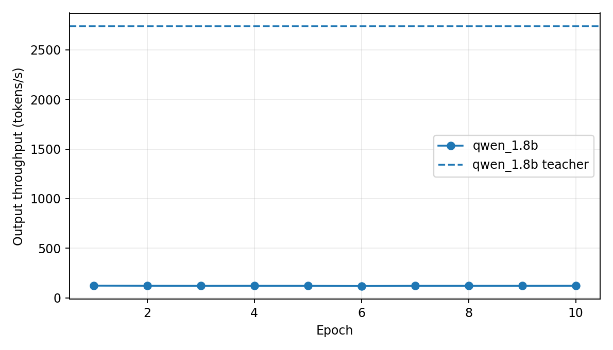

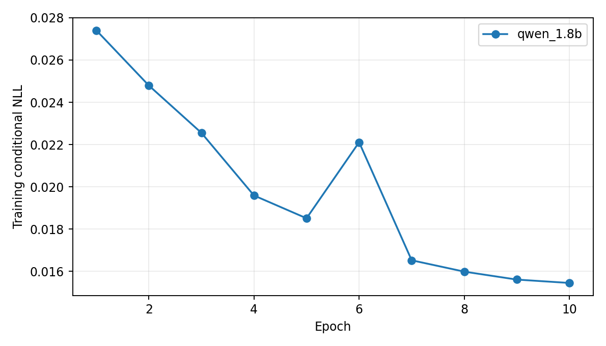

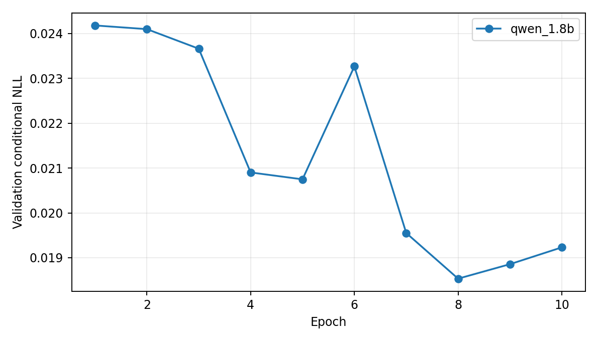

### qwen_7b

[原始逐轮 CSV](training/qwen_7b/training_progress.csv) · [原始报告](training/qwen_7b/report.md)

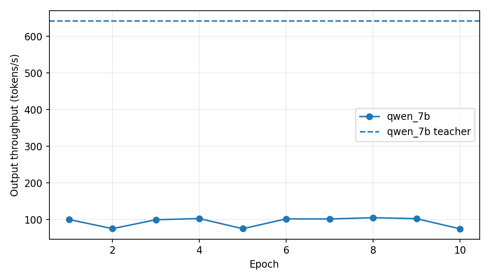

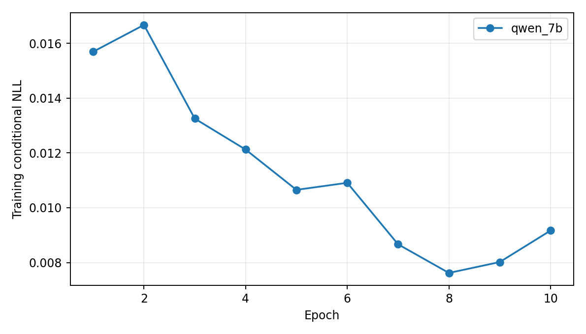

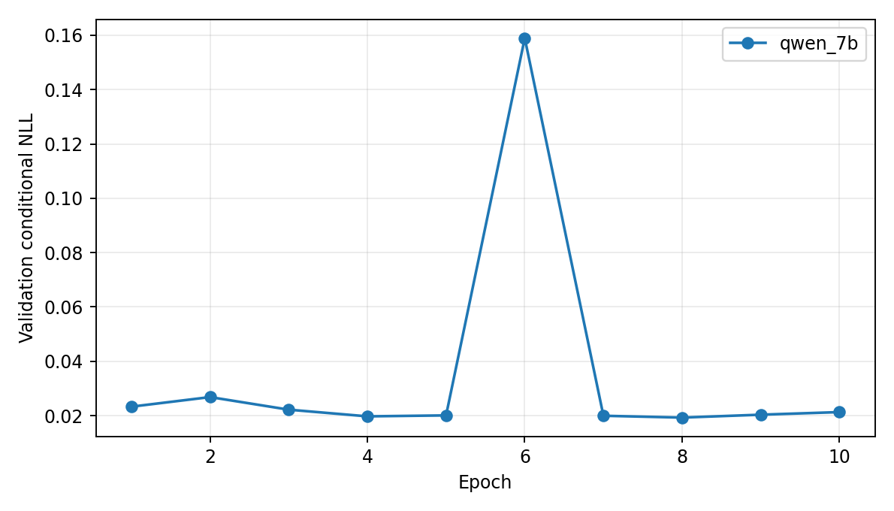

### qwen_14b

[原始逐轮 CSV](training/qwen_14b/training_progress.csv) · [原始报告](training/qwen_14b/report.md)

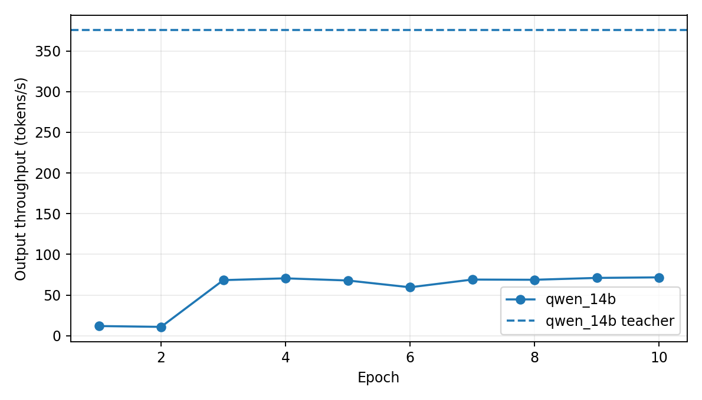

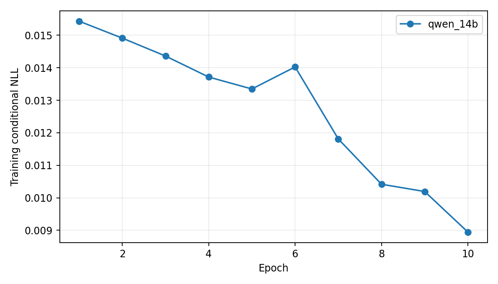

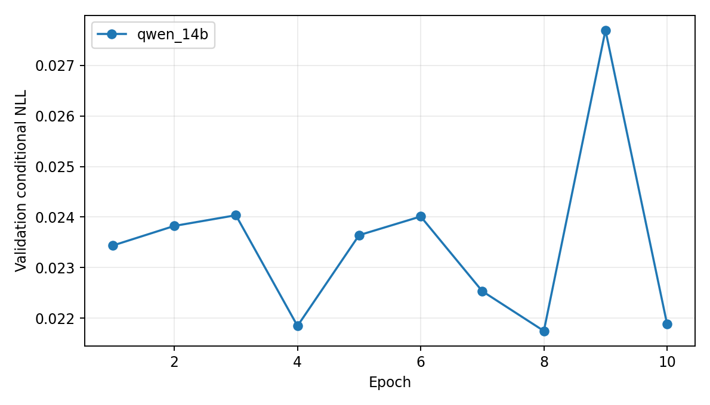

### shared

[原始逐轮 CSV](training/shared/training_progress.csv) · [原始报告](training/shared/report.md)

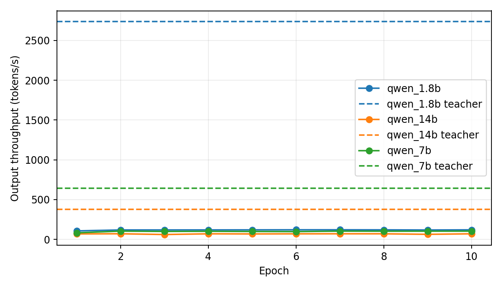

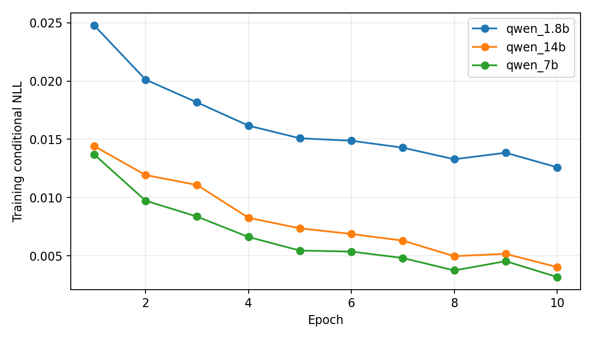

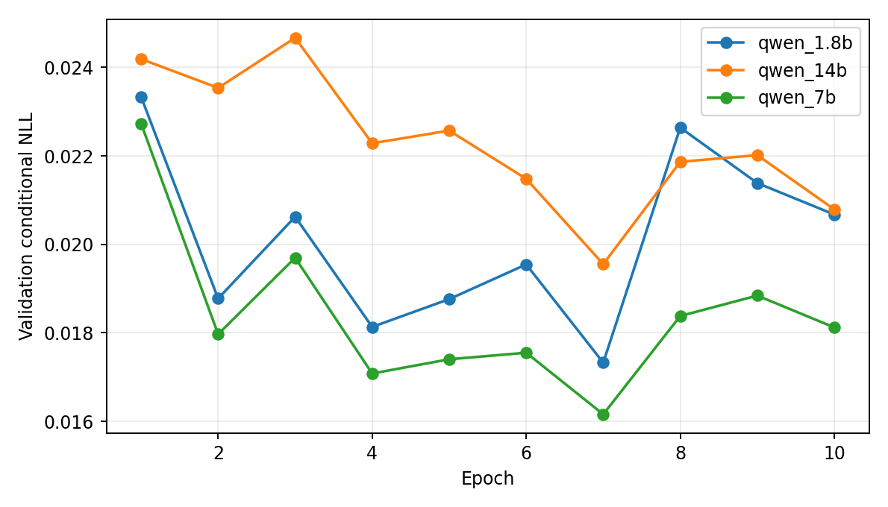
