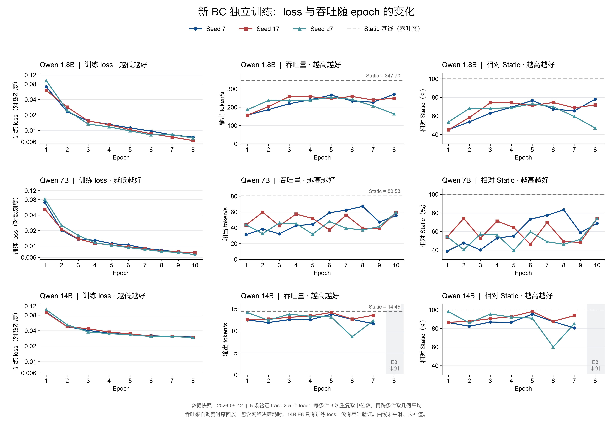

# Qwen BC/PPO 全部 epoch 的 loss 与吞吐

数据快照：2026-09-12。覆盖 **204 条模型×种子×epoch**，其中 **174 条有吞吐测量、30 条未测**；对应 **117 个实际种子-epoch 训练**。共享 BC 的 loss 在三个模型下重复展示，不能重复统计训练次数。

[Excel 全部明细](all_epochs.xlsx) · [CSV 全部明细](all_epochs.csv) · [BC 验证 NLL 与 regret](bc_validation_loss.csv)

## 阅读方式

- **loss 定义**：BC：每个 anchor 的代价加权动作 NLL、按节点归一化，再对训练过程中的 anchor 求均值。它不是整套自主安排的吞吐。
- **BC 验证 loss**：Excel 的 `BC验证loss` 表及对应 CSV 包含全部 105 条 BC 种子-epoch 的验证未加权 NLL 和 candidate regret；这属于固定 anchor 上的候选指标，不等于自主生成安排后的吞吐。
- **PPO loss 定义**：每条更新日志已经在窗口和 PPO 优化重复间求均值。本表再按模型×seed×epoch 对日志等权平均，末尾不足四个窗口的批次仍算一条。
- **PPO 分项**：总 loss = actor_loss + 0.5×value_loss - 0.001×entropy（新吞吐目标日志可核对）。旧 PPO 没记录分项，保留空白；训练采样分模型，网络参数仍共享。
- **reward**：PPO reward_batch_mean 是日志中每批奖励之和的跨批均值；不是每请求、每秒或每 epoch 的总奖励。这里只作为辅助原始信息。
- **吞吐口径**：单位 output tokens/s，包含原验证记录中的网络决策耗时；同一 trace/load 的三次重复先取中位数，再对条件取几何平均。早期只有一次测量。
- **跨阶段边界**：旧实验是一条验证 trace×5 load；后两段是5条验证 trace×5 load。Static、负载基准和教师版本也变过，只能在同段比较 epoch，不能按绝对吞吐直接跨段排名。
- **原图差异**：吞吐奖励 PPO 的历史图先对每个 repeat 跨条件聚合再取中位数。本表统一改为每条件先取中位数；极小数值差异来自聚合次序，不是新增实验。
- **早期缺测**：旧 BC 每种子训练3轮，只验证所选种子7 E1、17 E2、27 E3；其余18个模型行没有吞吐。
- **最新缺测**：共享 BC E6×3模型×3种子、独立14B E8×3种子已训练，但没有对应 validation 目录；共12行吞吐空白。
- **新方案**：H=2、gamma=0.4、lambda=0.5、eta=0.5、reuse_probability=1.0 的新方案尚无训练 epoch；不能把 09-08 fast 教师实验当作该方案结果。
- **真实性边界**：全部吞吐来自调度/时序模拟回放，不是真实 Qwen 模型推理吞吐。历史动作转换问题的影响尚不能从这些表量化；表中保留原结果，不冒充修复后的结果。
- **数值读取**：空白表示未测、未记录或仅参考，绝不等于0；CSV保留原始精度，Excel loss显示6位小数，吞吐2位小数，比例2位百分比。

## 从完整记录能确认什么

- **BC 的训练 loss 总体下降，但吞吐没有随之稳定提高。** 例如独立 1.8B 的 seed 27：E5 loss 为 0.009824、吞吐为 Static 的 73.11%；E8 loss 降至 0.007141，吞吐却降至 47.02%。精确值以下表为准。
- **不能把“loss 一直下降”概括到 PPO。** 新吞吐奖励 PPO 的 E2 相比 E1，9 个模型/种子组合中有 8 个总 loss 上升；仅 14B seed 17 下降。表内附 actor/critic 分项供继续定位。
- **新 fast 教师这条路线只执行到了 BC。** 共享与独立各分支都没有满足原先的全种子 BC 放行要求，因此没有该路线的新 PPO 训练结果。

## 各阶段概览

| 阶段 | 训练轮次（每种子） | 每轮训练覆盖 | 完整吞吐验证 |
|---|---|---|---|
| 旧 BC，共享参数 | E1–E3 | 15,460 个 anchor | 仅 seed 7 E1、17 E2、27 E3 |
| 旧奖励 PPO，共享参数 | E1–E2 | 3 模型×1 trace×1,000 请求 | E1、E2 |
| 吞吐奖励 PPO，共享参数 | E1–E2；E0为参考 | 3 模型×5 trace×1,000 请求 | E0、E1、E2 |
| 新 BC，独立1.8B | E1–E8 | 5,200 个 anchor | E1–E8 |
| 新 BC，独立7B | E1–E10 | 5,215 个 anchor | E1–E10 |
| 新 BC，独立14B | E1–E8 | 5,255 个 anchor | E1–E7；E8未测 |
| 新 BC，共享参数 | E1–E6 | 15,670 个 anchor | E1–E5；E6未测 |

## 逐 epoch 完整表

每个单元格的顺序为 **seed 7 / seed 17 / seed 27**。吞吐是输出 token/s；Static 比例 100% 表示等于该阶段 Static。`—` 表示未测。

### A_旧BC

**qwen_1.8b**

| Epoch | 训练 loss：7 / 17 / 27 | 吞吐 token/s：7 / 17 / 27 | Static%：7 / 17 / 27 |
|---|---|---|---|
| E1 | 0.080945 / 0.077090 / 0.077787 | 325.19 / — / — | 72.56 / — / — |
| E2 | 0.051169 / 0.048146 / 0.052494 | — / 380.41 / — | — / 84.89 / — |
| E3 | 0.042642 / 0.045184 / 0.045249 | — / — / 351.65 | — / — / 78.47 |

**qwen_7b**

| Epoch | 训练 loss：7 / 17 / 27 | 吞吐 token/s：7 / 17 / 27 | Static%：7 / 17 / 27 |
|---|---|---|---|
| E1 | 0.080945 / 0.077090 / 0.077787 | 51.84 / — / — | 48.79 / — / — |
| E2 | 0.051169 / 0.048146 / 0.052494 | — / 94.40 / — | — / 88.85 / — |
| E3 | 0.042642 / 0.045184 / 0.045249 | — / — / 77.73 | — / — / 73.16 |

**qwen_14b**

| Epoch | 训练 loss：7 / 17 / 27 | 吞吐 token/s：7 / 17 / 27 | Static%：7 / 17 / 27 |
|---|---|---|---|
| E1 | 0.080945 / 0.077090 / 0.077787 | 13.74 / — / — | 82.27 / — / — |
| E2 | 0.051169 / 0.048146 / 0.052494 | — / 15.14 / — | — / 90.67 / — |
| E3 | 0.042642 / 0.045184 / 0.045249 | — / — / 10.68 | — / — / 63.96 |

### B_旧奖励PPO

**qwen_1.8b**

| Epoch | 训练 loss：7 / 17 / 27 | 吞吐 token/s：7 / 17 / 27 | Static%：7 / 17 / 27 |
|---|---|---|---|
| E1 | 4433.559747 / 6221.367149 / 6867.987439 | 399.66 / 382.77 / 355.90 | 89.18 / 85.41 / 79.42 |
| E2 | 6430.199426 / 5734.876686 / 5266.657593 | 400.41 / 365.46 / 396.94 | 89.35 / 81.55 / 88.58 |

**qwen_7b**

| Epoch | 训练 loss：7 / 17 / 27 | 吞吐 token/s：7 / 17 / 27 | Static%：7 / 17 / 27 |
|---|---|---|---|
| E1 | 2999.200998 / 2703.624638 / 5358.767658 | 100.84 / 95.52 / 91.72 | 94.91 / 89.91 / 86.33 |
| E2 | 2004.186132 / 2605.374234 / 4500.373463 | 101.08 / 94.34 / 100.23 | 95.14 / 88.80 / 94.34 |

**qwen_14b**

| Epoch | 训练 loss：7 / 17 / 27 | 吞吐 token/s：7 / 17 / 27 | Static%：7 / 17 / 27 |
|---|---|---|---|
| E1 | 17653.633149 / 20558.455402 / 16594.767658 | 12.22 / 12.21 / 12.19 | 73.20 / 73.10 / 72.98 |
| E2 | 19829.589888 / 16393.355352 / 23055.699104 | 12.22 / 12.21 / 12.20 | 73.21 / 73.11 / 73.05 |

### C_吞吐奖励PPO

**qwen_1.8b**

| Epoch | 训练 loss：7 / 17 / 27 | 吞吐 token/s：7 / 17 / 27 | Static%：7 / 17 / 27 |
|---|---|---|---|
| E0 | — / — / — | 250.13 / 244.45 / 250.57 | 84.29 / 82.38 / 84.44 |
| E1 | 44.373195 / 40.245568 / 44.984235 | 250.45 / 251.18 / 247.99 | 84.40 / 84.64 / 83.57 |
| E2 | 60.174132 / 177.708301 / 89.551098 | 250.71 / 160.25 / 202.52 | 84.49 / 54.00 / 68.25 |

**qwen_7b**

| Epoch | 训练 loss：7 / 17 / 27 | 吞吐 token/s：7 / 17 / 27 | Static%：7 / 17 / 27 |
|---|---|---|---|
| E0 | — / — / — | 64.62 / 63.32 / 64.59 | 92.82 / 90.96 / 92.78 |
| E1 | 34.535694 / 29.179657 / 27.355742 | 64.61 / 64.73 / 63.77 | 92.82 / 92.99 / 91.60 |
| E2 | 41.589313 / 193.692954 / 56.850422 | 64.72 / 34.48 / 53.93 | 92.97 / 49.53 / 77.47 |

**qwen_14b**

| Epoch | 训练 loss：7 / 17 / 27 | 吞吐 token/s：7 / 17 / 27 | Static%：7 / 17 / 27 |
|---|---|---|---|
| E0 | — / — / — | 7.26 / 7.28 / 7.28 | 64.61 / 64.77 / 64.76 |
| E1 | 124.052722 / 112.421787 / 106.703279 | 7.26 / 7.28 / 7.30 | 64.58 / 64.75 / 64.96 |
| E2 | 149.438056 / 79.072519 / 140.848234 | 7.26 / 10.16 / 7.46 | 64.62 / 90.43 / 66.42 |

### D_新BC共享

**qwen_1.8b**

| Epoch | 训练 loss：7 / 17 / 27 | 吞吐 token/s：7 / 17 / 27 | Static%：7 / 17 / 27 |
|---|---|---|---|
| E1 | 0.054851 / 0.046374 / 0.041683 | 191.05 / 155.60 / 156.57 | 54.95 / 44.75 / 45.03 |
| E2 | 0.020335 / 0.021159 / 0.019627 | 155.92 / 221.42 / 200.89 | 44.84 / 63.68 / 57.78 |
| E3 | 0.016768 / 0.017497 / 0.016791 | 153.43 / 266.03 / 200.06 | 44.13 / 76.51 / 57.54 |
| E4 | 0.015873 / 0.016137 / 0.015082 | 212.02 / 147.16 / 267.96 | 60.98 / 42.32 / 77.07 |
| E5 | 0.014472 / 0.014958 / 0.014518 | 213.28 / 175.56 / 247.80 | 61.34 / 50.49 / 71.27 |
| E6 | 0.013868 / 0.013997 / 0.013984 | — / — / — | — / — / — |

**qwen_7b**

| Epoch | 训练 loss：7 / 17 / 27 | 吞吐 token/s：7 / 17 / 27 | Static%：7 / 17 / 27 |
|---|---|---|---|
| E1 | 0.054851 / 0.046374 / 0.041683 | 43.01 / 34.21 / 34.84 | 53.38 / 42.45 / 43.24 |
| E2 | 0.020335 / 0.021159 / 0.019627 | 33.15 / 54.61 / 41.83 | 41.14 / 67.77 / 51.92 |
| E3 | 0.016768 / 0.017497 / 0.016791 | 32.89 / 71.15 / 47.89 | 40.82 / 88.30 / 59.43 |
| E4 | 0.015873 / 0.016137 / 0.015082 | 51.18 / 31.06 / 66.31 | 63.51 / 38.55 / 82.29 |
| E5 | 0.014472 / 0.014958 / 0.014518 | 52.28 / 37.55 / 53.77 | 64.88 / 46.60 / 66.73 |
| E6 | 0.013868 / 0.013997 / 0.013984 | — / — / — | — / — / — |

**qwen_14b**

| Epoch | 训练 loss：7 / 17 / 27 | 吞吐 token/s：7 / 17 / 27 | Static%：7 / 17 / 27 |
|---|---|---|---|
| E1 | 0.054851 / 0.046374 / 0.041683 | 13.51 / 12.53 / 12.57 | 93.48 / 86.71 / 86.96 |
| E2 | 0.020335 / 0.021159 / 0.019627 | 12.49 / 14.18 / 12.81 | 86.39 / 98.10 / 88.61 |
| E3 | 0.016768 / 0.017497 / 0.016791 | 12.42 / 10.10 / 14.20 | 85.96 / 69.86 / 98.24 |
| E4 | 0.015873 / 0.016137 / 0.015082 | 9.14 / 12.37 / 9.80 | 63.24 / 85.58 / 67.80 |
| E5 | 0.014472 / 0.014958 / 0.014518 | 13.86 / 13.06 / 11.60 | 95.90 / 90.38 / 80.23 |
| E6 | 0.013868 / 0.013997 / 0.013984 | — / — / — | — / — / — |

### D_新BC独立

[可编辑 SVG](figures/independent_bc/independent_bc_overview.svg) · [矢量 PDF](figures/independent_bc/independent_bc_overview.pdf)

图中 loss 使用对数纵轴；三个种子分别展示，14B E8 吞吐缺失不补值。

**qwen_1.8b**

| Epoch | 训练 loss：7 / 17 / 27 | 吞吐 token/s：7 / 17 / 27 | Static%：7 / 17 / 27 |
|---|---|---|---|
| E1 | 0.070671 / 0.060054 / 0.093235 | 156.91 / 156.22 / 186.08 | 45.13 / 44.93 / 53.52 |
| E2 | 0.023165 / 0.028549 / 0.024616 | 186.55 / 202.95 / 236.77 | 53.65 / 58.37 / 68.10 |
| E3 | 0.015281 / 0.015358 / 0.013351 | 219.26 / 257.95 / 237.44 | 63.06 / 74.19 / 68.29 |
| E4 | 0.013146 / 0.012923 / 0.011735 | 240.98 / 257.91 / 239.08 | 69.31 / 74.18 / 68.76 |
| E5 | 0.011225 / 0.010393 / 0.009824 | 266.75 / 247.38 / 254.22 | 76.72 / 71.15 / 73.11 |
| E6 | 0.009717 / 0.008631 / 0.008193 | 234.23 / 259.19 / 242.75 | 67.36 / 74.54 / 69.82 |
| E7 | 0.008187 / 0.007443 / 0.008311 | 227.64 / 239.28 / 206.92 | 65.47 / 68.82 / 59.51 |
| E8 | 0.007426 / 0.006364 / 0.007141 | 271.22 / 249.61 / 163.50 | 78.00 / 71.79 / 47.02 |

**qwen_7b**

| Epoch | 训练 loss：7 / 17 / 27 | 吞吐 token/s：7 / 17 / 27 | Static%：7 / 17 / 27 |
|---|---|---|---|
| E1 | 0.070017 / 0.052044 / 0.081576 | 31.29 / 43.54 / 43.92 | 38.83 / 54.04 / 54.51 |
| E2 | 0.020300 / 0.021198 / 0.025285 | 38.39 / 59.74 / 32.53 | 47.65 / 74.14 / 40.38 |
| E3 | 0.013458 / 0.013733 / 0.016112 | 32.34 / 42.52 / 46.12 | 40.14 / 52.77 / 57.23 |
| E4 | 0.012989 / 0.011306 / 0.011583 | 42.73 / 57.39 / 45.38 | 53.03 / 71.23 / 56.32 |
| E5 | 0.011151 / 0.010528 / 0.010358 | 44.44 / 51.85 / 31.94 | 55.15 / 64.35 / 39.64 |
| E6 | 0.010529 / 0.009693 / 0.009341 | 59.06 / 37.23 / 48.06 | 73.29 / 46.21 / 59.65 |
| E7 | 0.008990 / 0.008830 / 0.008580 | 62.40 / 56.08 / 39.47 | 77.45 / 69.60 / 48.98 |
| E8 | 0.008279 / 0.007977 / 0.007819 | 67.15 / 39.57 / 37.30 | 83.34 / 49.11 / 46.30 |
| E9 | 0.007677 / 0.007699 / 0.007513 | 47.33 / 38.98 / 41.53 | 58.74 / 48.38 / 51.55 |
| E10 | 0.007306 / 0.007332 / 0.006806 | 55.46 / 59.50 / 59.54 | 68.83 / 73.84 / 73.90 |

**qwen_14b**

| Epoch | 训练 loss：7 / 17 / 27 | 吞吐 token/s：7 / 17 / 27 | Static%：7 / 17 / 27 |
|---|---|---|---|
| E1 | 0.091804 / 0.089200 / 0.102185 | 12.49 / 12.51 / 14.18 | 86.42 / 86.59 / 98.14 |
| E2 | 0.047726 / 0.047755 / 0.052040 | 11.91 / 12.69 / 12.43 | 82.38 / 87.83 / 86.02 |
| E3 | 0.040426 / 0.043623 / 0.037806 | 12.56 / 13.08 / 13.81 | 86.94 / 90.50 / 95.52 |
| E4 | 0.035524 / 0.037496 / 0.035026 | 12.53 / 13.41 / 13.34 | 86.73 / 92.81 / 92.31 |
| E5 | 0.033366 / 0.034681 / 0.033190 | 13.78 / 14.20 / 13.17 | 95.36 / 98.23 / 91.13 |
| E6 | 0.031813 / 0.031334 / 0.030788 | 12.62 / 12.68 / 8.68 | 87.35 / 87.76 / 60.06 |
| E7 | 0.030691 / 0.030961 / 0.030671 | 11.65 / 13.55 / 12.29 | 80.61 / 93.78 / 85.06 |
| E8 | 0.030019 / 0.029334 / 0.029425 | — / — / — | — / — / — |

## 同阶段基线

| 验证口径 | 方法 | 模型 | Seed | 吞吐 token/s |
|---|---|---|---|---|
| A_单trace5load | bifocal | qwen_1.8b | 固定 | 279.09 |
| A_单trace5load | bifocal | qwen_14b | 固定 | 16.30 |
| A_单trace5load | bifocal | qwen_7b | 固定 | 91.70 |
| A_单trace5load | static | qwen_1.8b | 固定 | 448.14 |
| A_单trace5load | static | qwen_14b | 固定 | 16.70 |
| A_单trace5load | static | qwen_7b | 固定 | 106.25 |
| B_五trace25条件 | bc | qwen_1.8b | 7 | 198.89 |
| B_五trace25条件 | bc | qwen_1.8b | 17 | 248.20 |
| B_五trace25条件 | bc | qwen_1.8b | 27 | 230.52 |
| B_五trace25条件 | bc | qwen_14b | 7 | 10.30 |
| B_五trace25条件 | bc | qwen_14b | 17 | 10.16 |
| B_五trace25条件 | bc | qwen_14b | 27 | 7.13 |
| B_五trace25条件 | bc | qwen_7b | 7 | 39.38 |
| B_五trace25条件 | bc | qwen_7b | 17 | 63.47 |
| B_五trace25条件 | bc | qwen_7b | 27 | 53.19 |
| B_五trace25条件 | bifocal | qwen_1.8b | 固定 | 178.16 |
| B_五trace25条件 | bifocal | qwen_14b | 固定 | 11.08 |
| B_五trace25条件 | bifocal | qwen_7b | 固定 | 57.18 |
| B_五trace25条件 | static | qwen_1.8b | 固定 | 296.75 |
| B_五trace25条件 | static | qwen_14b | 固定 | 11.24 |
| B_五trace25条件 | static | qwen_7b | 固定 | 69.62 |
| C_新教师25条件 | static | qwen_1.8b | 固定 | 347.70 |
| C_新教师25条件 | static | qwen_14b | 固定 | 14.45 |
| C_新教师25条件 | static | qwen_7b | 固定 | 80.58 |

## 核对记录

- 从每个训练分支最后一份 `bc_summary.json` 的累计 history 提取 BC 全部 epoch，避免重复累计与遗漏末轮。
- PPO 共按原始更新日志聚合；保留 `raw_training_loss.csv`，旧日志未记录的 actor/critic 项没有反推或填造。
- 新 fast BC 的全部 120 条已验证模型行，其 loss 和相对 Static 比例与原 `training_progress.csv` 逐条相符。
- 原始吞吐检查 trace/load/repeat 无重复；复核同组重复次数、25/5条件覆盖，以及基线与模型条件一致。
- Shared E6 和 independent 14B E8 的训练完成及验证目录缺失已在 HPC 核对；没有启动补测或自动监控。
- Excel 公式静态验证与源数据数值核对结果见 `verification.txt`；本机未安装 LibreOffice，因此没有执行 LibreOffice 动态重算。
- 汇总源文件位于 `sources/artifacts/`，保持原相对路径。早期 `ppo_epoch_throughput_raw.csv` 来自既有本地导出，已逐条件与本次下载的 HPC `comparison_summary.json` 核对；其余用于汇总的原始日志从 HPC 下载。此次临时提取、组装脚本在交付前删除。
