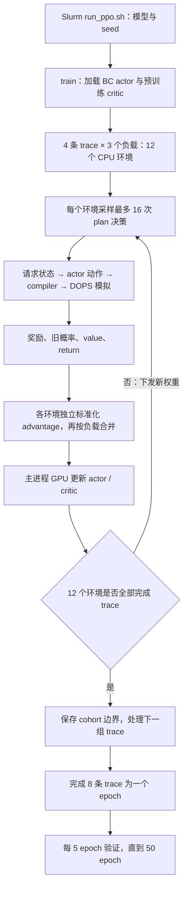

# 当前 PPO 远端同步与运行逻辑

核实时间：2026-09-17 21:47:48，北京时间。

## 同步结论

**当前正式 PPO 的本地运行源码与 HPC 一致，本次无需覆盖源码。** 通过 data 节点下载远端文件，以远端为准逐文件直接比较字节；没有使用摘要。全部 112 个对照文件一致，已有中文注释原样保留。

| 范围 | 一致文件数 |
| --- | ---: |
| PPO code：源码、测试、启动脚本、pyproject | 18 |
| PPO 三个模型配置 | 3 |
| DOPS 后端 src | 70 |
| DOPS 后端 configs | 8 |
| calibration | 9 |
| protocol、trace_selection、formal_budget、submission | 4 |

代码目录不存在单侧多出的有效文件。远端后端还有论文图、演示、测量和其他子模块材料；本地仅保存当前运行所用后端 src/configs，本次不扩充那些材料。完整数据集、初始权重和动态训练 checkpoint 不属于此次源码一致性结论。

- 本地根：`/Users/yangjiaqi/Desktop/Daily_2026/02_Projects/DOPSRT/DOPS-Serve`
- HPC 根：`/lustre/home/2501111916/workspace/DOPS-Serve`
- 正式 PPO 相对根：`artifacts/burstgpt_ppo_20260917`
- 后端：`backend -> ../burstgpt_critic_20260915/backend`；data、calibration 同样指向 critic 目录；`initial -> initial_weights`。
- [112 文件逐项核对记录](../artifacts/burstgpt_ppo_20260917/source_sync_check_20260917.json)

本次还读取了 Slurm 保存的实际 batch script。当前 code/configs 和后端 src 未发现首个子任务启动后修改的文件；这是磁盘源码与作业入口核对，未读取进程内存中的模块内容。没有更改远端代码、重启或重新提交作业，也没有重新进行数值测试。

## 当前作业

数组 `14943278`，9 路 = 3 个模型 × 3 个种子，最多并行 3 路；每路 16 CPU + 1 GPU。

| 子任务 | 模型 / seed | 核实到的状态 |
| --- | --- | --- |
| 0 | 1.8B / 4 | RUNNING，epoch 1，累计 update 152 |
| 1 | 1.8B / 15 | RUNNING，epoch 1，累计 update 104 |
| 2 | 1.8B / 26 | RUNNING，epoch 1，累计 update 88 |
| 3–8 | 7B、14B / 4、15、26 | 等待数组并发名额 |

以上是检查时快照，会继续变化；update 数不是完成 epoch 数。

## 从哪里开始读

以下路径均相对正式 PPO 根。

| 文件 / 函数 | 职责 |
| --- | --- |
| `code/slurm/run_ppo.sh` | 设置环境、数组索引映射、启动与恢复 |
| `code/src/dops_serve/burstgpt_ppo.py:train()` | 初始化、12 环境编排、采样更新循环、验证保存 |
| `code/src/dops_serve/placement_training.py:BurstWorkers` / `burst_worker()` | 12 个持久 CPU 子进程与 Pipe 通信 |
| `code/src/dops_serve/replay.py:BurstPlacementReplay` | 到达队列、准入、prefill/decode、KV 生命周期 |
| `code/src/dops_serve/placement_dataset.py:serving_policy_inputs()` | 模拟状态转成网络输入 |
| `code/src/dops_serve/placement_policy.py:StaticPlacementActor` / `StaticPlacementCritic` | 节点动作策略与条件价值预测 |
| `code/src/dops_serve/placement_compiler.py:compile()` | 动作列表转换为固定拓扑序和节点设备映射 |
| `code/src/dops_serve/placement_evaluator.py:evaluate()` | DOPS 执行时间模拟、推进设备/通信/KV 状态 |
| `code/src/dops_serve/placement_training.py:update_static_ppo()` | GPU 上计算 PPO 和价值损失、反传更新 |

## 一次训练如何推进

1. **入口与起点。** 数组索引 `i // 3` 选模型，`i % 3` 选 seed。训练调用 `python -m dops_serve.burstgpt_ppo train --rounds 50 --device cuda`。分别加载 BC E57/E77/E42 actor 与预训练 critic E2/E1/E5；主进程 actor、critic 在 GPU，关闭 TF32。先用4条固定验证 trace 建立 E0 基线。

2. **每个 epoch 的任务。** 固定8条训练 trace，打乱次序；每次取4条，每条展开为0.5、1.0、1.5三个到达负载，共12个独立环境。因此每 epoch 有2个 cohort、24个完整 trace×负载任务。负载通过标定后缩放请求到达时间实现。`BurstWorkers` 启动12个单线程 CPU 进程，每个保存独立的 FIFO、KV、设备状态和随机数状态。

3. **一个环境的服务过程。** 请求按时间进入 waiting；满足最大 batch=16 和 KV 预留约束后准入并做 prefill。prefill 产出首 token，随后推进活跃请求的 decode；完成请求释放 KV。没有请求可执行时模拟时钟跳到下一次到达。真实 `output_len` 用于判定结束，不进入 `_visible()` 暴露给策略的请求信息。

4. **什么时候问 actor。** prefill 总是生成新 plan；decode 在计数0、1、2、4、6……刷新，其他位置复用已有 plan。新 prefill 或请求完成会重置相关计数。复用 plan 时仍逐 token 执行模拟并更新 KV，不是跳过这些 token。`env.step(plan)` 从本次决策执行到下一个需要策略的边界，期间可能包含 plan 复用、准入和空闲跳时。

5. **actor 一次输出什么。** 输入为全局 state `[1,56]`、节点特征 `[1,N,35]`、合法设备 masks `[1,N,3]`，另有 `fixed_from` 和 `learned`。actor 按拓扑序用 GRU 自回归生成当前阶段整个计算图的设备动作，0/1/2对应 NPU/PIM0/PIM1。固定节点遵循规则，KV 写入由 compiler 固定，通信节点由后端处理。一次输出覆盖当前阶段可建模的各层计算节点，不提前生成未来全部 token 的计划。

6. **采样与奖励。** `sample_nodes()` 在 CPU 上随机采样动作，保存旧策略条件概率、完整旧分布和 critic 的逐节点 value，编译 plan 后执行模拟。每个环境每次最多收集16个 plan；12个环境都未结束时总计192个 plan，每负载64个。奖励 `r=-Δ模拟时间/reward_scale_s`，其中 Δ覆盖到下一个真实决策边界，不包含主机计算这次决策花的墙钟时间。片段末未结束时用 critic bootstrap，结束时为0；代码反向累计 return（当前 γ=λ=1），同一 plan 各节点共享其 return，value 可不同。

7. **PPO 更新。** 对每个环境的连续片段，以可学习节点的 `return-value` 独立标准化，再按三个负载合并。主进程在 GPU 上训练；每负载每次取最多4个 plan，损失各除以3累积。使用逐节点条件概率比、clip=0.1、entropy=0.001，critic 用均方误差；actor/critic 学习率为3e-5/1e-4，梯度裁剪0.5。一个 rollout 最多重复4遍；**每次 mini-batch 更新后**计算整个 rollout 的平均 KL，达到0.01即停止当前 rollout 剩余更新。下一轮把新权重拷到 CPU workers，环境从原状态继续。

8. **保存与选优。** 必须等 cohort 中12个完整环境都结束，才更新 cursor 并保存 `last.pt`；保存 actor/critic、优化器、随机数、任务次序及待验证状态。中断发生在 cohort 中间时，从上一个完整边界恢复，重做当前 cohort。每5个 epoch 用固定4条验证 trace 做确定性 argmax 回放；按三个负载相对 E0 吞吐比的几何平均选优，候选包含 E0。最终同时保留 E50 与 validation-best，test 保持锁定。

## 输出与性能解释

`training/<model>/seed_<seed>/` 下：`status.json` 为最新阶段，`updates_*.jsonl` 为每次更新日志，`completed/` 记录完整 cohort，`last.pt` 为恢复点，`checkpoints/` 为验证候选，`validation/` 为验证指标，`best.pt` 与 `selection.json` 为选优结果。

这里训练的是算子放置策略。CPU 运行请求服务与硬件耗时模拟、actor 采样；GPU 运行小型 actor/critic 的 PPO 更新。Qwen 的层数和算子形状用于构建模拟图，没有真实执行 Qwen 权重的生成推理。吞吐是完整 trace 的输出 token 总数除以模拟秒数；采样 wall time、更新 wall time 和 decision time 另记，不能当作实测 NPU/PIM 吞吐。
